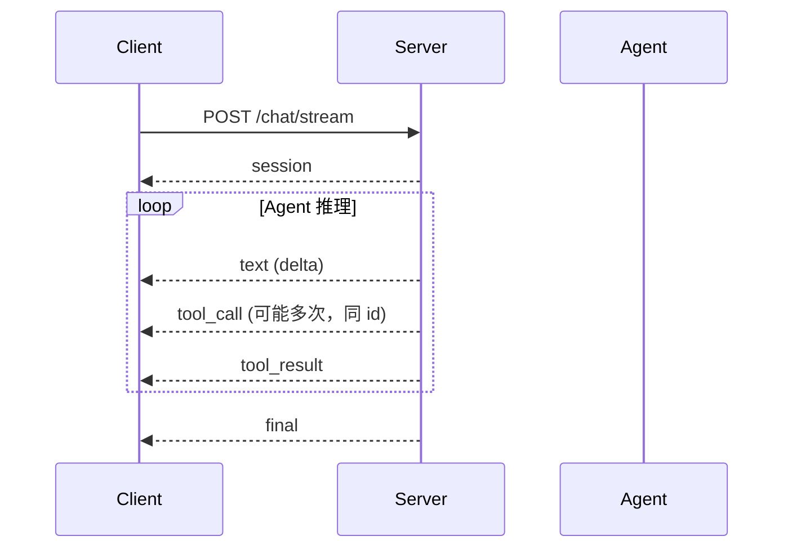

# SSE 流式消息协议

本文档描述 `deep-agent` 后端 `POST /api/v1/chat/stream` 接口返回的 **Server-Sent Events (SSE)** 消息格式，供前端、SDK 或其他客户端对接使用。

## 1. 连接方式

### 请求

`POST /api/v1/chat/stream` 使用统一的 `StreamChatRequest` 请求体。通过可选字段 `agent_id` 区分两种模式：

| 模式 | 条件 | 行为 |
|------|------|------|
| 默认 Agent | 省略 `agent_id` | 使用 Settings 默认配置，可通过 `model` / `capabilities` 覆盖 |
| DB Agent | 传入 `agent_id`（UUID） | 从数据库加载 Agent 配置，忽略 `model` / `capabilities` |

**默认 Agent 模式：**

```http
POST /api/v1/chat/stream HTTP/1.1
Content-Type: application/json
Accept: text/event-stream

{
  "message": "用户输入",
  "session_id": "可选，省略则服务端生成",
  "model": "可选，如 openai:gpt-4o",
  "capabilities": ["native", "mcp:doc_search"],
  "user": "可选用户标识"
}
```

**DB Agent 模式：**

```http
POST /api/v1/chat/stream HTTP/1.1
Content-Type: application/json
Accept: text/event-stream

{
  "agent_id": "550e8400-e29b-41d4-a716-446655440000",
  "message": "用户输入",
  "session_id": "可选，省略则服务端生成",
  "user": "可选用户标识"
}
```

> 带 `agent_id` 时，会话存储键为 `{agent_id}:{session_id}`，与默认模式的裸 `session_id` 隔离。

### 响应

- `Content-Type: text/event-stream`
- 连接保持打开，服务端按 Agent 执行进度持续推送事件
- 客户端断开时，服务端停止推送

> **注意**：浏览器原生 `EventSource` 仅支持 GET，因此前端需使用 `fetch` + `ReadableStream` 手动解析 SSE（参见 `frontend/app.js`）。

## 2. SSE 帧格式

每个事件由若干行组成，以**空行**（`\n\n` 或 `\r\n\r\n`）分隔：

```
event: <事件名>
data: <JSON 字符串>

```

### 字段说明

| 行 | 含义 |
|----|------|
| `event:` | 事件类型，与 `data.type` 一致（冗余但便于按 event 过滤） |
| `data:` | 单行 JSON；若未来有多行 data，按 SSE 规范用 `\n` 拼接后再 `JSON.parse` |
| `: ...` | 注释行，用于心跳（keep-alive），客户端应忽略 |

### 心跳示例

```
: ping - 2026-06-05T03:45:20.860855+00:00

```

## 3. 事件生命周期

一次完整对话流通常按以下顺序出现（中间可能穿插多次 `text` / `tool_call` / `tool_result`）：



| 阶段 | 事件 | 说明 |
|------|------|------|
| 开始 | `session` | 返回本次会话 ID，客户端应保存用于后续请求 |
| 流式输出 | `text` | 模型回复的文本增量 |
| 工具调用 | `tool_call` | 模型发起工具调用（同一 `tool_call_id` 可能推送多次） |
| 工具结果 | `tool_result` | 工具执行完毕的返回 |
| 结束 | `final` | 完整输出与 token 用量 |
| 异常 | `error` | 流中错误（出现后流通常结束） |

## 4. 事件类型详解

### 4.1 `session`

流中**第一个**事件，告知本次会话标识。

默认 Agent 模式：

```json
{
  "session_id": "3eff69967bee4a809c46a47c19e113ff"
}
```

DB Agent 模式（请求体含 `agent_id`）：

```json
{
  "session_id": "3eff69967bee4a809c46a47c19e113ff",
  "agent_id": "550e8400-e29b-41d4-a716-446655440000"
}
```

| 字段 | 类型 | 说明 |
|------|------|------|
| `session_id` | `string` | 会话 ID；请求未传时由服务端 `uuid4().hex` 生成 |
| `agent_id` | `string` | 可选；DB Agent 模式时回显请求中的 Agent UUID |

客户端应将 `session_id`（及 `agent_id`，若使用 DB Agent）持久化，后续同一会话的请求需带上相同字段以延续上下文。

---

### 4.2 `text`

模型回复的**文本增量**，客户端按顺序拼接即可得到完整 Markdown 文本。

```json
{
  "type": "text",
  "delta": "让我先搜索一下文档。"
}
```

| 字段 | 类型 | 说明 |
|------|------|------|
| `type` | `"text"` | 固定值 |
| `delta` | `string` | 本帧新增的文本片段，可能为一个字符、一个词或一句话 |

**客户端处理建议**：

- 将 `delta` 追加到当前文本缓冲区
- 可对缓冲区做增量 Markdown 渲染
- 出现 `tool_call` 后，后续 `text` 属于**新的文本段**（工具调用会切断文本流）

---

### 4.3 `tool_call`

模型请求调用某个工具。由于底层使用 Pydantic AI 流式 API，**同一 `tool_call_id` 可能收到 2 次** `tool_call` 事件：

```json
// 第 1 次：工具调用开始，参数尚未解析完成
{
  "type": "tool_call",
  "tool": "doc_search_doc_search",
  "args": {},
  "tool_call_id": "call_00_evdBG0xFNRn5Q8IlwgZW4217"
}

// 第 2 次：参数就绪，即将执行
{
  "type": "tool_call",
  "tool": "doc_search_doc_search",
  "args": { "query": "维度类型" },
  "tool_call_id": "call_00_evdBG0xFNRn5Q8IlwgZW4217"
}
```

| 字段 | 类型 | 说明 |
|------|------|------|
| `type` | `"tool_call"` | 固定值 |
| `tool` | `string` | 工具名称（含 capability 前缀时如 `doc_search_doc_search`） |
| `args` | `object` | 工具参数；首帧可能为 `{}`，应以同 `tool_call_id` 的后续帧覆盖 |
| `tool_call_id` | `string \| null` | 调用唯一标识，用于关联 `tool_result` |

**事件来源（后端实现）**：

| 次序 | 来源 | `args` 状态 |
|------|------|-------------|
| 较早 | `PartStartEvent` + `ToolCallPart`（模型流） | 通常为空 `{}` |
| 较晚 | `FunctionToolCallEvent`（工具执行前） | 完整参数 |

**客户端处理建议（重要）**：

- 以 `tool_call_id` 为键做 **upsert**，不要为每次事件新建 UI 块
- 当 `args` 为空对象时，可显示「参数接收中…」占位，收到完整参数后更新
- 不要假设每个 `tool_call_id` 只出现一次

---

### 4.4 `tool_result`

工具执行完成后的返回。

```json
{
  "type": "tool_result",
  "tool": "doc_search_doc_search",
  "result": "### 维度管理\n...(markdown 文本)...",
  "tool_call_id": "call_00_evdBG0xFNRn5Q8IlwgZW4217"
}
```

| 字段 | 类型 | 说明 |
|------|------|------|
| `type` | `"tool_result"` | 固定值 |
| `tool` | `string` | 工具名称 |
| `result` | `string \| number \| boolean \| object \| array \| null` | 工具返回值，经 `_to_jsonable` 序列化 |
| `tool_call_id` | `string \| null` | 对应 `tool_call` 的 ID |

**客户端处理建议**：

- 通过 `tool_call_id` 找到对应的 `tool_call` UI 块并标记完成
- 若 `result` 为字符串且含 Markdown，建议渲染为富文本
- 若 `tool_call_id` 缺失，可回退到「最近一个未完成的工具块」

---

### 4.5 `final`

流正常结束时的汇总事件，**一定在成功路径末尾出现**（在 `session` 锁释放后发出）。

```json
{
  "type": "final",
  "output": "## 平台的 11 种维度类型\n\n...",
  "usage": {
    "requests": 4,
    "input_tokens": 18079,
    "output_tokens": 1012,
    "total_tokens": 19091
  }
}
```

| 字段 | 类型 | 说明 |
|------|------|------|
| `type` | `"final"` | 固定值 |
| `output` | `string \| object \| ...` | Agent 最终结构化输出；字符串时通常为完整 Markdown |
| `usage` | `object` | Token 与请求次数统计，字段可能部分为 `null` |

`usage` 字段：

| 字段 | 类型 | 说明 |
|------|------|------|
| `requests` | `number \| null` | LLM 请求次数 |
| `input_tokens` | `number \| null` | 输入 token |
| `output_tokens` | `number \| null` | 输出 token |
| `total_tokens` | `number \| null` | 总 token |

**客户端处理建议**：

- 流式 `text` 拼接结果应与 `output` 基本一致；可用 `final` 做校验或兜底展示
- 展示 `usage` 供用户了解消耗

---

### 4.6 `error`

Agent 执行过程中抛出未捕获异常时发出，此后流结束，**不会**再发 `final`。

```json
{
  "type": "error",
  "message": "Connection timeout"
}
```

| 字段 | 类型 | 说明 |
|------|------|------|
| `type` | `"error"` | 固定值 |
| `message` | `string` | 错误描述 |

## 5. 完整示例

以下摘录一次真实对话流（省略大量 `text` delta）：

```
event: session
data: {"session_id": "3eff69967bee4a809c46a47c19e113ff"}

event: text
data: {"type": "text", "delta": "让我先搜索一下文档中关于\"维度类型\"的相关内容。"}

event: tool_call
data: {"type": "tool_call", "tool": "doc_search_doc_search", "args": {}, "tool_call_id": "call_00_evdBG0xFNRn5Q8IlwgZW4217"}

event: tool_call
data: {"type": "tool_call", "tool": "doc_search_doc_search", "args": {"query": "维度类型"}, "tool_call_id": "call_00_evdBG0xFNRn5Q8IlwgZW4217"}

event: tool_result
data: {"type": "tool_result", "tool": "doc_search_doc_search", "result": "### 维度管理\n...", "tool_call_id": "call_00_evdBG0xFNRn5Q8IlwgZW4217"}

event: text
data: {"type": "text", "delta": "让我查看维度概览文档..."}

event: final
data: {"type": "final", "output": "## 平台的 11 种维度类型\n...", "usage": {"requests": 4, "input_tokens": 18079, "output_tokens": 1012, "total_tokens": 19091}}
```

## 6. 客户端实现清单

对接时请确保实现以下行为：

1. **解析 SSE**：支持 `\n\n` / `\r\n\r\n` 分帧，忽略 `:` 心跳注释
2. **保存 session**：收到 `session` 后写入状态，后续请求携带 `session_id`
3. **文本流**：`text.delta` 顺序拼接，支持 Markdown 渲染
4. **工具调用 upsert**：同 `tool_call_id` 的 `tool_call` 更新而非重复创建
5. **工具结果关联**：用 `tool_call_id` 匹配并关闭对应工具块
6. **结束判断**：收到 `final` 或 `error` 后关闭 loading 状态
7. **中断**：用户取消时 `AbortController.abort()`，并优雅处理 `AbortError`

## 7. 与 REST 接口的关系

| 接口 | 说明 |
|------|------|
| `POST /api/v1/chat` | 非流式，直接返回 `{ session_id, output, usage }` |
| `POST /api/v1/chat/stream` | 流式（`StreamChatRequest`），支持默认 Agent 与 DB Agent 两种请求体，事件语义与上表一致 |
| `GET /api/v1/sessions/{id}` | 查询会话元信息（消息条数等），不返回 SSE |
| `DELETE /api/v1/sessions/{id}` | 删除会话历史 |

## 8. 后端源码索引

| 文件 | 职责 |
|------|------|
| `app/api/v1/chat.py` | SSE 端点，`EventSourceResponse` 封装 |
| `app/agent/events.py` | 事件 dict 构造函数 |
| `app/agent/runner.py` | Pydantic AI 事件 → SSE 事件映射 |
| `frontend/app.js` | 参考客户端实现 |

## 9. 版本与兼容性

- 当前协议版本：**v1**（随 `/api/v1` 路径发布）
- 新增事件类型时，`event` 与 `data.type` 将保持一致
- 客户端对未知 `event` 应忽略，避免硬崩溃
- `tool_call` 的「同 ID 多次推送」为当前版本的**既定行为**，不是 bug；客户端必须兼容
