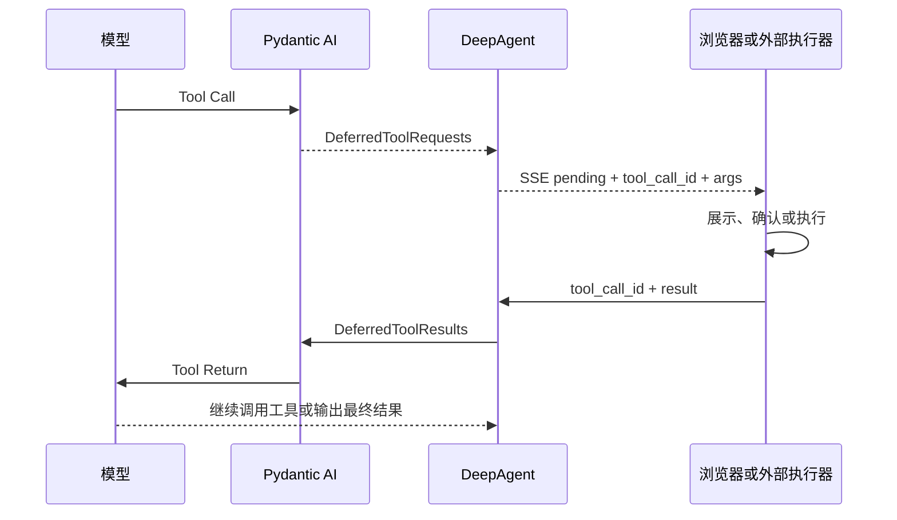
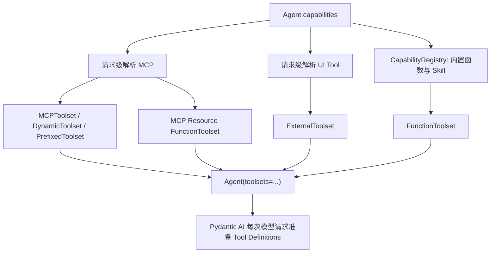

# Pydantic AI 工具体系与 DeepAgent 工具优化

> 最后核验：2026-07-29
>
> 当前 DeepAgent 运行基线：`pydantic-ai-slim 2.12.0`
>
> Harness 隔离实测基线：`pydantic-ai-slim 2.14.1` +
> `pydantic-ai-harness 0.10.0`
>
> 状态：设计梳理，不代表已引入新的 Native Tool、Output Tool 或 Harness 能力

## 1. 结论

DeepAgent 已经使用了 Pydantic AI 最核心的三种工具执行方式：

1. `FunctionToolset`：在 DeepAgent Python 进程内执行。
2. `MCPToolset`：由远端或内建 MCP Server 执行。
3. `ExternalToolset`：由前端或其他外部系统执行，通过 Deferred 协议续跑。

当前工具架构不需要推倒重做。后续优化应集中在：

- 统一工具分类和命名，消除“DeepAgent native”与“Provider Native Tool”的概念混淆。
- 保留一层稳定 MCP 命名空间，避免 `deepcube_deepcube_*` 这类重复前缀。
- 使用 Core `PrepareTools` 做请求级过滤；工具达到数十个后再评估 `ToolSearch`。
- 为所有工具补齐参数、结果、权限、副作用和错误语义。
- 前端表单操作继续使用 `ExternalToolset + DeferredToolRequests/Results`。
- 结构化最终输出使用 `ToolOutput` 或 `NativeOutput`，不依赖提示词约定 JSON。
- Provider Code Execution 作为模型可选能力接入，不作为所有模型默认工具。
- 超长工具结果优先评估 Harness `OverflowingToolOutput`，旧结果治理与上下文压缩统一设计。
- Harness 不替代 SQL 会话、SSE、配置中心、HITL 和前端执行器。

## 2. 三套概念的边界

### 2.1 Pydantic AI Core

Pydantic AI Core 是当前 Agent 运行时，负责：

- 模型适配和 Agent Loop。
- Tool Definition 生成、参数校验和工具路由。
- Toolset 组合。
- Deferred Tool 原语。
- 流式事件、消息历史和 UsageLimits。
- 结构化输出。
- Capability、Hook、工具准备和历史处理扩展点。

### 2.2 Pydantic AI Harness

`pydantic-ai-harness` 是建立在 Core 上的可选能力库，重点补充：

- 上下文压缩。
- 超长工具结果治理。
- Memory。
- Guardrails。
- Step Persistence。
- Planning、SubAgents、FileSystem、Shell、CodeMode 等 Agent Harness 能力。

它不是一套新的模型循环，也不提供 DeepAgent 的配置中心、用户隔离、会话页面或
SSE 协议。

### 2.3 Harness Engineering

`agent-labs/harness-engineering` 是工程方法和研究材料，不是 Python 依赖。它关注：

- 工具是否容易发现、正确调用和理解结果。
- 能力与执行权限是否分离。
- 工具失败是否能给模型可修复的信息。
- 真实用户链路是否证明功能有效。
- 运行经验是否沉淀回 Schema、测试、文档和工具边界。

对 DeepAgent 的直接价值是指导工具优化过程，而不是增加运行时框架。

## 3. Pydantic AI 工具完整分类

工具应按“执行位置”分类。Toolset、Capability 和 Output 机制不应与业务工具混为同一层。

### 3.1 模型可调用的执行工具

| 类型 | 执行位置 | 典型用途 | DeepAgent 当前状态 |
| --- | --- | --- | --- |
| Function Tool | DeepAgent Python 进程 | 时间、HTTP、业务函数、宿主代理 | 已使用 |
| MCP Tool | MCP Server | DeepCube、平台能力、外部服务 | 已使用 |
| External/Deferred Tool | 浏览器、任务系统或其他进程 | HITL、前端表单、长任务 | 已使用 |
| Provider Native Tool | 模型 Provider 托管环境 | 搜索、代码执行、文件搜索、图片生成 | 未接入 |
| Output Tool | Pydantic AI 输出处理 | 结构化最终结果 | 未接入 |

### 3.2 Function Tool

下面几种写法属于同一种原始工具类型：

```python
@agent.tool
async def query(ctx: RunContext[Deps], keyword: str) -> dict:
    ...


@agent.tool_plain
def get_current_time() -> str:
    ...


agent = Agent(model, tools=[some_function])
```

也可以通过 `FunctionToolset` 组织：

```python
toolset = FunctionToolset(instructions="只在需要时调用这些工具。")


@toolset.tool_plain
def calculate(expression: str) -> float:
    ...
```

函数类型注解和 Docstring 会转换为模型可见的名称、说明和 JSON Schema。

适合放在 Function Tool 的逻辑必须满足：

- 可以在当前后端进程安全执行。
- 不依赖浏览器页面状态。
- 能在一次工具调用生命周期内完成。
- 当前用户和请求权限可以通过 `RunContext[AgentDeps]` 校验。

### 3.3 MCP Tool

`MCPToolset` 从 MCP Server 获取工具定义，并将模型调用转发给 MCP Server：

```text
MCP initialize / tools/list
  → MCPToolset
  → Tool Definitions
  → 模型 Tool Call
  → MCP tools/call
  → Tool Result
  → 下一次模型请求
```

MCP Tool 从模型角度仍表现为函数工具；它的区别是工具定义和执行逻辑由 MCP
Server 所有。

MCP Prompt 和 MCP Resource 不是自动进入模型的工具：

- Prompt 需要宿主明确选择并注入。
- Resource 需要宿主读取，或包装成模型可调用的代理工具。

### 3.4 External/Deferred Tool

`ExternalToolset` 只向模型提供 Tool Definition，不在当前 Python 进程执行：

```python
toolset = ExternalToolset(
    [
        ToolDefinition(
            name="ui__fill_form",
            description="请用户补充表单信息。",
            parameters_json_schema={...},
        )
    ]
)
```

运行链路：



需要审批属于 Deferred 的控制方式，可以使用：

- `requires_approval=True`
- `ApprovalRequired`
- `ApprovalRequiredToolset`

审批不是新的工具执行类型。

### 3.5 Provider Native Tool

Provider Native Tool 由模型 Provider 执行，不在 DeepAgent Pod 中运行。

当前 Pydantic AI 2.12 暴露的原生工具定义包括：

- `WebSearchTool`
- `WebFetchTool`
- `CodeExecutionTool`
- `ImageGenerationTool`
- `FileSearchTool`
- `MemoryTool`
- `XSearchTool`
- `MCPServerTool`

接入形式示例：

```python
from pydantic_ai.capabilities import NativeTool
from pydantic_ai.native_tools import CodeExecutionTool

agent = Agent(
    model,
    capabilities=[
        NativeTool(CodeExecutionTool()),
    ],
)
```

是否可用取决于 Provider、模型和 API 类型。OpenAI 原生代码执行要求 Responses
链路；普通 OpenAI Chat Completions 或私有 OpenAI-compatible 地址不能因此自动获得
代码执行能力。

### 3.6 Output Tool 与结构化输出

`ToolOutput` 通过工具调用协议让模型生成并校验最终结果：

```python
class FinalAnswer(BaseModel):
    answer_markdown: str
    risks: list[str]
    next_actions: list[str]


agent = Agent(
    model,
    output_type=ToolOutput(
        FinalAnswer,
        name="return_final_answer",
    ),
)
```

它的语义是：

```text
模型调用 Output Tool
  → Pydantic AI 校验调用参数
  → 校验失败则要求模型重试
  → 校验成功后参数成为 result.output
  → 当前 Agent Run 结束
```

Output Tool 不是“先执行一个业务工具，再把工具结果与自由文本自动合并”。如果既要自然语言
又要机器可读字段，应将两者放在同一个输出模型中。

Pydantic AI 还有两种结构化输出方式：

| 方式 | 约束方式 | 特点 |
| --- | --- | --- |
| `ToolOutput` | 工具调用参数 Schema | 跨 Provider 适配面较广 |
| `NativeOutput` | Provider 原生 response schema | 支持时约束最强 |
| `PromptedOutput` | Prompt 注入 Schema 后解析文本 | 兼容性高，约束最弱 |

### 3.7 Toolset 是组织和加工机制

以下类型不是新的执行位置：

- `FunctionToolset`
- `ExternalToolset`
- `MCPToolset`
- `CombinedToolset`
- `FilteredToolset`
- `PrefixedToolset`
- `RenamedToolset`
- `PreparedToolset`
- `ApprovalRequiredToolset`
- `DynamicToolset`
- `DeferredLoadingToolset`

例如：

```text
MCPToolset
  → PrefixedToolset
  → FilteredToolset
  → Agent
```

最终仍是 MCP Tool，只是经过命名和过滤。

### 3.8 Capability 不是 Tool

Pydantic AI Capability 可以提供：

- Toolset 或 Native Tool。
- `PrepareTools`、`ToolSearch`。
- `ProcessHistory`、`ProcessEventStream`。
- Hooks、Instrumentation。
- 模型设置、Thinking 和输出处理。

DeepAgent 自研的 `deep_agent.capabilities.registry.Capability` 只是产品配置包装，负责
Agent 能力选择和 Console 展示；它不等于 Pydantic AI 原生 Capability。

## 4. DeepAgent 当前使用情况

### 4.1 Function Tool

DeepAgent 当前称为 `native` 的能力，实际是进程内 `FunctionToolset`：

- `get_current_time`
- `http_get`

位置：`deep_agent/capabilities/native/builtin.py`。

Python Skill 同样使用 `FunctionToolset`，由 Skill 同时贡献 Instructions 和函数工具。

MCP Resource 也被包装为宿主 Function Tool：

- `list_mcp_resources`
- `list_mcp_resource_templates`
- `read_mcp_resource`

这里建议后续把产品文案中的“原生工具”改成“内置函数工具”，避免与 Provider Native
Tool 混淆；代码 capability 名 `native` 是否迁移可单独评估兼容成本。

### 4.2 MCP Tool

Agent 选择 `mcp:<server_name>` 后，请求级加载 MCP 配置并构造 Toolset：

- URL MCP 使用 `DynamicToolset`，按当前 `AgentDeps` 计算 Header。
- Builtin MCP 使用 Run-scoped Client。
- Toolset 外层使用 `PrefixedToolset`。
- Server Instructions 通过 `include_instructions=True` 加入 Agent Instructions。

关键位置：

- `deep_agent/capabilities/mcp/resolver.py`
- `deep_agent/capabilities/mcp/toolset_builder.py`
- `deep_agent/capabilities/mcp/run_scoped.py`

### 4.3 UI External Tool

当前 UI 工具包括：

- `builtin__confirm`
- `builtin__choice`
- 管理员手工定义的 UI 工具

定义经过以下链路：

```text
UiToolDefinition / builtin record
  → ToolDefinition
  → RetryableExternalToolset
  → Agent toolsets
  → DeferredToolRequests
  → Console Widget
  → DeferredToolResults
```

当前已有：

- Agent 显式选择 `ui:<tool_name>`。
- 参数 JSON Schema 校验。
- `ModelRetry` 参数修复。
- SSE Tool Call。
- Pending 刷新和历史恢复。
- Confirm、Choice、Text、Date、Structured、Custom Widget。

仍需补强：

- 后端按 `result_schema` 校验前端返回结果。
- 工具执行权限和当前 App/页面/表单实例绑定。
- 对修改型 UI Tool 区分预览、确认、执行和失败。
- 工具结果增加版本冲突、部分成功和拒绝语义。

### 4.4 当前没有使用的能力

DeepAgent 当前没有正式启用：

- `ToolOutput`
- `NativeOutput`
- `PromptedOutput`
- Provider `CodeExecutionTool`
- Provider Web/File/Image Native Tool
- Core `ToolSearch`
- Core 通用 `PrepareTools`
- Pydantic AI 原生执行审批
- `pydantic-ai-harness`

当前主对话输出仍为：

```python
[str, DeferredToolRequests]
```

### 4.5 当前工具装配链路



关键位置：

- `deep_agent/api/v1/deps.py`：加载 Agent、模型、MCP、Resource 和 UI Toolset。
- `deep_agent/agent/factory.py`：合并 Toolset 并构造 Agent。
- `deep_agent/agent/runner.py`：运行、SSE、消息持久化和 Deferred 恢复。
- `deep_agent/capabilities/registry.py`：DeepAgent 产品能力注册表。

## 5. MCP 工具命名优化

### 5.1 当前问题

DeepAgent 当前统一执行：

```python
toolset.prefixed(server_name)
```

如果 MCP Server 已经自行添加命名空间：

```text
server_name = deepcube
raw_tool     = deepcube_list_cubes
final_tool   = deepcube_deepcube_list_cubes
```

### 5.2 判断

前缀不是 MCP 协议强制要求。Pydantic AI 官方提供并推荐 `PrefixedToolset`，用于多个
Toolset 合并时避免工具重名。

不能为了消除重复而对所有 MCP 取消前缀。外部 MCP 很容易提供 `search`、`list`、
`get` 等重名工具。

### 5.3 推荐规范

长期采用一层稳定命名空间：

```text
MCP Server 名：deepcube
Server 原始工具短名：list_cubes
模型最终看到：deepcube_list_cubes
```

实施选择：

1. 内建 MCP 逐步把自身工具改成短名，由宿主统一添加前缀。
2. 不能立即改 Server 时，只对已验证名称唯一的可信内建 MCP 做重复前缀归一化。
3. 外部 URL MCP 默认继续强制前缀。

不建议首版开放任意管理员关闭前缀，否则工具冲突会从部署时错误变成运行时不确定行为。

工具改名需要评估：

- Prompt 和 Skill 中引用的工具名。
- 历史 Tool Call/Return。
- Deferred Pending 会话。
- 测试夹具和前端展示。

## 6. 前端表单工具设计

### 6.1 两种表单场景

| 场景 | 说明 | 推荐机制 |
| --- | --- | --- |
| 对话内生成表单 | 模型缺少参数，请用户补充 | 现有 `ExternalToolset` Structured Widget |
| 操作宿主已有表单 | 设置字段、增加行、清空或提交当前页面 | `ExternalToolset` + 宿主 Form Adapter |

### 6.2 为什么使用 ExternalToolset

浏览器页面状态不在 DeepAgent Python 进程中。普通 Function Tool 无法可靠访问：

- 当前打开的页面。
- 未保存的字段值。
- 当前表单校验状态。
- 浏览器组件实例。

MCP Tool 更适合调用业务后端或外部服务。如果真正的业务事实仍未提交，只存在浏览器内，
就不应让 MCP Server 假设自己能操作它。

因此原始工具应选择：

```text
Pydantic AI ExternalToolset
  + DeferredToolRequests
  + DeferredToolResults
```

### 6.3 分层职责

DeepAgent 后端负责：

- Tool Definition 和参数 Schema。
- Agent 能力选择。
- Pending 调用和 `tool_call_id`。
- 当前用户、App、Space 和会话绑定。
- 参数与结果校验。
- 恢复 Agent Loop。

宿主前端负责：

- 将稳定业务字段编码映射到真实组件。
- 验证当前页面和表单实例。
- 展示变更预览和确认。
- 执行前端状态修改。
- 返回应用、拒绝、冲突或失败结果。

### 6.4 参数设计

禁止模型直接提交：

- CSS Selector。
- DOM 路径。
- 任意 JavaScript。
- 任意前端事件名。

应使用稳定业务动作：

```json
{
  "operations": [
    {
      "field": "company_code",
      "operation": "set",
      "value": "1001"
    },
    {
      "field": "budget_version",
      "operation": "clear"
    }
  ]
}
```

页面、表单实例、权限 Scope 和允许字段白名单应由宿主上下文绑定，不应允许模型通过参数
选择其他用户或其他页面。

推荐返回：

```json
{
  "status": "applied",
  "applied_fields": ["company_code", "budget_version"],
  "failed_fields": [],
  "form_revision": 8
}
```

状态至少覆盖：

- `applied`
- `rejected`
- `conflict`
- `failed`
- `partially_applied`

### 6.5 持久化业务数据的边界

| 动作 | 执行方 |
| --- | --- |
| 修改浏览器未保存表单 | External Tool / 前端 |
| 弹出补充信息表单 | External Tool / 前端 |
| 用户确认后操作当前页面 | External Tool / 前端 |
| 修改数据库正式业务数据 | Function Tool 或 MCP Tool / 后端 |
| 高风险后端写入 | Approval + Function/MCP Tool |

前端工具不应绕过后端业务权限。正式保存仍应调用现有业务 API。

## 7. Code Execution 的接入边界

`CodeExecutionTool` 可以让支持的 Provider 在托管隔离环境执行代码，但它不等于
DeepAgent 自建 Python 沙箱。

Provider Native Code Execution：

- 能力、文件、网络、包、时长和费用由 Provider 决定。
- 文件需显式上传。
- 不能默认访问 DeepAgent 本地文件、数据库或内网。
- 不同 Provider 行为不统一。
- 私有 OpenAI-compatible 模型通常不支持。

DeepAgent 若接入，建议：

```text
llm_models.tags 包含 code_execution
  + Agent 显式选择 native:code_execution
  + Provider/Model Profile 二次校验
  + 注册 NativeTool(CodeExecutionTool())
```

还需要补齐：

- Provider Native Tool 事件到 DeepAgent SSE 的映射。
- 历史持久化和 Console 展示。
- 文件上传映射。
- Usage、费用、超时和错误展示。
- 数据出境与客户部署边界。

如果要求所有私有模型获得一致 Python 能力，应建设受控 Sandbox MCP，并独立设计：

- 容器或进程隔离。
- CPU、内存、时间和磁盘配额。
- 网络和包白名单。
- 文件生命周期。
- 用户/Agent/App/Space 隔离。
- 审计和清理。

## 8. Pydantic AI Core 可用于工具优化的能力

| Core 能力 | 解决的问题 | DeepAgent 建议 |
| --- | --- | --- |
| `PrepareTools` | 按请求修改或过滤工具定义 | 优先用于权限、App、Space、模态和任务阶段过滤 |
| `ToolSearch` | 工具很多时按需发现 | 工具达到数十个、Schema 占用明显后试点 |
| `IncludeToolReturnSchemas` | 让模型看到工具返回结构 | 只对稳定、小型结果工具启用 |
| `HandleDeferredToolCalls` | 通用 Deferred 处理 | 不替换现有产品化 HITL |
| Hooks / Instrumentation | 工具校验、执行和 Usage 观测 | 增加脱敏后接入 |
| `ProcessHistory` | 请求前改写历史 | 若采用 Harness Compaction，不再维护第二套压缩器 |
| `ProcessEventStream` | 处理原生运行事件 | 可做内部观测，不替换现有 SSE 契约 |
| Native Tool Capability | 注册 Provider 工具 | 按模型和 Agent 显式开启 |

### 8.1 PrepareTools

适合把当前分散的工具可见性规则集中为请求级准备：

```text
已配置工具全集
  → Agent capabilities
  → 当前用户权限
  → App / Space
  → 模型模态和 Provider 能力
  → 当前任务阶段
  → 本轮最终 Tool Definitions
```

工具权限必须由可信 `AgentDeps` 决定，不允许模型在参数中自选权限 Scope。

### 8.2 ToolSearch

Tool Search 解决的是“工具太多导致发现困难和 Schema 占用”，不是替代 MCP 或 Toolset。

引入前应先有观测：

- 单轮工具数量。
- 工具 Schema Token。
- 模型选错工具率。
- 工具参数重试率。
- 工具列表按 Agent/权限过滤后的真实规模。

少量工具直接全部提供，通常比增加一次搜索工具调用更简单可靠。

### 8.3 Tool Return Schema

返回 Schema 可以帮助模型理解稳定结果，但不能代替运行时验证：

- JSON Schema 过大会增加上下文。
- 返回结果仍可能包含业务错误。
- 大型动态查询结果不适合声明完整列级 Schema。

优先对确认、选择、表单操作和稳定写入结果启用。

## 9. Pydantic AI Harness 与工具治理

### 9.1 TieredCompaction

上下文压缩必须保持 Tool Call/Return 配对，尤其是：

- 普通 Function/MCP 工具。
- `ModelRetry`。
- Deferred Pending。
- 用户拒绝和取消。

推荐采用 Harness `TieredCompaction`，而不是在 `AgentRunner` 中自行裁剪消息。详细方案见：

- [上下文压缩实施方案](../03-context-compaction/context-compaction-implementation-plan.md)
- [Pydantic AI/Harness 审计](../03-context-compaction/pydantic-ai-native-capabilities-and-deepagent-usage-audit.md)

### 9.2 OverflowingToolOutput

该能力直接治理工具刚产生的大结果，支持：

- `Truncate`：有损截断。
- `Summarize`：模型摘要。
- `Spill`：完整结果外置并返回读取句柄。

推荐顺序：

```text
业务工具自身分页和摘要
  → 通用大小观测
  → 受控 Truncate
  → 有共享存储后再使用 Spill
```

DeepAgent 不能在多 Pod 生产环境直接依赖本地文件 Store。Spill Store 必须提供：

- 共享存储。
- TTL 和清理。
- environment/user/agent/app/space 隔离。
- 句柄不可猜测。
- 读取范围和审计。

### 9.3 Memory

Harness Memory 可能向模型提供读写、搜索 Notebook 的工具，但不应替代聊天历史。

适合：

- 用户明确保存的偏好。
- 常用模型、Cube 和命名习惯。
- 跨会话工作约定。

不适合：

- 保存完整工具结果。
- 保存 Token、Cookie 或 API Key。
- 未经用户感知自动吸收业务数据。

### 9.4 Guardrails

工具相关 Guardrail 可用于：

- 凭据和高风险参数阻断。
- 按可信上下文限制工具调用范围。
- 修改型工具的确认策略。
- 最终结构化结果校验。

Guardrail 不替代业务服务自身权限，也不能撤回已经通过 SSE 发出的流式文本。

### 9.5 StepPersistence

对工具最有价值的部分是 Tool Effect 账本：

```text
started
completed
failed
unknown_after_crash
```

只有出现大量写入型工具、长工作流或崩溃后重复执行风险时才值得接入。它不替代：

- `chat_sessions/chat_messages`
- EventPersister
- Deferred Pending
- 前端表单状态
- 工具业务幂等

### 9.6 FileSystem、Shell 和 CodeMode

这些能力面向 Coding Agent，不适合作为 DeepAgent 业务 Agent 默认能力。引入前必须先有：

- 沙箱边界。
- Authority 和审批模型。
- 配额。
- 允许目录和命令白名单。
- 副作用账本。
- 产物和临时文件清理。

## 10. 工具质量统一契约

每个工具定义至少应回答：

| 维度 | 必须明确的内容 |
| --- | --- |
| 名称 | 稳定、无重复、能表达业务动作 |
| Description | 何时调用、何时不要调用 |
| 参数 | JSON Schema、必填、枚举、范围、单位 |
| 结果 | 成功结构、业务失败结构、是否有分页 |
| 执行位置 | 后端、MCP、浏览器或 Provider |
| 权限 | 谁可调用、Scope 如何从可信上下文获得 |
| 副作用 | 只读、幂等写入、不可逆写入 |
| 审批 | 是否需要用户确认，确认发生在哪里 |
| 重试 | 参数纠错、网络重试和业务重试分别如何处理 |
| 大小 | 最大参数、最大结果、分页或 Spill |
| 可观测 | 调用次数、耗时、失败、重试、结果大小 |
| 兼容 | 工具改名、Schema 升级、Pending 恢复策略 |

错误信息应面向模型修复，例如：

```text
company_code 不在当前表单允许字段中。
可用字段：company_code、period、budget_version。
请修改参数后重新调用。
```

不应只返回：

```text
Invalid request
```

## 11. 推荐迭代顺序

### 阶段 1：统一概念和观测

- 产品文案区分“内置函数工具”和“Provider Native Tool”。
- 统计每轮工具数量、Schema 体积、调用次数、重试率、结果大小和耗时。
- 为 UI Tool 增加服务端 `result_schema` 校验。
- 建立工具只读/写入/高风险分类。
- 保持现有 Agent Loop 不变。

### 阶段 2：工具名称和可见性

- 形成 MCP 单层命名空间规范。
- 按兼容计划处理重复前缀。
- 使用 Core `PrepareTools` 统一请求级过滤。
- 工具少时继续直接提供，不急于引入 Tool Search。

### 阶段 3：前端表单操作

- 定义通用 Form Operation Schema。
- 建立宿主前端 Form Adapter。
- 绑定当前用户、App、Space、页面和表单实例。
- 增加预览、确认、冲突和部分成功处理。
- 首版只修改浏览器未保存状态；正式保存仍走业务 API。

### 阶段 4：结构化输出和 Provider Native Tool

- 先在辅助任务或专用 API 试点 `ToolOutput`。
- 不直接改变当前自由文本聊天协议。
- 选择一个明确支持的 Provider/模型试点 Code Execution。
- 补齐 Native Tool SSE、历史、文件和 Usage。

### 阶段 5：大工具集和大工具结果

- 工具达到真实规模后试点 `ToolSearch`。
- 先要求业务工具分页和摘要。
- 再评估 Harness `OverflowingToolOutput`。
- 与上下文压缩使用同一 Token、结果大小和安全观测。

## 12. 测试与验收

### 12.1 Function/MCP Tool

- 工具定义和 Schema 与实际参数一致。
- MCP 前缀唯一且无意外重复。
- Header 和用户上下文不泄漏。
- `ModelRetry` 可以让模型修复参数。
- 网络失败、业务失败和参数失败可以区分。

### 12.2 External/UI Tool

- Agent 未选择时工具不可见。
- 参数不完整时不向前端发布可操作组件。
- Pending 刷新后可恢复。
- `result_schema` 服务端验证。
- `tool_call_id`、用户、会话和页面实例绑定。
- 重复提交幂等。
- 取消、拒绝、冲突和超时可恢复。

### 12.3 表单操作

- 模型不能使用 CSS Selector 或任意脚本。
- 不允许操作白名单外字段。
- 表单版本变化返回冲突，不覆盖用户新输入。
- 部分成功有明确结果。
- 正式保存不绕过业务后端权限。

### 12.4 Output/Native Tool

- `ToolOutput` 非法结果触发受控重试。
- 文本和结构字段使用同一输出契约。
- 不支持 Native Tool 的模型不会看到对应工具。
- Provider Native 事件可持久化并被 Console 正确展示。
- Code Execution 文件、配额和数据边界生效。

### 12.5 Harness

- Compaction 不破坏 Tool Call/Return 配对和 Pending。
- 大工具结果策略不产生非法 JSON。
- Spill 跨 Pod 可读且权限隔离。
- Harness 失败时不损坏 SQL 原始历史。
- Core/Harness 使用联合验证的固定版本。

## 13. 当前待决问题

1. MCP 重复前缀先只治理内建 DeepCube，还是形成所有内建 MCP 的统一改名计划。
2. 前端表单工具首个宿主项目和第一个稳定业务动作是什么。
3. 表单操作默认先预览确认，还是允许只读和低风险赋值直接执行。
4. `result_schema` 校验失败时是拒绝请求，还是允许前端修正后重新提交。
5. 主对话是否需要结构化最终输出，还是只在辅助任务和专用 API 使用。
6. 首个 Code Execution Provider 和模型是什么。
7. 何时工具规模足以引入 Tool Search；应先定义量化阈值。
8. 是否已有共享对象存储承载 Overflow Spill。

## 14. 相关资料

项目文档：

- [UI 工具课题](../01-ui-tools/README.md)
- [上下文压缩课题](../03-context-compaction/README.md)
- [Pydantic AI 原生能力与 DeepAgent 使用审计](../03-context-compaction/pydantic-ai-native-capabilities-and-deepagent-usage-audit.md)
- [上下文压缩实施方案](../03-context-compaction/context-compaction-implementation-plan.md)
- [Harness Engineering 对 DeepAgent 的研究结论](../../../../agent-labs/harness-engineering/DEEPAGENT_STUDY.md)

官方资料：

- [Pydantic AI Tools](https://ai.pydantic.dev/tools/)
- [Pydantic AI Toolsets](https://ai.pydantic.dev/toolsets/)
- [Pydantic AI Deferred Tools](https://ai.pydantic.dev/deferred-tools/)
- [Pydantic AI Output](https://ai.pydantic.dev/output/)
- [Pydantic AI Capabilities](https://ai.pydantic.dev/capabilities/)
- [Pydantic AI MCP Client](https://ai.pydantic.dev/mcp/client/)
- [Pydantic AI Harness](https://github.com/pydantic/pydantic-ai-harness)
