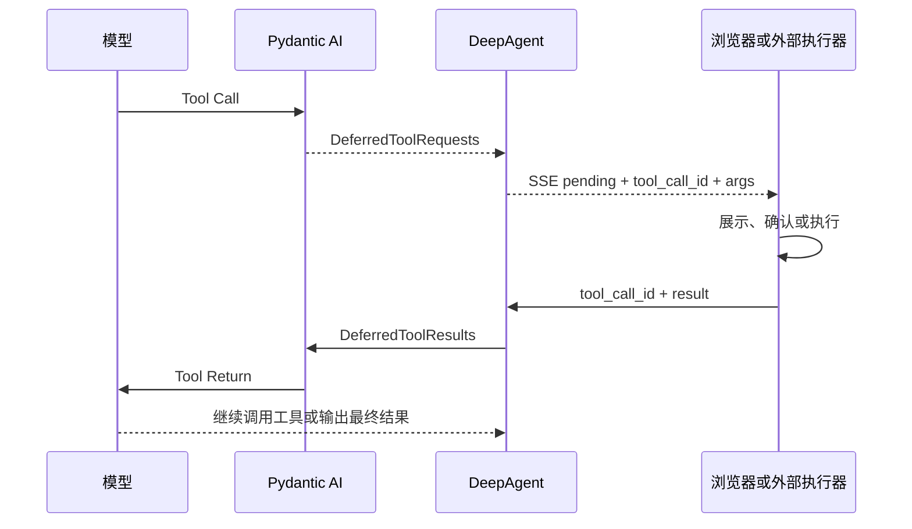
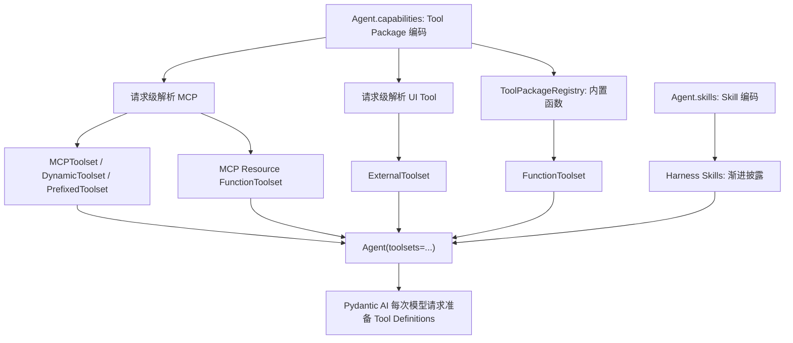

# Pydantic AI 工具体系与 DeepAgent 工具优化设计

> 最后核验：2026-08-03
>
> 当前运行基线：`pydantic-ai-slim 2.26.0` + `pydantic-ai-harness 0.18.0`
>
> 状态：v0.3.17 已选择性接入 Tool Return Schema；Native Tool、Output Tool 和其他 Harness 能力仍按本文边界评估

## 1. 结论

DeepAgent 已经使用了 Pydantic AI 最核心的三种工具执行方式：

1. `FunctionToolset`：在 DeepAgent Python 进程内执行。
2. `MCPToolset`：由远端或内建 MCP Server 执行。
3. `ExternalToolset`：由前端或其他外部系统执行，通过 Deferred 协议续跑。

当前工具架构不需要推倒重做。后续优化应集中在：

- 统一工具分类和命名，消除“DeepAgent native”与“Provider Native Tool”的概念混淆。
- 保留一层稳定 MCP 命名空间，避免 `deepcube_deepcube_*` 这类重复前缀。
- 使用 Core `PrepareTools` 做请求级过滤；工具达到数十个后再评估 `ToolSearch`。
- 为所有工具补齐参数、结果、权限、副作用和错误语义。
- 前端表单操作继续使用 `ExternalToolset + DeferredToolRequests/Results`。
- 结构化最终输出使用 `ToolOutput` 或 `NativeOutput`，不依赖提示词约定 JSON。
- Provider Code Execution 作为模型可选能力接入，不作为所有模型默认工具。
- Harness 0.18 已用于上下文压缩和大工具结果治理；v0.4.0使用公开的
  `ToolOutputLimits` + `Spill`，不再引用旧 `OverflowingToolOutput`方案。
- Harness 不替代 SQL 会话、SSE、配置中心、HITL 和前端执行器。

## 2. 三套概念的边界

### 2.1 Pydantic AI Core

Pydantic AI Core 是当前 Agent 运行时，负责：

- 模型适配和 Agent Loop。
- Tool Definition 生成、参数校验和工具路由。
- Toolset 组合。
- Deferred Tool 原语。
- 流式事件、消息历史和 UsageLimits。
- 结构化输出。
- Capability、Hook、工具准备和历史处理扩展点。

### 2.2 Pydantic AI Harness

`pydantic-ai-harness` 是建立在 Core 上的可选能力库，重点补充：

- 上下文压缩。
- 超长工具结果治理。
- Memory。
- Guardrails。
- Step Persistence。
- Planning、SubAgents、FileSystem、Shell、CodeMode 等 Agent Harness 能力。

它不是一套新的模型循环，也不提供 DeepAgent 的配置中心、用户隔离、会话页面或
SSE 协议。

#### 2.2.1 升级到 0.18 后的采用判断

| 0.12～0.18 能力 | 是否值得做 | DeepAgent 结论 |
| --- | --- | --- |
| `Skills` 渐进披露 | 是，优先 | 作为 `SKILL.md` Instructions 延迟加载基础；安装、权限、References、Assets、scripts 仍由 DeepAgent 负责 |
| Tool Guardrail / Guard Chain | 是，依赖前置 | 待工具风险元数据统一后用于参数、结果、审批和敏感信息治理，不先堆零散规则 |
| Compaction receipts、`pin`、`keep_user_messages` | 部分吸收 | 用于补充观测和回归思路；不替换当前单次摘要、完整 SQL 历史和 Checkpoint |
| Spend Limits | 是，中期 | 适合请求级成本保护；先与现有 `UsageLimits`、全局请求上限和错误协议统一 |
| 大文本外置 / Tool Output Limits | 已采用 | v0.4.0 使用平台文件 Store 完成会话内 Spill；TTL、孤儿治理和通用 Artifact 平台不作为前置条件 |
| ConversationSearch | 后续评估 | 用自定义 `HistorySource` 读取现有 SQL `chat_messages`，不为搜索启用第二套 StepPersistence；默认只查当前会话 |
| StepPersistence | 暂不做 | 现有 SQL 会话是事实源；除非出现崩溃恢复或子 Agent 持久化需求，否则会形成第二套历史 |
| Planning / Advisor / SubAgent | 按业务需求 | 只有长任务、可审计计划和专业分工形成明确产品场景后再启用 |
| BrowserUse | 当前不做 | 浏览器执行权限和网络边界过大，不作为通用线上 Agent 默认能力 |

升级依赖不等于启用上述能力。每一项仍需单独的产品边界、权限设计和目标测试。

### 2.3 Harness Engineering

`agent-labs/harness-engineering` 是工程方法和研究材料，不是 Python 依赖。它关注：

- 工具是否容易发现、正确调用和理解结果。
- 能力与执行权限是否分离。
- 工具失败是否能给模型可修复的信息。
- 真实用户链路是否证明功能有效。
- 运行经验是否沉淀回 Schema、测试、文档和工具边界。

对 DeepAgent 的直接价值是指导工具优化过程，而不是增加运行时框架。

## 3. Pydantic AI 工具完整分类

工具应按“执行位置”分类。Toolset、Capability 和 Output 机制不应与业务工具混为同一层。

### 3.1 模型可调用的执行工具

| 类型 | 执行位置 | 典型用途 | DeepAgent 当前状态 |
| --- | --- | --- | --- |
| Function Tool | DeepAgent Python 进程 | 时间、HTTP、业务函数、宿主代理 | 已使用 |
| MCP Tool | MCP Server | DeepCube、平台能力、外部服务 | 已使用 |
| External/Deferred Tool | 浏览器、任务系统或其他进程 | HITL、前端表单、长任务 | 已使用 |
| Provider Native Tool | 模型 Provider 托管环境 | 搜索、代码执行、文件搜索、图片生成 | 未接入 |
| Output Tool | Pydantic AI 输出处理 | 结构化最终结果 | 未接入 |

### 3.2 Function Tool

下面几种写法属于同一种原始工具类型：

```python
@agent.tool
async def query(ctx: RunContext[Deps], keyword: str) -> dict:
    ...


@agent.tool_plain
def get_current_time() -> str:
    ...


agent = Agent(model, tools=[some_function])
```

也可以通过 `FunctionToolset` 组织：

```python
toolset = FunctionToolset(instructions="只在需要时调用这些工具。")


@toolset.tool_plain
def calculate(expression: str) -> float:
    ...
```

函数类型注解和 Docstring 会转换为模型可见的名称、说明和 JSON Schema。

适合放在 Function Tool 的逻辑必须满足：

- 可以在当前后端进程安全执行。
- 不依赖浏览器页面状态。
- 能在一次工具调用生命周期内完成。
- 当前用户和请求权限可以通过 `RunContext[AgentDeps]` 校验。

### 3.3 MCP Tool

`MCPToolset` 从 MCP Server 获取工具定义，并将模型调用转发给 MCP Server：

```text
MCP initialize / tools/list
  → MCPToolset
  → Tool Definitions
  → 模型 Tool Call
  → MCP tools/call
  → Tool Result
  → 下一次模型请求
```

MCP Tool 从模型角度仍表现为函数工具；它的区别是工具定义和执行逻辑由 MCP
Server 所有。

MCP Prompt 和 MCP Resource 不是自动进入模型的工具：

- Prompt 需要宿主明确选择并注入。
- Resource 需要宿主读取，或包装成模型可调用的代理工具。

### 3.4 External/Deferred Tool

`ExternalToolset` 只向模型提供 Tool Definition，不在当前 Python 进程执行：

```python
toolset = ExternalToolset(
    [
        ToolDefinition(
            name="ui__fill_form",
            description="请用户补充表单信息。",
            parameters_json_schema={...},
        )
    ]
)
```

运行链路：



需要审批属于 Deferred 的控制方式，可以使用：

- `requires_approval=True`
- `ApprovalRequired`
- `ApprovalRequiredToolset`

审批不是新的工具执行类型。

### 3.5 Provider Native Tool

Provider Native Tool 由模型 Provider 执行，不在 DeepAgent Pod 中运行。

当前 Pydantic AI 2.26.0 暴露的原生工具定义包括：

- `WebSearchTool`
- `WebFetchTool`
- `CodeExecutionTool`
- `ImageGenerationTool`
- `FileSearchTool`
- `MemoryTool`
- `XSearchTool`
- `MCPServerTool`

接入形式示例：

```python
from pydantic_ai.capabilities import NativeTool
from pydantic_ai.native_tools import CodeExecutionTool

agent = Agent(
    model,
    capabilities=[
        NativeTool(CodeExecutionTool()),
    ],
)
```

是否可用取决于 Provider、模型和 API 类型。OpenAI 原生代码执行要求 Responses
链路；普通 OpenAI Chat Completions 或私有 OpenAI-compatible 地址不能因此自动获得
代码执行能力。

### 3.6 Output Tool 与结构化输出

> 本节只保留工具体系概览。完整运行语义、多结构方案、Deferred 协同、AI Labs 参考与业务
> 适用边界见 [`../09-structured-output/structured-output-design.md`](../09-structured-output/structured-output-design.md)。

`ToolOutput` 通过工具调用协议让模型生成并校验最终结果：

```python
class FinalAnswer(BaseModel):
    answer_markdown: str
    risks: list[str]
    next_actions: list[str]


agent = Agent(
    model,
    output_type=ToolOutput(
        FinalAnswer,
        name="return_final_answer",
    ),
)
```

它的语义是：

```text
模型调用 Output Tool
  → Pydantic AI 校验调用参数
  → 校验失败则要求模型重试
  → 校验成功后参数成为 result.output
  → 当前 Agent Run 结束
```

Output Tool 不是“先执行一个业务工具，再把工具结果与自由文本自动合并”。如果既要自然语言
又要机器可读字段，应将两者放在同一个输出模型中。

Pydantic AI 还有两种结构化输出方式：

| 方式 | 约束方式 | 特点 |
| --- | --- | --- |
| `ToolOutput` | 工具调用参数 Schema | 跨 Provider 适配面较广 |
| `NativeOutput` | Provider 原生 response schema | 支持时约束最强 |
| `PromptedOutput` | Prompt 注入 Schema 后解析文本 | 兼容性高，约束最弱 |

### 3.7 Toolset 是组织和加工机制

以下类型不是新的执行位置：

- `FunctionToolset`
- `ExternalToolset`
- `MCPToolset`
- `CombinedToolset`
- `FilteredToolset`
- `PrefixedToolset`
- `RenamedToolset`
- `PreparedToolset`
- `ApprovalRequiredToolset`
- `DynamicToolset`
- `DeferredLoadingToolset`

例如：

```text
MCPToolset
  → PrefixedToolset
  → FilteredToolset
  → Agent
```

最终仍是 MCP Tool，只是经过命名和过滤。

### 3.8 AbstractCapability、Tool Package 与 Toolset 不是同一层

Pydantic AI `AbstractCapability` 可以提供：

- Toolset 或 Native Tool。
- `PrepareTools`、`ToolSearch`。
- `ProcessHistory`、`ProcessEventStream`。
- Hooks、Instrumentation。
- 模型设置、Thinking 和输出处理。

DeepAgent 原有自研 `Capability` 只是产品配置包装，却与 Pydantic AI 的
`AbstractCapability` 同名，容易把产品授权和运行扩展混为一谈。v0.3.2 将它改名为
`ToolPackage`：负责 Agent 选择、Console 目录和一组工具元数据；Pydantic AI `Toolset` 仍是
真正交给 Agent 的运行对象。一个 Tool Package 严格包装一个 Toolset；该 Toolset 既可预定义，
也可在请求时按 MCP 或数据库 UI 定义动态创建。完整定义见
[`../11-tool-packages/tool-packages-design.md`](../11-tool-packages/tool-packages-design.md)。

## 4. DeepAgent 当前使用情况

### 4.1 内置 Function Tool

产品层把代码随 DeepAgent 发布、无需管理员注册的可配置后端 Function Tool 归入
“内置工具”，与 MCP 服务同级展示。v0.3.23 保留两个 Tool Package：

| 前端名称 | Tool Package 编码 | 默认状态 | 工具 |
| --- | --- | --- | --- |
| 通用工具 | `builtin:general` | 默认启用 | `get_current_time` |
| Python 沙箱 | `builtin:sandbox` | 默认关闭 | `execute_python`、条件式 `execute_skill_script` |

两包中的后端函数对模型都表现为 `FunctionToolset`。配置中心只读展示工具包及工具明细，
实际启用仍由 `agents.capabilities` 中的工具包编码决定；本轮不提供包内逐工具开关。
`execute_python` 的工具定义位于 DeepAgent 进程，实际代码通过可替换的
`PythonExecutionBackend` 执行；这不改变它的 Function Tool 类型。Skill脚本复用同一Backend，
在Agent启用Sandbox且选择含脚本Skill时动态追加，不扩大包级授权。

0.2.3 删除了原来 Native 中的 `http_get`。该工具没有目标域名白名单、私网地址保护和
请求审计，不适合作为所有 Agent 默认获得的通用网络能力；需要联网时应接入边界明确、
可配置和可审计的 MCP 或业务工具。

附件和Skill文件由自动注入的系统工具 `read_file`统一读取，不进入内置工具包或
`agents.capabilities`。位置：

- `deep_agent/capabilities/native/builtin.py`
- `deep_agent/files/toolset.py`
- `deep_agent/sandbox/toolset.py`

v0.3.18 起 Skill 不再使用 `FunctionToolset`，也不属于 ToolPackage。Skill 通过 Harness
`load_capability` 渐进披露说明，实际工具权限仍来自 Agent 独立选择的 ToolPackage。

MCP Resource 也被包装为宿主 Function Tool：

- `list_mcp_resources`
- `list_mcp_resource_templates`
- `read_mcp_resource`

产品文案统一使用“内置工具”，工具目录仍标注具体执行类型，避免与 Provider Native Tool
混淆。旧 `native`、`python-sandbox`、`attachment` 编码由 Alembic 002 一次性迁移，运行时
不保留旧分支。

### 4.2 MCP Tool

Agent 选择 `mcp:<server_name>` 后，请求级加载 MCP 配置并构造 Toolset：

- URL MCP 在“检测并更新”时保存完整工具快照；请求级使用快照 Toolset 披露定义，首次真实调用时才按
  当前 `AgentDeps` 计算 Header、初始化官方 `MCPToolset`，并在本 Run 内复用连接。
- Builtin MCP 使用 Run-scoped Client。
- Toolset 外层使用 `PrefixedToolset`。
- URL Server Instructions 来自同一检测快照；Builtin Instructions 仍由运行时 initialize 获取。
- 缺快照或配置变更后的 URL MCP 当前 Run 不披露工具；远端调用失败只终止该工具，不阻塞其他 Toolset。

关键位置：

- `deep_agent/capabilities/mcp/resolver.py`
- `deep_agent/capabilities/mcp/toolset_builder.py`
- `deep_agent/capabilities/mcp/snapshot_toolset.py`
- `deep_agent/capabilities/mcp/run_scoped.py`

### 4.3 UI External Tool

当前 UI 工具包括：

- `builtin__confirm`
- `builtin__choice`
- 管理员手工定义的 UI 工具

定义经过以下链路：

```text
UiToolDefinition / builtin record
  → ToolDefinition
  → RetryableExternalToolset
  → Agent toolsets
  → DeferredToolRequests
  → Console Widget
  → DeferredToolResults
```

v0.3.2 之前已有：

- Agent 显式选择 `ui:<tool_name>`。
- 参数 JSON Schema 校验。
- `ModelRetry` 参数修复。
- SSE Tool Call。
- Pending 刷新和历史恢复。
- Confirm、Choice、Text、Date、Structured、Custom Widget。

v0.3.2 将定义和选择颗粒度明确分为两层：

```text
UI Tool Definition
  → 稳定工具协议名、参数 Schema、Widget、结果 Schema

UI Tool Package
  → Agent 选择单元，例如 ui:deepcube
  → 展开为一个或多个 UI Tool Definition
```

Agent 本轮只选择整个包，不继续保留 `ui:<tool_name>` 单工具授权。代码内置交互归入
`ui:builtin`，现有 DeepCube 两个手工工具归入 `ui:deepcube`；模型工具名、SSE、Pending 和历史
协议保持不变，只调整 Agent 配置如何展开工具集合。未来确有细粒度授权需求时扩展独立的选择结构，
不再让工具协议名兼任授权主键。

Output Tool 不属于 UI Tool Package，也不加入 `agents.capabilities`。多个互斥 Output Tool 应由
独立的输出契约组统一选择，例如 `deepcube.v1` 内包含 answer、code、config 和 mixed 四种终止
结构。详见 [`../09-structured-output/structured-output-design.md`](../09-structured-output/structured-output-design.md)。

仍需补强：

- 严格业务 UI Tool 在自己的恢复逻辑中校验结果；公共层不按 `result_schema` 强制拒绝提交。
- 工具执行权限和当前 App/页面/表单实例绑定。
- 对修改型 UI Tool 区分预览、确认、执行和失败。
- 工具结果增加版本冲突、部分成功和拒绝语义。
- UI Tool 定义与 Agent 选择颗粒度解耦；v0.3.2 使用 Tool Package 整包选择，旧逐工具引用只在迁移中转换。

### 4.4 当前没有使用的能力

DeepAgent 当前没有正式启用：

- `ToolOutput`
- `NativeOutput`
- `PromptedOutput`
- Provider `CodeExecutionTool`
- Provider Web/File/Image Native Tool
- Core `ToolSearch`
- Core 通用 `PrepareTools`
- Pydantic AI 原生执行审批

`pydantic-ai-harness 0.18.0` 已用于上下文压缩，但工具结果治理、Memory、StepPersistence、
SubAgent 和其他 Harness 能力尚未启用，不能把“已安装 Harness”理解成这些能力已经开放。

当前主对话输出仍为：

```python
[str, DeferredToolRequests]
```

### 4.5 当前工具装配链路



关键位置：

- `deep_agent/api/v1/deps.py`：加载 Agent、模型、MCP、Resource 和 UI Toolset。
- `deep_agent/agent/factory.py`：合并 Toolset 并构造 Agent。
- `deep_agent/agent/runner.py`：运行、SSE、消息持久化和 Deferred 恢复。
- `deep_agent/capabilities/registry.py`：DeepAgent 产品工具包注册表。

## 5. MCP 工具命名优化

### 5.1 当前问题

DeepAgent 当前统一执行：

```python
toolset.prefixed(server_name)
```

如果 MCP Server 已经自行添加命名空间：

```text
server_name = deepcube
raw_tool     = deepcube_list_cubes
final_tool   = deepcube_deepcube_list_cubes
```

### 5.2 判断

前缀不是 MCP 协议强制要求。Pydantic AI 官方提供并推荐 `PrefixedToolset`，用于多个
Toolset 合并时避免工具重名。

不能为了消除重复而对所有 MCP 取消前缀。外部 MCP 很容易提供 `search`、`list`、
`get` 等重名工具。

### 5.3 推荐规范

长期采用一层稳定命名空间：

```text
MCP Server 名：deepcube
Server 原始工具短名：list_cubes
模型最终看到：deepcube_list_cubes
```

实施选择：

1. 内建 MCP 逐步把自身工具改成短名，由宿主统一添加前缀。
2. 不能立即改 Server 时，只对已验证名称唯一的可信内建 MCP 做重复前缀归一化。
3. 外部 URL MCP 默认继续强制前缀。

不建议首版开放任意管理员关闭前缀，否则工具冲突会从部署时错误变成运行时不确定行为。

工具改名需要评估：

- Prompt 和 Skill 中引用的工具名。
- 历史 Tool Call/Return。
- Deferred Pending 会话。
- 测试夹具和前端展示。

MCP 配置名称本身同时参与工具包编码 `mcp:<name>`、模型工具前缀 `<name>_` 和
Resource Server 名称。数据库 URL MCP 如需改名，必须使用独立重命名事务：更新
`mcp_servers.name` 的同时，原位替换全部 Agent 中的 `mcp:<old_name>` 引用。该操作不重新
检测远端 MCP，也不修改已经持久化的历史 Tool Call/Result；当前正在执行的 Run 继续使用其
创建时的工具列表，后续 Run 才使用新名称。Builtin 与已停止支持的 stdio MCP 不开放重命名。

## 6. 前端表单工具设计

### 6.1 两种表单场景

| 场景 | 说明 | 推荐机制 |
| --- | --- | --- |
| 对话内生成表单 | 模型缺少参数，请用户补充 | 现有 `ExternalToolset` Structured Widget |
| 操作宿主已有表单 | 设置字段、增加行、清空或提交当前页面 | `ExternalToolset` + 宿主 Form Adapter |

### 6.2 为什么使用 ExternalToolset

浏览器页面状态不在 DeepAgent Python 进程中。普通 Function Tool 无法可靠访问：

- 当前打开的页面。
- 未保存的字段值。
- 当前表单校验状态。
- 浏览器组件实例。

MCP Tool 更适合调用业务后端或外部服务。如果真正的业务事实仍未提交，只存在浏览器内，
就不应让 MCP Server 假设自己能操作它。

因此原始工具应选择：

```text
Pydantic AI ExternalToolset
  + DeferredToolRequests
  + DeferredToolResults
```

### 6.3 分层职责

DeepAgent 后端负责：

- Tool Definition 和参数 Schema。
- Agent 能力选择。
- Pending 调用和 `tool_call_id`。
- 当前用户、App、Space 和会话绑定。
- 参数与结果校验。
- 恢复 Agent Loop。

宿主前端负责：

- 将稳定业务字段编码映射到真实组件。
- 验证当前页面和表单实例。
- 展示变更预览和确认。
- 执行前端状态修改。
- 返回应用、拒绝、冲突或失败结果。

### 6.4 参数设计

禁止模型直接提交：

- CSS Selector。
- DOM 路径。
- 任意 JavaScript。
- 任意前端事件名。

应使用稳定业务动作：

```json
{
  "operations": [
    {
      "field": "company_code",
      "operation": "set",
      "value": "1001"
    },
    {
      "field": "budget_version",
      "operation": "clear"
    }
  ]
}
```

页面、表单实例、权限 Scope 和允许字段白名单应由宿主上下文绑定，不应允许模型通过参数
选择其他用户或其他页面。

推荐返回：

```json
{
  "status": "applied",
  "applied_fields": ["company_code", "budget_version"],
  "failed_fields": [],
  "form_revision": 8
}
```

状态至少覆盖：

- `applied`
- `rejected`
- `conflict`
- `failed`
- `partially_applied`

### 6.5 持久化业务数据的边界

| 动作 | 执行方 |
| --- | --- |
| 修改浏览器未保存表单 | External Tool / 前端 |
| 弹出补充信息表单 | External Tool / 前端 |
| 用户确认后操作当前页面 | External Tool / 前端 |
| 修改数据库正式业务数据 | Function Tool 或 MCP Tool / 后端 |
| 高风险后端写入 | Approval + Function/MCP Tool |

前端工具不应绕过后端业务权限。正式保存仍应调用现有业务 API。

## 7. Code Execution 的接入边界

`CodeExecutionTool` 可以让支持的 Provider 在托管隔离环境执行代码，但它不等于
DeepAgent 自建 Python 沙箱。

Provider Native Code Execution：

- 能力、文件、网络、包、时长和费用由 Provider 决定。
- 文件需显式上传。
- 不能默认访问 DeepAgent 本地文件、数据库或内网。
- 不同 Provider 行为不统一。
- 私有 OpenAI-compatible 模型通常不支持。

DeepAgent 若接入，建议：

```text
llm_models.tags 包含 code_execution
  + Agent 显式选择 native:code_execution
  + Provider/Model Profile 二次校验
  + 注册 NativeTool(CodeExecutionTool())
```

还需要补齐：

- Provider Native Tool 事件到 DeepAgent SSE 的映射。
- 历史持久化和 Console 展示。
- 文件上传映射。
- Usage、费用、超时和错误展示。
- 数据出境与客户部署边界。

DeepAgent 已通过 `builtin:sandbox` 中的 `execute_python` 向私有和 OpenAI-compatible 模型提供统一 Python 能力：

```text
FunctionToolset(execute_python)
  → PythonExecutionBackend
  → subprocess-dev
```

v0.3.22 同一Backend内部增加Skill脚本模式：宿主只复制已授权脚本、JSON inputs和同Skill资源，
固定读取 `outputs/result.json`。Agent选择含脚本Skill并启用 `builtin:sandbox`时，模型可直接调用
`execute_skill_script`。

该能力不是 MCP，也不依赖 Provider Native Tool。当前已落地无状态执行、独立解释器、超时、
并发和软防护。当前执行语义见 [Python Sandbox 课题](../07-python-sandbox/README.md)。长期按真实需求继续治理：

- 容器或进程隔离。
- CPU、内存、时间和磁盘配额。
- 网络和包白名单。
- 文件生命周期。
- 用户/Agent/App/Space 隔离。
- 审计和清理。

## 8. Pydantic AI Core 可用于工具优化的能力

| Core 能力 | 解决的问题 | DeepAgent 建议 |
| --- | --- | --- |
| `PrepareTools` | 按请求修改或过滤工具定义 | 优先用于权限、App、Space、模态和任务阶段过滤 |
| `ToolSearch` | 工具很多时按需发现 | 工具达到数十个、Schema 占用明显后试点 |
| `IncludeToolReturnSchemas` | 让模型看到工具返回结构 | 只对稳定、小型结果工具启用 |
| `HandleDeferredToolCalls` | 通用 Deferred 处理 | 不替换现有产品化 HITL |
| Hooks / Instrumentation | 工具校验、执行和 Usage 观测 | 增加脱敏后接入 |
| `ProcessHistory` | 请求前改写历史 | 若采用 Harness Compaction，不再维护第二套压缩器 |
| `ProcessEventStream` | 处理原生运行事件 | 可做内部观测，不替换现有 SSE 契约 |
| Native Tool Capability | 注册 Provider 工具 | 按模型和 Agent 显式开启 |

### 8.1 PrepareTools

适合把当前分散的工具可见性规则集中为请求级准备：

```text
已配置工具全集
  → Agent capabilities
  → 当前用户权限
  → App / Space
  → 模型模态和 Provider 能力
  → 当前任务阶段
  → 本轮最终 Tool Definitions
```

工具权限必须由可信 `AgentDeps` 决定，不允许模型在参数中自选权限 Scope。

文件工具是已落地的请求级准备场景：当前请求或原始 `chat_messages` 存在合法附件，或者 Agent
选择了可读且运行目录就绪的 Skill资源时，才注入统一系统工具 `read_file`；没有任何文件来源时
不注入。附件归属不能从 Checkpoint推断，Skill路径必须命中已授权资源索引。该优化只减少无效
Schema和误调用，实际读取仍需复检用户、会话、`file_id`、Skill选择和路径权限。

### 8.2 ToolSearch

Tool Search 解决的是“工具太多导致发现困难和 Schema 占用”，不是替代 MCP 或 Toolset。

引入前应先有观测：

- 单轮工具数量。
- 工具 Schema Token。
- 模型选错工具率。
- 工具参数重试率。
- 工具列表按 Agent/权限过滤后的真实规模。

少量工具直接全部提供，通常比增加一次搜索工具调用更简单可靠。

2026-08-06 Test 实测已经达到启动 Tool Search 设计的条件：一个 DeepFOS MCP 包包含 24 个工具，
纯工具 Schema 的保守估算约为 36k Token；Agent 全部 35 个可见函数的请求参数定义保守估算约
66k Token。Provider 实际计数会因 tokenizer 和缓存口径更低，现有预算字段也混合了 Instructions，
因此这些数字不能直接当作精确账单，但足以证明“每轮完整披露所有 MCP Schema”已经是主要成本。

推荐分层处理：

- Agent 选择 ToolPackage 仍表示授权上限，不改成逐工具配置。
- 大型 MCP 使用一个稳定的搜索/发现入口，在已授权 MCP 包内检索，再按需加载候选 Tool Definitions。
- 少量 Function、附件和 UI 工具继续直接披露或做简单条件过滤，不强行经过搜索。
- 搜索结果必须受用户、Agent、App、Space 和 MCP 包权限约束，不能把未授权工具“搜出来”。
- 第一版先解决 Schema 披露，不把普通工具结果溢出治理混在同一个功能中。

完整研究和当前推荐方案已经拆为第 13 个课题：

- [框架与 AI Labs 对比、Pydantic AI 中文黑盒验证](../13-tool-discovery/tool-discovery-research.md)
- [DeepAgent 工具检索与渐进披露设计](../13-tool-discovery/tool-discovery-design.md)
- [离线评估、真实模型和灰度验收](../13-tool-discovery/tool-discovery-evaluation.md)

v0.3.12 已复用 Pydantic AI Deferred Loading / ToolSearch 状态机；v0.4.1 将具体检索实现收敛到
DeepAgent独立的 `lexical_v2` 字段化词法内核。它优先匹配协议名、标准 `title`和参数名，再对描述
做BM25，低置信结果才进入拼音或受限错字回退。已授权 MCP候选超过3个时首轮预选最多Top 3，
模型主动搜索最多返回Top 5；本轮不部署Embedding，也不通过硬编码词典伪装跨语言语义。后续只有
真实召回数据证明词法方案不足时才评估多语言Embedding。

### 8.3 Toolset 组合与展示命名

`CombinedToolset` 可以把多个 Toolset 合成一个整体，再统一增加过滤、审批或延迟加载。
当前 Agent 已能接收多个 Toolset，因此暂不为“形式统一”引入；当需要对 Native、Attachment、
MCP 等一组工具应用同一横切策略时再采用。

`RenamedToolset` 修改的是提供给模型的工具协议名，并会在执行时映射回原工具名。它适合治理
上游工具名，但不应只为隐藏聊天里的 MCP 前缀而直接使用，否则会影响历史工具事件、Pending
恢复和模型调用兼容。MCP 工具在 Console 中直接展示模型实际收到的最终协议名，不由 DeepAgent
虚构或维护另一套 `display_name` 映射。DeepAgent 自定义的 UI 工具可继续使用产品元数据中的展示名，
但该概念不扩展到通用第三方 MCP 协议。

### 8.4 Tool Return Schema

返回 Schema 可以帮助模型理解稳定结果，但不能代替运行时验证：

- JSON Schema 过大会增加上下文。
- 返回结果仍可能包含业务错误。
- 大型动态查询结果不适合声明完整列级 Schema。

v0.3.17 直接使用 Pydantic AI 2.26 `IncludeToolReturnSchemas`，首版只匹配 MCP 原始工具名：

- `cube_query_data`
- `dimension_query_members`

匹配发生在模型请求前。MCP Server 即使重命名，最终协议名的前缀变化也不会让白名单失效；
若 MCP 未提供合法 `outputSchema`，DeepAgent 不伪造结构，只在本轮工具发现遥测中记录
`return_schema_unavailable`。未直接披露的延迟工具不产生返回 Schema Token，只有 Top 3 预选或
`search_tools` 发现后才随完整 Tool Definition进入下一次模型请求。

```text
延迟阶段：
  名称目录含 deepfos_cube_query_data
  模型未看到 input/output Schema

披露阶段：
  deepfos_cube_query_data(input_schema + return_schema)
  tool_discovery.estimated_return_schema_tokens 计入实际披露预算

执行阶段：
  Tool Result仍只是本次真实 JSON，不会重复附加 return_schema
```

该能力解决“模型调用前不知道稳定返回字段”问题；结果本身过大、空字段多或需分页仍属于
Tool Output/Artifact治理。禁止按名称包含 `query` 等模糊规则全量开启，后续扩充必须有真实失败样本。

## 9. Pydantic AI Harness 与工具治理

### 9.1 TieredCompaction

上下文压缩必须保持 Tool Call/Return 配对，尤其是：

- 普通 Function/MCP 工具。
- `ModelRetry`。
- Deferred Pending。
- 用户拒绝和取消。

推荐采用 Harness `TieredCompaction`，而不是在 `AgentRunner` 中自行裁剪消息。详细方案见：

- [上下文压缩设计](../03-context-compaction/context-compaction-design.md)
- [上下文治理研究结论](../03-context-compaction/context-compaction-research.md)

### 9.2 ToolOutputLimits 与大工具结果外置

v0.4.0 已直接采用Harness 0.18公开的 `ToolOutputLimits`。它在工具执行完成后、结果进入下一次模型
请求与持久化History前运行，避免一个超大结果在后续每次模型请求中重复占用上下文。

```text
普通 Function / MCP / Sandbox / MCP Resource 返回
  → 统一Token估算
  → 小于阈值：保持原结果
  → 超过阈值：Harness Spill
      → 完整UTF-8结果上传DeepFOS平台文件服务
      → 平台File ID作为artifact_id / overflow handle
      → Tool Return只保留首尾预览、结构草图和读取说明
      → 模型按需调用Harness read_tool_result分页或关键词读取
  → Tool Return进入SSE、原始History与后续模型请求
```

阈值不增加数据库字段或环境变量，固定为：

```text
available_input = context_window_tokens - max_output_tokens
threshold = clamp(available_input × 20%, 4K, 24K Token)
无有效context_window_tokens时使用24K Token
```

第一版只解决安全兜底，不把它扩成通用文件或Artifact平台：

- Store仅适配现有平台文件服务，不使用Harness默认本地文件Store。
- 平台File ID同时就是会话内 `artifact_id`，不增加Artifact表和第二层ID映射。
- 句柄权限只从当前Session完整原始 `chat_messages`中的Tool Return metadata恢复；模型猜测、其他会话
  和经过脱敏的Checkpoint均不能增加权限。
- 同一Run首次读取后复用内存缓存，并发读取使用single-flight；下一Run重新按原始History授权和下载。
- `read_file`、`read_tool_result`、`load_capability`和Tool Search排除在治理外，防止读取结果再次外置。
- 上传失败时回退到最多8K字符的有损截断，保证Run仍可继续；不伪造外置成功。
- SSE和History只附加脱敏的 `artifacts`元数据；日志仅记录数量、字节数、耗时/失败，不记录句柄、
  工具参数、完整Schema、完整结果、Header或凭据。
- Console提示“完整结果已外置”，当前只展示受限预览；不新增下载中心按钮。

当前没有TTL、孤儿文件清理、全平台Artifact列表、独立CRUD或统计表。这些只有出现真实治理需求后，
才作为平台文件生命周期课题另行设计，不影响本轮“大结果不再挤占模型上下文”的目标。

### 9.3 Memory

Harness Memory 可能向模型提供读写、搜索 Notebook 的工具，但不应替代聊天历史。

适合：

- 用户明确保存的偏好。
- 常用模型、Cube 和命名习惯。
- 跨会话工作约定。

不适合：

- 保存完整工具结果。
- 保存 Token、Cookie 或 API Key。
- 未经用户感知自动吸收业务数据。

### 9.4 Guardrails

工具相关 Guardrail 可用于：

- 凭据和高风险参数阻断。
- 按可信上下文限制工具调用范围。
- 修改型工具的确认策略。
- 最终结构化结果校验。

Guardrail 不替代业务服务自身权限，也不能撤回已经通过 SSE 发出的流式文本。

Harness `ToolGuardrail` 可同时介入工具调用两侧：执行前读取已经校验的参数，执行后读取尚未进入模型的
原始结果。DeepAgent 的采用顺序应固定为：

```text
统一风险元数据（TOOL-003）
  → 执行前按可信 deps 复检 user/App/Space、参数范围和副作用
  → 必要时进入 Deferred 审批（TOOL-106）
  → 工具真实执行
  → 结果敏感信息清理（TOOL-110）
  → ToolOutputLimits 截断或外置（TOOL-109）
  → 模型、SSE 与历史
```

审批原语只能解决“本轮是否允许执行”，正式产品仍需持久化审批记录、TTL、操作人、幂等和执行审计。
UI Tool 的 Deferred Result 是用户提交业务结果，不等同于批准后由后端执行原工具。

### 9.5 StepPersistence

对工具最有价值的部分是 Tool Effect 账本：

```text
started
completed
failed
unknown_after_crash
```

只有出现大量写入型工具、长工作流或崩溃后重复执行风险时才值得接入。它不替代：

- `chat_sessions/chat_messages`
- EventPersister
- Deferred Pending
- 前端表单状态
- 工具业务幂等

### 9.6 FileSystem、Shell 和 CodeMode

这些能力面向 Coding Agent，不适合作为 DeepAgent 业务 Agent 默认能力。引入前必须先有：

- 沙箱边界。
- Authority 和审批模型。
- 配额。
- 允许目录和命令白名单。
- 副作用账本。
- 产物和临时文件清理。

## 10. 工具质量统一契约

每个工具定义至少应回答：

| 维度 | 必须明确的内容 |
| --- | --- |
| 名称 | 稳定、无重复、能表达业务动作 |
| Description | 何时调用、何时不要调用 |
| 参数 | JSON Schema、必填、枚举、范围、单位 |
| 结果 | 成功结构、业务失败结构、是否有分页 |
| 执行位置 | 后端、MCP、浏览器或 Provider |
| 权限 | 谁可调用、Scope 如何从可信上下文获得 |
| 副作用 | 只读、幂等写入、不可逆写入 |
| 审批 | 是否需要用户确认，确认发生在哪里 |
| 重试 | 参数纠错、网络重试和业务重试分别如何处理 |
| 大小 | 最大参数、最大结果、分页或 Spill |
| 可观测 | 调用次数、耗时、失败、重试、结果大小 |
| 兼容 | 工具改名、Schema 升级、Pending 恢复策略 |

错误信息应面向模型修复，例如：

```text
company_code 不在当前表单允许字段中。
可用字段：company_code、period、budget_version。
请修改参数后重新调用。
```

不应只返回：

```text
Invalid request
```

工具异常必须按模型是否能够修正来分类：

- `ModelRetry`：参数缺失、枚举错误、对象歧义或选错工具等，模型修改参数或重新选工具后可能成功。
- `ToolFailed`：明确权限拒绝、文件损坏、下载失败或上游已经确定终止等，本次执行已经失败；继续让
  模型使用相同工具盲目重试只会增加请求和 Token。

该分类不改变稳定工具协议名和历史主结构。`ToolFailed` 会成为带失败原因的合法 Tool Result，
模型仍可据此继续回答；REST/SSE/History 不能丢弃失败语义或把该次工具执行伪装成成功。

v0.3.15 首批只改无歧义路径：附件下载、损坏、解析和读取上限，以及 MCP Resource 已发起的
list/read 上游失败使用 `ToolFailed`；文件 ID、MIME、分页范围、Resource Server 选择等模型可
修正错误继续使用 `ModelRetry`。UI Tool 参数、Sandbox 和普通 MCP Tool 暂不扩大调整范围。

## 11. 已完成阶段与后续触发条件

以下表格保留工具体系形成过程，不再表示当前 P0～P3 优先级。当前状态统一以
[`../TODO.md`](../TODO.md) 的“待实现、有潜力、暂缓、已关闭、已实现”五组为准；框架采用依据见
[`../14-framework-capabilities/framework-capabilities-baseline.md`](../14-framework-capabilities/framework-capabilities-baseline.md)。

| 能力 | 当前状态 | 落地或重新打开条件 |
| --- | --- | --- |
| 按来源条件注入统一文件工具 | 已实现 | 当前请求/原始会话有合法附件，或 Agent有可读 Skill资源时注入系统 `read_file`；无来源时不注入，执行时继续复检权限 |
| MCP 工具名原样展示 | 已关闭额外映射 | 模型、SSE、历史和 Console 统一使用最终稳定协议名，不增加 MCP `display_name` |
| MCP `ToolSearch` | 已实现 | 在 ToolPackage 授权范围内 Top 3 预选、Top 5 搜索和渐进披露 |
| 结构化最终输出 | 有潜力 | 产品锁定普通文本、多输出组合、严格模式和混合工具调用规则后重新实施 |
| 高风险工具审批 | 有潜力 | 出现真实副作用工具并完成风险元数据、审计、TTL、幂等和权限复检设计后打开 |
| `CombinedToolset` | 已关闭为独立事项 | 继续作为运行时组合实现细节按需使用，不成为产品概念 |
| Provider Native 工具 | 有潜力 | 只在特定托管 Provider 能力成为明确产品功能时接入，不替代公共能力 |

### 已完成：工具可见性

- 落地附件与 Skill资源统一的 `read_file`条件注入。
- MCP 工具保持最终协议名原样展示，不增加另一套名称映射。
- 同步补充每轮工具数量和 Schema 体积观测，为后续 Tool Search 提供数据。

### 有潜力：结构化最终输出

详细设计和测试边界见
[`../09-structured-output/structured-output-design.md`](../09-structured-output/structured-output-design.md)。

- 首版默认使用 `ToolOutput`，兼容私有 OpenAI-compatible 模型。
- 要求严格结构化时，输出类型只保留 `ToolOutput(...)` 与 `DeferredToolRequests`，不同时允许 `str` 绕过结构约束。
- 固定业务结构优先使用 Pydantic Model；Agent 动态 JSON Schema 使用 `StructuredDict` 时，DeepAgent 必须补服务端校验和有限重试。
- 中间 Thinking、普通工具和 Pending 继续流式；结构化结果第一版在 `final.output` 一次性返回，不把终止输出工具渲染成普通工具卡片。

### 有潜力：高风险工具审批

- 工具元数据标识只读、写入、删除、外发和代码执行等风险。
- 审批通过后由 Pydantic AI 执行原后端工具，再把真实工具结果交给模型；它与用户直接完成 External UI Tool 的语义不同。
- 没有真实写入、删除或外发工具前，不为只读工具增加审批复杂度。

### 已实现与有潜力：大工具集和 Provider 增强

- v0.3.12已用 `ToolSearch + DeferredLoadingToolset`完成MCP渐进披露，并在Run内使用
  `CombinedToolset`统一Top 3/Top 5检索。
- v0.4.0已用Harness `ToolOutputLimits` + 平台File Store完成大工具结果外置；业务工具仍可优先
  提供领域分页和摘要，两者互补。
- Provider Native Code Execution/File Search 只作为特定 Provider 增强，不作为 DeepAgent 跨模型公共能力。

## 12. 测试与验收

### 12.1 Function/MCP Tool

- 工具定义和 Schema 与实际参数一致。
- MCP 前缀唯一且无意外重复。
- Header 和用户上下文不泄漏。
- `ModelRetry` 可以让模型修复参数。
- 网络失败、业务失败和参数失败可以区分。

### 12.2 External/UI Tool

- Agent 未选择时工具不可见。
- 参数不完整时不向前端发布可操作组件。
- Pending 刷新后可恢复。
- `result_schema` 用于前端渲染和协议说明；严格业务校验在业务恢复层完成。
- `tool_call_id`、用户、会话和页面实例绑定。
- 重复提交幂等。
- 取消、拒绝、冲突和超时可恢复。

### 12.3 表单操作

- 模型不能使用 CSS Selector 或任意脚本。
- 不允许操作白名单外字段。
- 表单版本变化返回冲突，不覆盖用户新输入。
- 部分成功有明确结果。
- 正式保存不绕过业务后端权限。

### 12.4 Output/Native Tool

- `ToolOutput` 非法结果触发受控重试。
- 文本和结构字段使用同一输出契约。
- 不支持 Native Tool 的模型不会看到对应工具。
- Provider Native 事件可持久化并被 Console 正确展示。
- Code Execution 文件、配额和数据边界生效。

### 12.5 Harness

- Compaction 不破坏 Tool Call/Return 配对和 Pending。
- 大工具结果策略不产生非法 JSON。
- Spill 跨 Pod 可读且权限隔离。
- Harness 失败时不损坏 SQL 原始历史。
- Core/Harness 使用联合验证的固定版本。

## 13. 后续事项

MCP 命名、请求级过滤、表单宿主、Deferred 结果校验、Code Execution、ToolSearch 和
Overflow Spill 的状态统一维护在 [`../TODO.md`](../TODO.md)，不在本文复制第二份清单。

## 14. 相关资料

项目文档：

- [UI 工具课题](../01-ui-tools/README.md)
- [上下文压缩课题](../03-context-compaction/README.md)
- [上下文治理研究结论](../03-context-compaction/context-compaction-research.md)
- [上下文压缩设计](../03-context-compaction/context-compaction-design.md)
- [Harness Engineering 对 DeepAgent 的研究结论](../../../../agent-labs/harness-engineering/DEEPAGENT_STUDY.md)

官方资料：

- [Pydantic AI Tools](https://ai.pydantic.dev/tools/)
- [Pydantic AI Toolsets](https://ai.pydantic.dev/toolsets/)
- [Pydantic AI Deferred Tools](https://ai.pydantic.dev/deferred-tools/)
- [Pydantic AI Output](https://ai.pydantic.dev/output/)
- [Pydantic AI Capabilities](https://ai.pydantic.dev/capabilities/)
- [Pydantic AI MCP Client](https://ai.pydantic.dev/mcp/client/)
- [Pydantic AI Harness](https://github.com/pydantic/pydantic-ai-harness)
