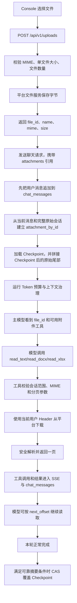

# Attachment Tool 分支完整交接

> 文档用途：交给后续开发 Agent，继续维护 `fix-ruge-0730-attachment-tool` 分支  
> 编写日期：2026-07-30  
> 当前基线：`fix-ruge-0717`  
> 当前实施分支：`fix-ruge-0730-attachment-tool`  
> 当前已提交 HEAD：`739e7a18d9adcf3faa91e8a3dfc9a68522e54330`  
> 数据库版本：Alembic `023`，附件功能本身没有新增表或迁移  
> 状态说明：第一版功能、测试和设计文档已经完成；后续应在当前分支增量修改，不要重新实现一套

## 1. 接手 Agent 先做什么

进入仓库：

```bash
cd /Users/wuzhiruge/PycharmProjects/deepfos-knowleage_base/deepfos-AI/deep-agent
```

先核对现场，不要直接切分支、重置或覆盖工作区：

```bash
git status --short
git branch --show-current
git rev-parse HEAD
git log --oneline --decorate -8
```

预期分支：

```text
fix-ruge-0730-attachment-tool
```

本轮关键提交：

```text
739e7a1 清理附件设计文档格式
340b8bd 完善附件按需读取与上下文压缩协同
c58ca5d 移除压缩测试会话环境开关
3a03685 完善上下文压缩与测试会话能力
4c85c21 完成上下文压缩与检查点持久化
```

如果 `git status --short` 出现未提交内容，默认认为是用户或上一位 Agent 的有效工作，必须先阅读
差异再继续，不能执行 `git reset --hard`、`git checkout -- .` 或删除未跟踪文件。

## 2. 一句话结论

这次不是给旧的“上传时文本抽取”补更多格式，而是把非原生文档附件改造成 Agent 可选的按需读取
能力：

```text
上传到平台文件服务
  → DeepAgent 会话只保存文件引用
  → Agent 显式启用 attachment 能力
  → 模型按需调用 read_* 工具
  → 工具安全分页返回
  → 工具调用和结果进入原始消息历史
  → 上下文压缩按正常工具事件治理
```

必须始终保持以下两个事实源边界：

- 平台文件服务保存真实文件字节。
- DeepAgent 的 `chat_messages` 保存会话中的附件引用、工具调用和工具结果。

Checkpoint 不是第三份原始历史，也不是附件权限表。它只是为了下一轮模型输入而生成、可随时丢弃并
重建的派生投影。

## 3. 为什么要这样改

### 3.1 旧实现的问题

旧链路在上传时尝试解析文本、截取固定长度，然后把抽取文本直接塞给模型。这个方案看起来简单，
但存在根本缺陷：

1. 大文件只保留开头一段，模型不知道后面还有内容，也没有继续读取的入口。
2. 无论问题是否需要附件内容，每一轮都可能携带大段文本，持续挤占上下文窗口。
3. TXT、Office、PDF、图片和模型原生模态混在同一处理链路里，能力边界不清楚。
4. Word、Excel 这种结构化文档被压成单一字符串后，页、行、表格、工作表等结构不可恢复。
5. 上传阶段解析失败会影响上传本身，文件存储和文档理解被错误耦合。
6. 固定字符截断不是可靠的 Token 预算策略，也无法与后续上下文压缩协同。

### 3.2 新实现解决什么

新实现只在模型明确需要内容时读取，并用统一的 `offset/limit` 协议分页：

- 第一次通常只传 `file_id`。
- 工具使用安全的默认页大小。
- 返回 `has_more` 和 `next_offset`。
- 模型根据任务决定是否继续读下一页。
- 同一页在同一 Run 内不会重复下载和解析。
- 每一页作为普通工具结果进入消息历史和 Token 预算。

它解决了“上传时截断”和“每轮重复塞全文”，同时保留了未来替换专业文档解析服务的接口空间。

## 4. 为什么没有直接合并 `origin/attachment_tool`

原开发分支：

```text
origin/attachment_tool
HEAD b838436 :sparkles: 支持附件处理tools
```

它基于更早的 `test` 代码，和当前 `fix-ruge-0717` 的共同祖先是 `2dc8bb9`。当前 0717 已经包含：

- 模型目录数据库化。
- 模型上下文窗口与最大输出属性。
- 上下文压缩和 Checkpoint。
- 内置 UI 工具改造。
- 控制台、请求上下文、标题等后续修复。

直接 merge 会把旧版标题、历史、Runner、Console 等大量逻辑带回来，产生行为倒退。因此本分支采取：

```text
以最新 fix-ruge-0717 为基线
  → 阅读 origin/attachment_tool 的有效能力
  → 按当前架构重新接入
  → 补足安全、分页、上下文压缩和端到端测试
```

这不是漏合并，而是有意避免把旧基线整体混进当前代码。

## 5. 原分支与当前实现的主要差异

| 主题 | `origin/attachment_tool` | 当前 `fix-ruge-0730-attachment-tool` |
| --- | --- | --- |
| 基线 | 旧 `test` | 最新 0717，包含上下文压缩 |
| 分页参数 | 各工具分别使用 `start_line/end_line`、`start_para/end_para`、`start_row/end_row` | 三个工具统一 `offset/limit` |
| 首次调用 | 模型需要理解各工具范围参数 | 通常只传 `file_id`，工具给默认页 |
| 继续读取 | `preview/next_range` 等异构结构 | 统一 `has_more/next_offset` |
| 文件范围 | 任意 `file_id` 都可尝试平台下载 | 必须先属于当前 Agent 会话附件白名单 |
| 下载和解析 | 每次调用重新下载、重新解析 | 单 Run 字节缓存、解析缓存和 single-flight |
| DOCX | 主要读取普通段落 | 页眉、正文段落与表格、页脚、批注附录 |
| DOCX 图片 | 每次分页可能重复返回 | 只在第一页、安全数量内返回 |
| XLSX | 基础行读取 | 首个可见 sheet、显式 sheet、分页和扫描上限 |
| 文本编码 | 基础编码 | UTF-16 BOM、UTF-8 BOM、UTF-8、GB18030 |
| Office 安全 | 不完整 | ZIP Bomb、成员数、解压体积、压缩比、加密和路径穿越检查 |
| 旧抽取配置 | 保留 `DEEP_AGENT_UPLOAD_EXTRACT_TEXT_MAX_CHARS` | 已删除 |
| 上下文压缩 | 旧分支没有当前实现 | 附件页键、Token 预算、Checkpoint 完整协同 |
| 标题改造 | 夹带一套较大的辅助模型重构 | 只保留与当前架构兼容的有效修复 |
| 测试 | 解析器和工具局部测试为主 | 增加 Tool → SSE → 历史 → 同会话续读集成测试 |

## 6. 已确认的产品口径

### 6.1 `attachment` 是 Agent 可选能力

能力定义：

```text
name: attachment
kind: attachment
default_enabled: false
```

行为：

- 新 Agent 默认不启用。
- 历史 Agent 不自动迁移。
- `capabilities=null` 不启用。
- `capabilities=[]` 不启用。
- 只有显式包含 `attachment` 才加载三个工具。

三个工具：

```text
read_text_attachment
read_docx
read_xlsx
```

用户已明确接受第一版不做复杂的前端发送前阻断。也就是说，Agent 没启用附件能力时，Console 仍可能
允许上传文档；管理员应在 Agent 配置中启用“附件读取”。后续如果统一建设使用态产品页面，再补更
完整的能力提示机制。

### 6.2 原生模态和工具读取分开

| 文件类型 | 处理方式 | 约束 |
| --- | --- | --- |
| 图片 | 直接作为模型原生输入 | 模型 `input_modalities` 必须包含 `image` |
| 音频 | 直接作为模型原生输入 | 必须包含 `audio` |
| 视频 | 直接作为模型原生输入 | 必须包含 `video` |
| PDF | 直接作为模型原生输入 | 必须包含 `pdf` |
| TXT/CSV/JSON/Markdown/HTML/XML | `read_text_attachment` | Agent 必须启用 `attachment` |
| DOCX | `read_docx` | Agent 必须启用 `attachment` |
| XLSX | `read_xlsx` | Agent 必须启用 `attachment` |

本轮不实现 PDF 文本解析或 OCR。PDF 解析涉及版面、扫描件、OCR、表格和图片，应在未来接专业的统一
文档解析服务，不能重新退回“粗略抽取一段文本”的旧模式。

### 6.3 不新增附件数据库表

本轮没有附件表，也没有为附件增加 Alembic migration。文件 ID、名称和 MIME 已经随用户消息保存在
现有 `chat_messages.payload`；真实文件由平台文件服务管理。

不要在后续开发中擅自：

- 把附件二进制写进 `chat_messages`。
- 把文件字节写进 Checkpoint。
- 创建长期本地文件副本。
- 把临时下载 URL 当成稳定文件身份。

## 7. 完整运行链路



关键顺序不能改变：

1. 先读取完整原始历史。
2. 先持久化本轮用户附件引用。
3. 从完整原始历史建立附件白名单。
4. 再加载 Checkpoint 形成模型输入投影。

如果先加载 Checkpoint、再从投影建立白名单，被压缩掉的旧附件引用就会消失，模型无法继续读取同一
会话中的旧文件。

## 8. 数据到底存在哪里

### 8.1 平台文件服务

`POST /api/v1/uploads`：

1. DeepAgent 读取上传字节。
2. `process_upload()` 做类型、大小及必要的媒体处理。
3. 通过 `PlatformAPI.file.upload()` 上传到平台文件服务。
4. 返回平台 `file_id`。

响应概念结构：

```json
{
  "id": "file-demo-123",
  "name": "合同.docx",
  "mime": "application/vnd.openxmlformats-officedocument.wordprocessingml.document",
  "size": 12456,
  "extracted_text": null
}
```

`extracted_text` 字段暂时保留在 Schema 中用于旧客户端和旧历史兼容，但新上传始终返回 `null`，
Console 也不再发送抽取文本。

### 8.2 原始 `chat_messages.payload`

用户消息只保存稳定附件引用，不保存文件字节：

```json
{
  "kind": "request",
  "parts": [
    {
      "part_kind": "user-prompt",
      "content": [
        "请概括这个文件",
        {
          "kind": "attachment-ref",
          "id": "file-demo-123",
          "name": "合同.docx",
          "mime": "application/vnd.openxmlformats-officedocument.wordprocessingml.document"
        }
      ]
    }
  ]
}
```

模型工具调用也作为原始消息事件保存：

```json
{
  "part_kind": "tool-call",
  "tool_name": "read_docx",
  "args": {
    "file_id": "file-demo-123",
    "offset": 1,
    "limit": 100
  },
  "tool_call_id": "call-1"
}
```

对应工具结果概念结构：

```json
{
  "part_kind": "tool-return",
  "tool_name": "read_docx",
  "tool_call_id": "call-1",
  "content": {
    "file_id": "file-demo-123",
    "name": "合同.docx",
    "mime": "application/vnd.openxmlformats-officedocument.wordprocessingml.document",
    "unit": "block",
    "offset": 1,
    "limit": 100,
    "returned_count": 100,
    "total_count": 245,
    "content": "本页解析内容……",
    "has_more": true,
    "next_offset": 101,
    "truncated_by": "limit",
    "metadata": {}
  }
}
```

数据库序列化可能还包含 Pydantic AI 的时间戳或 Provider 字段，以上示例只表达本功能依赖的稳定
协议。

### 8.3 Checkpoint.payload

Checkpoint 表：

```text
chat_context_checkpoints
```

核心字段：

```text
agent_id
session_id
source_last_sequence
source_history_hash
payload
payload_schema_version
projection_fingerprint
estimated_tokens
summary_model_id
row_version
```

`payload` 是 `list[dict]`，表示下一轮模型输入的派生消息投影。它不是原始消息表的备份。

附件相关清洗规则：

- `attachment-ref` 只保留 `kind/id/name/mime`。
- 不保留 `extracted_text`。
- 图片、音频、视频和 PDF 等二进制内容替换为文本占位：
  `"[附件内容已省略；原始附件仍保留在会话历史中]"`。
- 删除 `metadata`、`provider_details`、`vendor_details` 等不必要内容。
- Token、Cookie、Authorization 和临时签名 URL 会被脱敏。
- 写入前必须可以重新反序列化。

所以 Checkpoint 里可能存在附件引用和经过压缩后的工具结论，但绝不应存在原始文件字节。

## 9. 附件与 Checkpoint 的精确关系

假设完整原始历史为：

```text
U0：用户上传 report.xlsx
A0：模型调用 read_xlsx(offset=1, limit=100)
T0：第一页工具结果
A1：模型结论
U1：用户追问
A2：模型调用 read_xlsx(offset=101, limit=100)
T1：第二页工具结果
A3：模型结论
```

发生可靠摘要后，Checkpoint 可能变成：

```text
S0：摘要，保留 report.xlsx 的 file_id、已读取范围和关键结论
U1：最近用户任务
A2/T1/A3：最近保留尾部
```

数据库中的原始 `chat_messages` 仍然完整保留 U0 到 A3。下一轮：

```text
完整原始历史
  → 建立 report.xlsx 的允许读取范围
  → 校验 Checkpoint 覆盖的原始历史哈希
  → 模型输入 = Checkpoint.payload + source_last_sequence 后的新原始消息
```

因此：

- 即使 U0 的原始附件引用没有出现在最近尾部，模型仍可读取同会话的 `file_id`。
- Checkpoint 损坏、版本不符或哈希不匹配时，可以放弃投影并回退完整原始历史。
- 删除 Checkpoint 不会删除文件或会话。
- 不能用 Checkpoint 中有没有附件引用来判断用户是否有权读取文件。

## 10. 上下文压缩如何处理附件

附件本身不是 Token；进入预算的是：

- 用户消息中的文件引用文本。
- 模型的工具调用参数。
- 每次工具返回的解析文本。
- 模型对附件的结论。

治理顺序沿用当前上下文压缩：

```text
ClampOversizedMessages
→ DeduplicateFileReads
→ ClearToolResults
→ 主模型滚动摘要
→ Sliding Window 失败兜底
```

附件读取去重键：

```text
tool_name + file_id + sheet + offset + limit
```

这条规则的目的：

- 同一文件、同一页、同一参数的重复读取可以被识别。
- 同一文件的下一页不能误删。
- Excel 不同工作表不能误删。
- `read_docx` 和 `read_text_attachment` 不能因为 file_id 一样被当成同一次读取。

Checkpoint 只有在以下条件同时满足时才保存：

- 本轮正常完成。
- 确实生成或更新了摘要。
- 摘要成功且最终达到目标 Token 预算。
- 没有使用 Sliding Window 兜底。
- 不是 Pending、取消或失败。
- 原始消息已经完成持久化。
- 清洗后的 payload 可以反序列化。
- CAS 的 `row_version` 匹配。

只做确定性裁剪、不生成可靠摘要时，不更新 Checkpoint。Checkpoint 写入冲突或失败也不能把已经完成
的对话变成失败。

摘要 Prompt 需要保留：

- 稳定的 `file_id`。
- 文件名和类型。
- 已读取的工作表或范围。
- 工具读取形成的关键结论。
- 尚未完成的附件任务。

不要让摘要复制大段文件原文；后续需要细节时应重新调用工具读取。

## 11. 三个工具的稳定协议

### 11.1 通用响应

```json
{
  "file_id": "platform-file-id",
  "name": "report.docx",
  "mime": "application/vnd.openxmlformats-officedocument.wordprocessingml.document",
  "unit": "block",
  "offset": 1,
  "limit": 100,
  "returned_count": 100,
  "total_count": 245,
  "content": "...",
  "has_more": true,
  "next_offset": 101,
  "truncated_by": "limit",
  "metadata": {}
}
```

共同规则：

- `offset` 从 1 开始。
- `offset` 和 `limit` 都可省略。
- 模型首次通常只传 `file_id`。
- 超过工具硬上限的 `limit` 会被收紧。
- 单次工具文本结果还受约 50,000 字符输出上限保护。
- `truncated_by` 可能是 `limit`、`output_size` 或 `item_size`。
- 模型使用 `next_offset` 继续，不自行猜下一个范围。

### 11.2 `read_text_attachment`

```text
read_text_attachment(file_id, offset=None, limit=None)
```

- 单位：物理行。
- 默认：500 行。
- 最大：2,000 行。
- 支持：TXT、CSV、JSON、Markdown、HTML、XML。
- 编码探测：UTF-16 BOM → UTF-8 BOM → UTF-8 → GB18030 → 替换字符兜底。
- 只有明确 JSON MIME 或 `.json` 文件名才格式化 JSON。

### 11.3 `read_docx`

```text
read_docx(file_id, offset=None, limit=None)
```

- 单位：逻辑块。
- 默认：100 块。
- 最大：500 块。
- 顺序：页眉 → 正文段落/表格 → 页脚 → 批注附录。
- 正文段落和表格尽量维持文档中的先后顺序。
- 表格转换为可读文本行，不做视觉版面复刻。
- 文档图片最多返回安全数量，并只在第一页返回，避免每次分页重复占用上下文。
- 图片是附件级集合，不保证与原文段落精确锚定。

当前不承诺：

- 页面布局和样式还原。
- 浮动对象与图文锚点。
- 修订前后版本重建。
- 宏、嵌入对象和复杂域。

### 11.4 `read_xlsx`

```text
read_xlsx(file_id, sheet=None, offset=None, limit=None)
```

- 单位：物理行，包含表头。
- 默认：100 行。
- 最大：500 行。
- 未传 `sheet` 时选择第一个可见工作表。
- 显式工作表名称不区分大小写。
- 返回工作表列表、行列数和表头等元数据。
- 公式只读取文件中的缓存值，不在服务端执行计算。

## 12. 会话范围和认证边界

工具允许的文件 ID 来自：

```text
本轮请求 attachments[]
  + 当前 (agent_id, session_id) 的完整原始 chat_messages 中 attachment-ref
```

未知 ID 在下载前直接拒绝。即使攻击者知道另一个会话的 `file_id`，也不能只靠模型工具参数绕过
DeepAgent 的会话范围。

通过范围校验后，平台下载仍必须使用当前请求身份的转发 Header。禁止：

- 使用服务端全局管理员 Token 替用户下载。
- 接受模型传入自定义 Authorization、Cookie 或下载 URL。
- 把某个用户的 Header 写入缓存供其他请求复用。
- 让 Checkpoint 反向扩大附件允许范围。

缓存只活在一次 Agent Run 的 `AgentDeps` 中，不跨用户、不跨 Run。

## 13. 上传限制与 Office 安全

全局环境变量：

```text
DEEP_AGENT_UPLOAD_MAX_SIZE_MB=20
DEEP_AGENT_UPLOAD_MAX_COUNT=10
DEEP_AGENT_UPLOAD_ALLOWED_MIMES=
```

默认：

- 单文件最大 20MB。
- 每条消息最多 10 个文件。
- MIME 白名单为空时使用代码内置支持范围。

Console 通过：

```text
GET /api/v1/uploads/capabilities
```

读取最终限制并做快速校验。前端校验只是体验层，后端必须继续兜底。

Office 文件解析前已有：

- ZIP 成员数量上限。
- 单成员解压大小上限。
- 总解压体积上限。
- 异常压缩比检查。
- 加密成员拒绝。
- ZIP 路径穿越拒绝。
- 损坏压缩包稳定报错。
- XLSX 最大扫描单元格数。

解析错误应转换为稳定、可理解的工具错误；模型可纠正参数的问题使用 `ModelRetry`，不要把内部堆栈
直接暴露给模型或用户。

## 14. 单 Run 缓存

`AgentDeps` 当前包含：

```text
attachment_by_id
attachment_bytes
attachment_parsed
attachment_download_tasks
attachment_parse_tasks
```

作用：

- 相同文件在一次 Run 内只下载一次。
- 相同解析任务只解析一次。
- 并发工具调用通过 single-flight 共享同一个 Task。
- 一个调用失败后会清理对应进行中 Task，不留下永久失败缓存。

缓存生命周期故意不跨 Run。跨 Run 解析缓存会引入租户隔离、失效、存储和资源配额问题，应作为未来
独立设计，不要顺手加到当前内存缓存里。

## 15. 后端文件地图

### 15.1 附件核心

| 文件 | 职责 |
| --- | --- |
| `deep_agent/agent/attachments.py` | 附件引用、会话索引、原生模态处理、平台下载基础逻辑 |
| `deep_agent/agent/attachment_extractors.py` | 文本、DOCX、XLSX 解析与 Office 安全 |
| `deep_agent/agent/media_pipeline.py` | 上传前媒体处理、类型与大小校验 |
| `deep_agent/agent/input_capabilities.py` | 给模型说明当前原生模态和附件工具能力 |
| `deep_agent/agent/deps.py` | 当前 Run 的附件白名单和缓存 |
| `deep_agent/schemas/attachment.py` | 上传响应和聊天附件引用 Schema |
| `deep_agent/db/serialization.py` | `attachment-ref` 的消息序列化兼容 |

### 15.2 附件能力

| 文件 | 职责 |
| --- | --- |
| `deep_agent/capabilities/attachments/builtin.py` | 三个内置读取工具、分页、下载与解析缓存 |
| `deep_agent/capabilities/attachments/schema.py` | 统一 `AttachmentReadResult` |
| `deep_agent/capabilities/attachments/__init__.py` | 能力导出 |
| `deep_agent/capabilities/__init__.py` | 注册 `attachment` 能力 |

### 15.3 Runner 与上下文压缩

| 文件 | 职责 |
| --- | --- |
| `deep_agent/agent/runner.py` | 持久化用户附件引用、建立白名单、加载投影、运行与保存 Checkpoint |
| `deep_agent/agent/context/file_keys.py` | 附件读取页去重键 |
| `deep_agent/agent/context/compaction.py` | Token 治理层和摘要 |
| `deep_agent/agent/context/checkpoint.py` | 投影清洗、加载、哈希校验和保存 |
| `deep_agent/agent/context/estimator.py` | 附件引用和工具结果 Token 估算 |
| `deep_agent/db/models.py` | `chat_messages` 与 `chat_context_checkpoints` ORM |

### 15.4 API 与模型适配

| 文件 | 职责 |
| --- | --- |
| `deep_agent/api/v1/uploads.py` | 上传能力和上传接口 |
| `deep_agent/api/v1/chat.py` | REST/SSE 附件错误边界 |
| `deep_agent/api/v1/sessions.py` | 历史消息中的附件与 Checkpoint 状态 |
| `deep_agent/api/v1/global_settings.py` | 展示上传限制 |
| `deep_agent/agent/models/openai_compatible_video.py` | OpenAI Compatible `video_url` 适配 |
| `deep_agent/agent/models/catalog.py` | 模型能力 tag 中的 `attachment` |

## 16. Console 文件地图

| 文件 | 职责 |
| --- | --- |
| `frontend/console/chat.js` | 选择、上传、删除待发送附件，发送引用，历史附件展示 |
| `frontend/console/workspace.js` | Workspace 状态和附件计数 |
| `frontend/console/workspace-template.html` | 附件选择与预览结构 |
| `frontend/console/workspace.css` | 待发送附件、历史附件样式 |
| `frontend/console/configuration/agents.js` | Agent 能力选择中的“附件读取” |
| `frontend/console/configuration/catalog.js` | 模态标签中文展示 |
| `frontend/console/configuration-template.html` | 模型 `attachment` tag 配置 |

控制台只是管理员和开发者调试页面，本轮没有建设复杂的文件管理器、解析进度中心或上传与 Agent 能力
的强耦合交互。

## 17. 标题逻辑为什么也有少量改动

原 `attachment_tool` 分支夹带了会话标题辅助模型重构。当前分支没有整体照搬，而是只合入与附件和
当前架构确实相关的修复：

- 标题输入从 `<user>...</user>` 包装中抽取真实用户请求，避免把引用上下文或附件说明当标题。
- 标题模型解析优先使用 Runner 已经持有的 Store，减少隐式全局依赖。

后续不要因为“原分支还有标题代码”再次整体覆盖当前标题与上下文压缩实现。需要调整标题时，应逐项
比较行为并补独立测试。

## 18. 已完成测试

当前功能完成时的验证结果：

- 完整 Python：`510 tests`，通过；`4 skipped`。
- 附件与上下文重点测试：`43 tests`，通过。
- Console Node：`60/60`，通过。
- 配置备份与 SQLite migration：`8 tests`，通过。
- `git diff --check`：通过。
- `/health`、OpenAPI 和 Console：通过。
- 测试浏览器和临时 MCP 进程：已清理。

真实解析样本包括：

- `import-template.xlsx`：3 个工作表，首个可见表“模板说明”，209 行。
- `working_paper_example.xlsx`：7 个工作表，首个可见表“整体简介”，8 行。
- `titanic.csv`：892 行 UTF-8。
- OpenCode `read.txt`：14 行 UTF-8。
- 测试生成 DOCX：页眉、正文、表格、页脚、批注，共解析 7 个逻辑块和 1 条批注。

公网或临时测试文件在验证后已清理，不应提交到仓库。

## 19. 重点测试文件

| 文件 | 覆盖内容 |
| --- | --- |
| `tests/unit/test_attachment_extractors.py` | 文本编码、DOCX/XLSX 结构、分页和 Office 安全 |
| `tests/unit/test_attachment_tools.py` | 默认参数、会话范围、缓存、分页和多模态返回 |
| `tests/unit/test_attachments.py` | 引用序列化、历史恢复、平台下载和原生附件 |
| `tests/unit/test_capability_registry.py` | `attachment` 默认关闭和显式启用 |
| `tests/unit/test_context_compaction.py` | 附件页去重、Checkpoint 清洗、原始历史白名单 |
| `tests/integration/test_chat_attachment_tools.py` | 模型调用工具、SSE、历史持久化和同会话续读 |
| `tests/integration/test_chat_image_attachments.py` | 图片等原生模态链路 |
| `tests/frontend/console/attachments.test.mjs` | Console 上传、载荷和能力显示 |

## 20. 推荐验证命令

当前项目使用 `unittest`，不是以 pytest 为主入口。

目标附件与上下文测试：

```bash
python3.12 -m unittest \
  tests.unit.test_attachment_extractors \
  tests.unit.test_attachment_tools \
  tests.unit.test_attachments \
  tests.unit.test_capability_registry \
  tests.unit.test_context_compaction \
  tests.integration.test_chat_attachment_tools \
  tests.integration.test_chat_image_attachments \
  -v
```

完整 Python：

```bash
python3.12 -m unittest discover -s tests -p 'test_*.py' -v
```

Console：

```bash
node --test tests/frontend/console/*.test.mjs
```

备份和迁移重点：

```bash
python3.12 -m unittest \
  tests.unit.test_config_backup \
  tests.unit.test_sqlite_bootstrap \
  -v
```

静态差异检查：

```bash
git diff --check
git status --short
```

如果启动过 Playwright 或 Chrome for Testing，结束时必须关闭 browser/context，并检查没有
`playwright_chromiumdev_profile`、Chrome Helper 或临时服务残留。

## 21. 本地 SQLite 启动

此前用于当前分支验证的本地数据库：

```text
data/deep-agent-context-compaction-demo-v023.db
```

此前本地配置文件：

```text
/tmp/deep-agent-context-local-TMP-to-delete.env
```

它是本机临时配置，可能包含敏感凭据，不能输出内容、不能提交。接手时先确认文件存在并检查 8000
端口，不要盲目重复启动：

```bash
lsof -nP -iTCP:8000 -sTCP:LISTEN
curl -fsS http://127.0.0.1:8000/health
```

需要重新启动时：

```bash
/Library/Frameworks/Python.framework/Versions/3.12/bin/python3.12 \
  -m deep_agent.local_dev \
  --config /tmp/deep-agent-context-local-TMP-to-delete.env \
  --port 8000
```

访问：

```text
http://127.0.0.1:8000/console/
```

注意：

- `local_dev` 只用于本机回环调试，不用于容器部署。
- 这个 SQLite 是开发验证库，不是共享 Test。
- 不要用带有新 migration 的本地代码直接连接共享 Test。
- 如果临时配置或数据库不再使用，应按 `TMP-to-delete` 标识清理。

## 22. 后续修改必须守住的红线

### 22.1 数据与历史

1. `chat_messages` 永远是完整原始事实源。
2. 压缩不能重写或删除原始附件引用、工具调用或工具结果。
3. Checkpoint 只能整体覆盖自己的派生投影。
4. Checkpoint 损坏必须可回退，不能阻断会话。
5. 附件二进制、临时 URL、认证 Header 不能写入 Checkpoint。

### 22.2 文件权限

1. `file_id` 必须来自当前 Agent 会话的完整原始历史或当前请求。
2. 必须继续使用当前用户身份访问平台文件。
3. 不允许模型传入自定义 Header 或 URL。
4. Checkpoint 不能作为附件权限来源。

### 22.3 工具协议

1. 保持三个工具统一 `offset/limit`。
2. 首次调用不强迫模型猜范围。
3. 必须返回 `has_more/next_offset`。
4. 工具结果要有稳定的硬上限。
5. 同页可去重，不同页和不同 sheet 不能误去重。
6. Tool Call 和 Tool Result 不能在裁剪时拆成非法配对。

### 22.4 能力边界

1. `attachment` 默认关闭，不自动迁移历史 Agent。
2. 图片、音频、视频和 PDF 只认模型原生模态。
3. 本轮不增加 PDF/OCR 简易解析。
4. 不恢复 `DEEP_AGENT_UPLOAD_EXTRACT_TEXT_MAX_CHARS`。
5. 不根据模型名字猜输入模态。

### 22.5 兼容与发布

1. 保留旧 `extracted_text` 的反序列化兼容，直到有明确的数据清理版本。
2. Backend、Console、测试和文档要在同一修改中同步。
3. 附件功能目前不需要新 migration；如果未来确实新增表，必须单独评估备份工具。
4. 不要把旧 `origin/attachment_tool` 整体 merge 回来。

## 23. 当前已知限制

这些是已知边界，不是遗漏：

1. PDF 没有本地文本解析和 OCR。
2. DOCX 不做精确页面布局、修订重建和图片锚点。
3. XLSX 不执行公式，只读缓存值。
4. 缓存只在单 Run 内有效，下一轮会重新下载和解析。
5. 没有附件全文索引和检索式阅读。
6. 没有异步大文件解析任务、租户配额或解析沙箱。
7. Console 没有在发送前强制校验 Agent 是否启用附件读取。
8. 历史 Agent 需要管理员手工勾选 `attachment`。
9. 目前没有现成的“已发生附件摘要”的本地 Checkpoint 样例；相关结构由序列化和单元测试验证。

## 24. 后续合理演进方向

按优先级建议：

1. 建设统一文档解析服务，覆盖 PDF/OCR、PPTX、复杂 Word、复杂 Excel 和版面结构。
2. 超大文件异步解析、超时、进程隔离和租户资源配额。
3. 基于结构块的文件索引与检索式阅读，避免模型顺序翻完整文档。
4. 受控的跨 Run 解析缓存，明确租户隔离、版本和失效策略。
5. 长工具结果外置存储，仅在消息中保存稳定引用和摘要。
6. 使用态产品页面统一提示“当前 Agent 是否具备附件读取能力”。
7. 增加真实附件触发上下文压缩并成功生成 Checkpoint 的端到端固定用例。

## 25. 接手 Agent 的执行清单

继续修改前：

- [ ] 确认当前分支和 HEAD。
- [ ] 阅读本文件和 `attachment-tool-integration-plan.md`。
- [ ] 阅读当前未提交差异，保护用户改动。
- [ ] 明确本次需求属于解析器、工具协议、上下文压缩、Console 还是平台文件服务。

修改过程中：

- [ ] 不改变原始历史与派生 Checkpoint 的边界。
- [ ] 不扩大附件授权范围。
- [ ] 不让单次工具输出失去硬限制。
- [ ] 同步更新后端和 Console 契约。
- [ ] 补目标单元测试和真实链路集成测试。
- [ ] 如改变工具结果结构，同步检查 Token 估算、去重键和历史展示。
- [ ] 如改变附件引用结构，同步检查序列化、历史恢复、Checkpoint 清洗和会话白名单。

交付前：

- [ ] 运行附件和上下文目标测试。
- [ ] 运行完整 Python 测试。
- [ ] 运行 Console Node 测试。
- [ ] 验证 SQLite migration 和配置备份。
- [ ] 运行 `git diff --check`。
- [ ] 检查 `git status --short`。
- [ ] 清理临时文件、浏览器、服务和测试进程。
- [ ] 先向用户汇报修改、测试和工作区状态；只有用户明确要求时再提交和推送。

## 26. 相关文档

- [附件工具合并与运行设计](attachment-tool-integration-plan.md)
- [附件解析专题入口](README.md)
- [上下文压缩专题](../03-context-compaction/)
- [模型目录专题](../04-model-catalog/)
