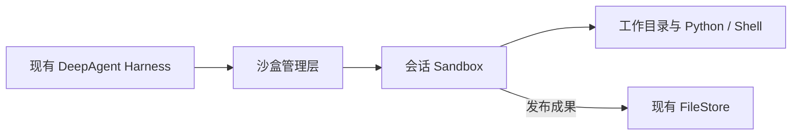

# 会话级 Sandbox：产品与架构讨论

更新：2026-09-25。状态：研究讨论，未开发、未部署候选运行时。本文区分用户已澄清的需求、助手建议和待验证能力；当前行为仍见本课题 README。

## 1. 给研发的产品描述

给 DeepAgent 增加会话级沙盒。Agent 需要处理文件、运行 Python 或 Shell 时按需获得执行环境，同一会话后续调用在环境有效期内复用工作目录。环境可以到期清理，用户应被明确告知临时文件已不可用；正式交付文件通过现有 FileStore 保存，按文件服务自身规则保留。

核心是正在进行的任务能连续工作。用户没有要求历史会话工作目录永久保留，也没有要求关掉计算资源后恢复全部进程和内存。保留多久、是否支持休眠恢复，允许根据技术实现和资源成本妥协。此前将“工作区随会话长期持久化”当成硬要求的表述不再作为实施依据。

## 2. 简单架构与概念

| 概念 | 产品含义 | 边界 |
| --- | --- | --- |
| Session | 用户对话及运行记录 | 历史仍存在，不代表临时环境仍存在 |
| Sandbox | 分配给会话使用的隔离执行环境 | 提供计算、进程、网络与文件操作；有有效期 |
| Workspace | 执行环境中的工作目录 | 有效期内保持连续；首版不必独立建设永久工作区产品 |
| 环境模板 | 预装语言、依赖、命令和资源的版本化环境 | 不需要每次会话重新制作；运行时安装依赖的保留策略需明确 |
| Execution | 一次命令或脚本执行 | 单独有超时、取消、输出与状态 |
| Worker | 接收或管理执行工作的服务进程 | 实现层术语，不等于子 Agent，也不等于会话沙盒 |
| Artifact | 已发布给用户的成果文件 | 与临时目录分开保留，不承诺永久保存 |

Harness 继续负责模型、会话、工具授权、Skill 和 MCP。远程业务 MCP 不必复制到沙盒；本地执行依赖和已授权 Skill 脚本可以进入环境。Monty/PTC 保持现有受控 MCP 编排职责，不因此获得任意 Shell 或宿主访问能力。

## 3. 生命周期建议

建议首版：首次需要执行时创建 → 同一会话后续调用复用 → 空闲到期销毁 → 再次需要时新建并明确返回已过期状态。Agent 可以主动申请使用或释放，但不能依赖模型记得关机；首次执行自动创建可减少一次模型工具调用。

管理层保留会话与 sandbox_id 的授权绑定。ID 是查找环境的索引，不是恢复数据的魔法，也不能只凭模型给出的 ID 跨用户连接环境。

系统分别管理：

- 单次执行超时：限制一条命令的占用时间。
- 空闲超时：没有执行中的工作且持续未使用时回收；不能把正在执行长命令判成空闲。
- 最长保留期：兜底限制环境存在时间；到期时停止执行并清理的规则需要明确。

具体时长作为配置，尚未确定默认值。失败、取消、主动释放、后台清理与会话删除都应有明确状态，不能宣称文件已保留但实际已经销毁。同一沙盒的写操作先串行是助手建议，尚未批准为实现约束。

## 4. 复用、恢复与过期

| 实际状态 | 同一个 ID 再次请求的含义 |
| --- | --- |
| 仍在运行 | 连接原环境继续执行 |
| 已休眠且状态仍保留 | 服务端找到快照或持久存储，恢复后执行 |
| 已过期并清理 | 返回已过期；新建环境不意味着原文件自动回来 |

可选技术路线有两类：持久卷保留目录、按需重建计算环境；或保存文件系统/虚拟机快照后恢复。它们都仍有存储成本。是否保留 Python 变量、后台进程、已安装依赖，必须逐项定义，不用“环境恢复”笼统承诺。

第一阶段建议不强制实现休眠恢复。若选定服务已有成熟能力，再比较实际保存/恢复耗时、存储、隔离和运维成本。长会话重开后的持久目录不是首版验收门槛。

## 5. 研究结论与证据

下列官方资料于 2026-09-16 查阅；未本地部署、压测或验收。主流架构可归纳为环境模板、隔离执行、生命周期管理与可选持久状态，未据此认定某一个项目拥有最高市场占有率。

| 项目 | 参考价值与实际边界 |
| --- | --- |
| [OpenSandbox](https://github.com/opensandbox-group/OpenSandbox) | 统一生命周期、命令、文件和代码执行接口，Docker/Kubernetes 接入候选；并不自动完成 DeepAgent 会话权限和产物治理 |
| [Kubernetes agent-sandbox](https://github.com/kubernetes-sigs/agent-sandbox) | 集群中的稳定身份、持久存储、模板和预热池；不是所有私有集群都自带内存恢复，自动唤醒应按具体版本验收 |
| [E2B Runtime](https://github.com/e2b-dev/runtime) | Firecracker 运行环境、执行接口、持久卷和快照参考；Embed 官方明确为评估包，不是生产部署模式 |
| [AIO Sandbox](https://github.com/agent-infra/sandbox) | 浏览器、Shell、文件、Jupyter 等共享文件系统的环境参考；集成软件不等于已经证明多租户强隔离 |
| [BoxLite](https://github.com/boxlite-ai/boxlite) | 可嵌入的虚拟化执行环境候选；Linux 需 KVM，客户部署条件要先核验 |
| [DeerFlow](https://github.com/bytedance/deer-flow) | 上传、工作目录、跨步骤处理和产物展示的产品参考，不整体替换现有 Harness |

### Pydantic AI Harness 的现成沙箱支持

2026-09-16 核验：官方 Harness 当前开箱即用的完整容器沙箱集成仅有 **Modal 云沙箱**，未见内置本地 Docker、Kubernetes、OpenSandbox 等适配器。它另有本地 Shell / FileSystem 能力，但这些本身不提供容器隔离；Monty 也不是完整 Linux 工作环境。私有化可参考 Modal 集成的命令执行、文件读写与生命周期接口，增加自有沙箱适配器及会话绑定管理；不能只替换服务地址，也不代表 DeepAgent 已接入。参考：[官方执行能力](https://pydantic.dev/docs/ai/harness/)、[Modal Sandbox](https://pydantic.dev/docs/ai/harness/modal-sandbox/)。

### D06 后续吸收范围（2026-09-25）

用户明确：本项目要做本地／自托管沙盒，**不接 Modal 云后端**；D06 作为潜力待办，等本地沙盒具备基础能力后按需补齐。不是重新启动一套云沙盒选型，也不把本地宿主 Shell 当成隔离后端。

- 设计阶段可提前参考：会话与执行环境的绑定、跨 Run 复用、命令超时及取消、连接与销毁的职责划分，避免后续补工具时接口不兼容。
- 落地后按缺口吸收：FileSystem/Shell 工具分工、文件变化事件、读取与输出上限、后台命令状态和结果获取。先核对实际需要，不为与上游功能列表一致而全部实现。
- 原有会话权限、附件授权、FileStore、产物发布、空闲回收与过期提示仍由产品负责；官方工具约定不会自动提供这些保证。

本轮只记录参考方向，未接入新能力。统一待办为 `D06-SANDBOX-REFERENCE`，基础开发仍归 `SANDBOX-001`。

需保留的限制：

- OpenSandbox 内置 egress sidecar 的域名控制与 gVisor 存在兼容限制；不能直接将“OpenSandbox + gVisor + 内置网络策略”作为已验证组合。[官方指南](https://github.com/opensandbox-group/OpenSandbox/blob/main/docs/guides/secure-container.md#5-egress-sidecar-incompatible-with-gvisor)
- OpenSandbox Kubernetes 默认 Rootfs 快照恢复文件系统，不恢复运行进程/内存；另有可选 QEMU 模式，不能混为同一种保证。[暂停恢复](https://github.com/opensandbox-group/OpenSandbox/blob/main/docs/guides/pause-resume.md#what-is-preserved)
- Claude API 对外提供 container ID 复用、空闲检查点和有效期内恢复；接口说明不能证明完整底层实现，也不能推导聊天产品永久保留环境。[容器复用](https://platform.claude.com/docs/en/agents-and-tools/tool-use/code-execution-tool#container-reuse)
- [Daytona](https://github.com/daytonaio/daytona#readme) 公告核心开发迁私有、公开仓库停止维护；[AgentScope Runtime](https://github.com/agentscope-ai/agentscope-runtime) 公告能力并入 AgentScope 2.0、独立仓库将归档，不按旧资料当作独立活跃开源选项推荐。

OpenSandbox 是当前建议优先验证的候选，不是已经选定的技术栈。用户无需先决定所有存储/隔离细节，实施方应拿实际环境成本与最小验证结果支撑选择。

## 6. 与定时任务的关系

定时任务负责“什么时候启动一次 Agent 工作”，Sandbox 负责“这次工作在哪里执行”。定时任务不以本课题落地为前提；只调用现有 MCP 的定期查询可以先实现。需要脚本/文件时再按需申请沙盒，不为定时等待常驻计算环境，也不默认跨周期共享前一次沙盒。

统一未完成事项见 [TODO.md](../TODO.md) 的 `SANDBOX-001`，定时设计见 [26 号课题](../26-scheduled-tasks/README.md)。

## v0.14.7 PTC 接入边界

本版仅让已装配的 Python、Skill、Web Search/Fetch 和下载中心导出可同时从普通工具与 PTC 调用；Python/Skill 继续使用现有后端和原参数。PTC 内部结果绕过模型展示用的大结果包装，普通调用及外层返回仍执行保护。

不引入工作区、会话沙盒、保存中间变量工具或 Skill 文件接口。未来沙盒接入需要另行设计和验收，不因本版 PTC 扩展自动启动或持久化沙盒。固定资源限制及交接流程见 [PTC 数据交接设计](../20-code-mode/ptc-data-transfer-design.md)；它们不替代 Python 后端自己的资源限制。
