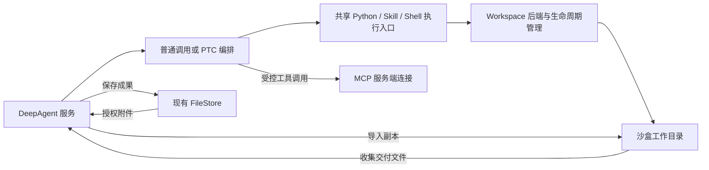

# 会话级 Sandbox：产品与架构讨论

更新：2026-10-24。状态：**设计讨论；会话级方案未合入当前 `test`，未完成产品验收。** 同事沙盒分支已有候选实现，不等于本课题已经采纳；本轮不合分支、不升级依赖、不修改代码或部署。本文区分当前行为、已确认方向和待定细节；当前行为仍见本课题 README，最新讨论见第 7 节。

## 1. 给研发的产品描述

给 DeepAgent 增加会话级沙盒。Agent 需要处理文件、运行 Python 或 Shell 时按需获得执行环境，同一会话后续调用在环境有效期内复用工作目录。环境可以到期清理，用户应被明确告知临时文件已不可用；正式交付文件通过现有 FileStore 保存，按文件服务自身规则保留。

核心是正在进行的任务能连续工作。用户没有要求历史会话工作目录永久保留，也没有要求关掉计算资源后恢复全部进程和内存。保留多久、是否支持休眠恢复，允许根据技术实现和资源成本妥协。此前将“工作区随会话长期持久化”当成硬要求的表述不再作为实施依据。

## 2. 简单架构与概念



| 概念 | 产品含义 | 边界 |
| --- | --- | --- |
| Session | 用户对话及运行记录 | 历史仍存在，不代表临时环境仍存在 |
| Sandbox | 分配给会话使用的隔离执行环境 | 提供计算、进程、网络与文件操作；有有效期 |
| Workspace | 执行环境中的工作目录 | 有效期内保持连续；首版不必独立建设永久工作区产品 |
| 环境模板 | 预装语言、依赖、命令和资源的版本化环境 | 不需要每次会话重新制作；运行时安装依赖的保留策略需明确 |
| Execution | 一次命令或脚本执行 | 单独有超时、取消、输出与状态 |
| Worker | 接收或管理执行工作的服务进程 | 实现层术语，不等于子 Agent，也不等于会话沙盒 |
| Artifact | 已发布给用户的成果文件 | 与临时目录分开保留，不承诺永久保存 |

Harness 继续负责模型、会话、工具授权、Skill 和 MCP。远程业务 MCP 不必复制到沙盒；本地执行依赖和已授权 Skill 脚本可以进入环境。PTC 通过工具入口组织业务查询和执行，不因此直接取得宿主文件、凭据或任意 Shell 权限。图中是目标架构；v0.14.7 的 PTC 已能调用现有 Python／Skill 工具，但尚无上述共享工作区，也未开放 Shell。当前工具范围见第 7.4 节。

## 3. 生命周期建议

建议首版：首次需要执行时创建 → 同一会话后续调用复用 → 空闲到期销毁 → 再次需要时新建并明确返回已过期状态。Agent 可以主动申请使用或释放，但不能依赖模型记得关机；首次执行自动创建可减少一次模型工具调用。

管理层保留会话与 sandbox_id 的授权绑定。ID 是查找环境的索引，不是恢复数据的魔法，也不能只凭模型给出的 ID 跨用户连接环境。

系统分别管理：

- 单次执行超时：限制一条命令的占用时间。
- 空闲超时：没有执行中的工作且持续未使用时回收；不能把正在执行长命令判成空闲。
- 最长保留期：兜底限制环境存在时间；到期时停止执行并清理的规则需要明确。

具体时长作为配置，尚未确定默认值。失败、取消、主动释放、后台清理与会话删除都应有明确状态，不能宣称文件已保留但实际已经销毁。同一沙盒的写操作先串行是助手建议，尚未批准为实现约束。

## 4. 复用、恢复与过期

| 实际状态 | 同一个 ID 再次请求的含义 |
| --- | --- |
| 仍在运行 | 连接原环境继续执行 |
| 已休眠且状态仍保留 | 服务端找到快照或持久存储，恢复后执行 |
| 已过期并清理 | 返回已过期；新建环境不意味着原文件自动回来 |

可选技术路线有两类：持久卷保留目录、按需重建计算环境；或保存文件系统/虚拟机快照后恢复。它们都仍有存储成本。是否保留 Python 变量、后台进程、已安装依赖，必须逐项定义，不用“环境恢复”笼统承诺。

第一阶段建议不强制实现休眠恢复。若选定服务已有成熟能力，再比较实际保存/恢复耗时、存储、隔离和运维成本。长会话重开后的持久目录不是首版验收门槛。

## 5. 研究结论与证据

下列官方资料于 2026-09-16 查阅；未本地部署、压测或验收。主流架构可归纳为环境模板、隔离执行、生命周期管理与可选持久状态，未据此认定某一个项目拥有最高市场占有率。

| 项目 | 参考价值与实际边界 |
| --- | --- |
| [OpenSandbox](https://github.com/opensandbox-group/OpenSandbox) | 统一生命周期、命令、文件和代码执行接口，Docker/Kubernetes 接入候选；并不自动完成 DeepAgent 会话权限和产物治理 |
| [Kubernetes agent-sandbox](https://github.com/kubernetes-sigs/agent-sandbox) | 集群中的稳定身份、持久存储、模板和预热池；不是所有私有集群都自带内存恢复，自动唤醒应按具体版本验收 |
| [E2B Runtime](https://github.com/e2b-dev/runtime) | Firecracker 运行环境、执行接口、持久卷和快照参考；Embed 官方明确为评估包，不是生产部署模式 |
| [AIO Sandbox](https://github.com/agent-infra/sandbox) | 浏览器、Shell、文件、Jupyter 等共享文件系统的环境参考；集成软件不等于已经证明多租户强隔离 |
| [BoxLite](https://github.com/boxlite-ai/boxlite) | 可嵌入的虚拟化执行环境候选；Linux 需 KVM，客户部署条件要先核验 |
| [DeerFlow](https://github.com/bytedance/deer-flow) | 上传、工作目录、跨步骤处理和产物展示的产品参考，不整体替换现有 Harness |

### Pydantic AI Harness 的现成沙箱支持

2026-09-16 的研究快照仅核对到 Modal 云沙箱，**不再据此判断新版官方能力**。2026-10-24 已核对：统一 Workspace 接口始于 Core `2.52.0`／Harness `0.52.0`，文件与命令工具通过 `ctx.workspace` 使用本机或沙盒后端；官方 Docker／Podman 后端始于 `2.60.0`／`0.60.0`。产品当前仍固定 Core `2.46.0`／Harness `0.32.0`／Monty `0.0.23`，不能把新版文档当成已安装能力。

后续以新版官方接口规范为接入依据，缺少的 DeepAgent 附件、权限和产物治理在边界包装；不先自创另一套完整工具规范。本地／自托管方向保持，不因参考 Modal 而改接云服务。统一接口与隔离后端是两件事：本地 Workspace 不自动提供容器隔离，Monty 也不是完整 Linux 工作环境。依赖候选及兼容性由 [38 课题](../38-pydantic-ai-harness-upgrade/README.md) 单独验证，本轮没有升级。参考：[2.52 发布说明](https://github.com/pydantic/pydantic-ai/releases/tag/v2.52.0)、[2.60 发布说明](https://github.com/pydantic/pydantic-ai/releases/tag/v2.60.0)、[Workspace 规范](https://pydantic.dev/docs/ai/core-concepts/workspace/)。

### D06 后续吸收范围（2026-09-25）

用户明确：本项目要做本地／自托管沙盒，**不接 Modal 云后端**；D06 作为潜力待办，等本地沙盒具备基础能力后按需补齐。不是重新启动一套云沙盒选型，也不把本地宿主 Shell 当成隔离后端。

- 设计阶段可提前参考：会话与执行环境的绑定、跨 Run 复用、命令超时及取消、连接与销毁的职责划分，避免后续补工具时接口不兼容。
- 落地后按缺口吸收：FileSystem/Shell 工具分工、文件变化事件、读取与输出上限、后台命令状态和结果获取。先核对实际需要，不为与上游功能列表一致而全部实现。
- 原有会话权限、附件授权、FileStore、产物发布、空闲回收与过期提示仍由产品负责；官方工具约定不会自动提供这些保证。

本轮只记录参考方向，未接入新能力。统一待办为 `D06-SANDBOX-REFERENCE`，基础开发仍归 `SANDBOX-001`。

需保留的限制：

- OpenSandbox 内置 egress sidecar 的域名控制与 gVisor 存在兼容限制；不能直接将“OpenSandbox + gVisor + 内置网络策略”作为已验证组合。[官方指南](https://github.com/opensandbox-group/OpenSandbox/blob/main/docs/guides/secure-container.md#5-egress-sidecar-incompatible-with-gvisor)
- OpenSandbox Kubernetes 默认 Rootfs 快照恢复文件系统，不恢复运行进程/内存；另有可选 QEMU 模式，不能混为同一种保证。[暂停恢复](https://github.com/opensandbox-group/OpenSandbox/blob/main/docs/guides/pause-resume.md#what-is-preserved)
- Claude API 对外提供 container ID 复用、空闲检查点和有效期内恢复；接口说明不能证明完整底层实现，也不能推导聊天产品永久保留环境。[容器复用](https://platform.claude.com/docs/en/agents-and-tools/tool-use/code-execution-tool#container-reuse)
- [Daytona](https://github.com/daytonaio/daytona#readme) 公告核心开发迁私有、公开仓库停止维护；[AgentScope Runtime](https://github.com/agentscope-ai/agentscope-runtime) 公告能力并入 AgentScope 2.0、独立仓库将归档，不按旧资料当作独立活跃开源选项推荐。

OpenSandbox 是早期建议优先验证的候选，不是已经选定的技术栈。2026-10-24 的接入方向以新版 Pydantic AI Workspace 规范为准，具体隔离后端仍须结合部署条件验证；不能沿用旧研究直接选定，也不能把同事分支的自定义工具当成已经认可的新规范。用户无需先决定所有存储/隔离细节，实施方应拿实际环境成本与最小验证结果支撑选择。

## 6. 与定时任务的关系

定时任务负责“什么时候启动一次 Agent 工作”，Sandbox 负责“这次工作在哪里执行”。定时任务不以本课题落地为前提；只调用现有 MCP 的定期查询可以先实现。需要脚本/文件时再按需申请沙盒，不为定时等待常驻计算环境，也不默认跨周期共享前一次沙盒。

统一未完成事项见 [TODO.md](../TODO.md) 的 `SANDBOX-001`，定时设计见 [26 号课题](../26-scheduled-tasks/README.md)。

## 7. PTC、脚本和文件进出的最新边界（2026-10-24）

### 7.1 已确认方向与当前实现

目标是一个有效期内可复用的执行环境：Python、Skill 脚本与 Shell 共享工作目录，PTC 按需要组织工具和执行步骤。**附件导入、成果收集由 Agent 服务负责；沙盒内代码主要读写工作区文件。** 不把每份中间数据上传平台，不让每个执行工具分别实现一套平台读写。

当前 `test / v0.14.7` 仍使用一次性 Python 子进程；PTC 已保留 MCP 原生与程序入口，并接入当前已装配的 Python／Skill、Web 和下载中心工具，`load_file_data` 仍为代码内辅助函数。工具扩展不创建会话级工作区。此前核对到的 `origin/sandbox-new-backend / f8ac758` 有自定义 Workspace 服务和执行后端，但未合并、未完成本课题验收；该 SHA 仅表示当时的候选快照。本节记录产品边界，不认可该分支的全部默认行为、工具命名、资源分配或自动注入规则。

| 层 | 负责什么 | 不因此获得什么 |
| --- | --- | --- |
| PTC／Monty | 调用已授权函数，循环、筛选、聚合、组织依赖 | 不直接访问宿主目录、任意网络、平台凭据或完整 CPython 第三方库 |
| Python／Skill／Shell | 在选定执行环境处理文件、计算和生成报告 | 不自动获得 MCP 客户端、平台身份或平台上传能力 |
| 沙盒与工作目录 | 执行隔离、有效期内文件连续性、执行与环境回收 | 不承诺销毁后恢复内存或全部临时文件 |
| Agent 服务／Harness | 授权、MCP 连接、附件导入、成果收集、文件引用和业务发布 | 不把中间数据或配置复制成新的会话事实源 |
| FileStore | 原始附件、Skill 原包及明确保存的成果 | 不是每份临时 JSON 的默认落点；按其自身保留规则管理 |

MCP 可以由模型普通调用，也可以由 PTC 经服务端工具桥调用。沙盒中自装 MCP 客户端在技术上并非不可能，但本方案不要求这样做，不向脚本发放平台 Token。PTC 与普通调用复用原授权和分发，不创建另一套业务连接。

### 7.2 附件导入与中间数据

- 首次需要文件时，Agent 服务按当前用户、会话和 Agent 授权，从 FileStore 读取被选中的附件，使用执行后端的文件接口送入工作目录。不是每次打开会话就创建沙盒、下载全部附件。
- 后续可以补充导入；同一有效工作区中的文件可供多次执行复用。平台原件不随沙盒清理而删除，过期后需要按原授权重新导入，不能返回看似仍可用的旧路径。
- Python、Shell 和 Skill 复用同一附件准备流程。现有 `execute_python(files=...)` 可以作为兼容入口，具体是否继续使用 `input_path(file_id)` 取路径属于适配细节，不再另写一套下载器。
- MCP 返回首先进入 PTC 程序变量。小数据可直接传 `inputs`；需要文件时，通过受控 Workspace 写入接口序列化到沙盒 JSON，再由脚本按路径读取。Monty 不直接 `open()` 宿主或另一个环境的目录。
- **不新增将 PTC 变量上传平台的 `save_file_data`。** 工作区写文件和平台保存文件是两个动作，不能用同一个模糊接口暗中切换存储位置及有效期。
- 现有 PTC `load_file_data` 保留为小型原样中转辅助函数：读取授权 File ID 或公开 URL，返回 Run 级不透明二进制载荷句柄或文本；它不是沙盒导入协议，也不承担新建平台文件。
- 当前无沙盒共享目录时，仍只能按现有 Python 文件输入／输出能力处理；不能把本节未来的工作区交接写成近期 PTC 扩展已经具备的能力。

### 7.3 输出目录、平台文件与下载中心

用户认可采用明确的输出目录作为成果交付方向。拟由执行服务向进程提供 `OUTPUT_DIR`，代码将需要交付的文件放入该目录；工作区其他文件继续作为临时文件。实际路径由后端分配，模型和 Skill 不应写死宿主路径。这个变量由执行服务设置，不等于新增部署配置项。

```text
平台附件 ──授权导入──> 沙盒工作目录
MCP 返回 ──程序写入──> 工作区 actuals.json
                             ↓ Python／Skill／Shell
                      临时计算与待交付报告
                             ↓ 明确放入 OUTPUT_DIR
                       Agent 服务收集、校验、上传
                             ↓
                      平台 file_id／会话成果引用
                             ↓ 按用户任务需要
                      下载中心登记或渠道发送
```

写入交付目录代表选定要交付的文件，不扫描整个工作目录自动上传。平台鉴权、上传和成果引用由服务端执行，Python 不需要内置平台客户端。是否为老脚本保留 `publish_path()` 薄封装、收集目录的层级与文件名规则，需在兼容设计中确定，不在本次讨论里删除已有接口。

必须区分两种收集时序；**本轮未锁定其中一种为最终实现**：

| 收集边界 | 平台 File ID 什么时候可用 | 对 PTC 的影响 |
| --- | --- | --- |
| 一次 Python／命令执行结束，返回前收集 | 该执行工具返回上传成功的文件引用后 | 同一段 PTC 后续可以把真实 File ID 交给下载中心工具 |
| 整段 PTC 结束后统一收集 | 外层收集上传完成后 | PTC 内部末尾只有工作区路径；不能假设已经有 File ID，需要在外层发布 |

不为把下载中心工具塞进 PTC 而强制中途上传。下载中心登记与平台持久保存是两个动作；当前 `export_file_to_download_center` 支持已有 `platform_file + file_id`，也支持 `content` 新建 UTF-8 文本并发布。开放给 PTC 有已有文件或文本导出的场景，但不意味着它已经支持沙盒路径，或每段 PTC 都必须调用它。平台已有 File ID 时只复用文件，不重复上传。

平台只在实际上传成功后返回正式文件引用；生成了路径、脚本结束或文件进入交付目录均不等于已经保存成功。收集失败、取消、上传确认丢失与重复收集的处理必须单独验收，不能伪造 File ID、返回假成功或盲目重传。已发布成果按 FileStore 生命周期保留，临时工作区按沙盒生命周期回收。

### 7.4 近期 PTC 扩展与沙盒改造分开实施

v0.14.7 已接入现有 Python／Skill 执行入口，不以会话级沙盒或框架升级完成为前提。下表为已发布的工具范围；不按此前草案额外增加辅助工具：

| 工具 | 普通原生入口 | PTC 内部入口 | 保留的条件 |
| --- | --- | --- | --- |
| MCP | 保留 | 保留 | 当前 Agent 授权，且工具已经披露 |
| `web_search`／`web_fetch` | 保留 | 已实现 | 原 Web 授权、供应商和网络规则 |
| `execute_python`／`execute_skill_script` | 保留 | 已实现 | 原执行权限、Skill 选择及脚本索引；共用执行实现 |
| `export_file_to_download_center` | 保留 | 已实现，显式调用 | 原用户／App／Space 和来源授权；输入确实有 File ID 或文本 |
| `load_file_data` | 维持代码内辅助函数，无普通入口 | 保留 | 原文件／URL 授权、读取上限与不透明载荷规则 |

不因启用 PTC 而移除原生 Schema、强迫所有工具走代码或扩大授权。`read_file`、`parse_document`、UI／Deferred、工具发现、计划与输出控制不随本次进入 PTC；任意 Shell 也不在近期新增白名单。沙盒未来的工作区／命令工具接入另按官方规范和实际需要确定。

所有 PTC 内部开放函数统一绕过平台给模型用的大结果外置、截断和分页，完整值交给程序；普通调用以及外层 `run_code` 给模型的最终返回仍受原大结果保护。数据源正式分页、工具自身输入／输出限制及安全规则不变，不做通用自动分页，也不把超限失败伪装成成功的分页提示。

PTC 已确认默认值仍为 Monty 内存 256 MiB、单次内部返回 32 MiB、执行预算及单段实际总超时 120 秒、每段最多 100 次内部调用，先不做配置项。它们不是完整 CPython／沙盒的资源配置，不能据此放大执行工具本身的预算。超过硬限明确失败，不能先无限接收，再依赖落盘补救。

这里仅规定工具入口与后端解耦：PTC 调用同一工具，后续沙盒适配该工具内部的执行和文件准备。不是承诺未来零适配；Workspace 生命周期、取消、超时及 SDK 自定义包装仍要验证。前一版 [PTC 数据交接草案](../20-code-mode/ptc-data-transfer-design.md) 中新增平台 `save_file_data` 的链路已撤回，不作为实施依据。

### 7.5 两种执行方式与依赖示例

例：附件 `预算.xlsx` 决定部门／月份，MCP 查询对应实际费用，报告脚本同时依赖预算表和查询返回。

```text
分段：导入附件 → Python 提取查询条件 → 查询并写工作区 JSON
      → 返回小摘要和工作区路径 → 普通调用 Python／Skill 生成报告

整段：附件导入准备完成
      → 一次 run_code 中：Python 提取条件 → MCP 查询 → 写工作区 JSON
        → Python／Skill 读取预算表和 JSON → 生成交付文件
```

两种都允许；同一有效工作区提供文件连续性，不依赖 PTC 内存跨 Run 存活。一次 `run_code` 不等于整个对话，也不保证只发生一次 HTTP 往返。模型可以先根据已确认的文件和返回结构编写脚本，运行时再读取完整数据，不需要把整份 JSON抄进代码；结构未知时先查小样本和正式定义。

### 7.6 外部参考及尚待确定的细节

以下仅为官方接口参考，不表示选用其云服务或已验收其底层隔离实现：

| 参考 | 本次核对的事实 |
| --- | --- |
| [Anthropic 附件与成果](https://platform.claude.com/docs/en/agents-and-tools/tool-use/code-execution-tool#work-with-files) | 应用经 Files API 上传，并在消息中使用 `container_upload`；不是容器 Python 自己调用导入函数。每次 Bash 执行提供新的 `$OUTPUT_DIR`，收集顶层文件，其他文件留容器；这是按执行收集的一个参考，不自动成为我方最终时序 |
| [Anthropic PTC](https://platform.claude.com/docs/en/agents-and-tools/tool-use/programmatic-tool-calling) | PTC 本身可在容器运行 Python，调用外部函数时暂停并由应用回传结果，之后继续计算；不只用于请求工具，也不强制先创建 `.py`。原生 MCP connector 工具目前不能直接被 PTC 调用，需由应用提供转接工具 |
| [OpenAI PTC](https://developers.openai.com/api/docs/guides/tools-programmatic-tool-calling#agents-api) | JavaScript 编排不改变工具实际执行位置；Shell 命令仍由执行环境运行。本会话本地 Codex 返回本机文件路径，不等于所有 OpenAI 产品没有交付目录规范 |
| [OpenAI 托管 Shell](https://developers.openai.com/api/docs/guides/tools-shell#hosted-runtime-details) | `/mnt/data` 是其支持的用户可下载成果位置；我方不照抄为宿主路径 |
| [Modal 文件接口](https://modal.com/docs/guide/sandbox-files) | 应用可通过 SDK 在沙盒内外传文件；是否保存到自身平台属于应用责任，不要求脚本携带平台凭据 |

尚待确定：具体官方后端及版本组合、按需创建／复用与显式释放接口、环境回收时长和部署资源成本、收集采用执行边界还是 PTC 边界、输出目录及失败产物规则、老 Python／Skill 文件接口兼容方式。这些是后续实施决策，不代表本轮自动新增配置项或数据库结构。

验收应覆盖附件授权和导入去重、同目录内分段／PTC整段执行、双入口与大结果边界、文件引用产生时序、正常／失败／取消后的成果收集、重复发布、沙盒过期与跨用户隔离；平台已保存文件不随工作区回收误删。具体任务继续归统一台账 `SANDBOX-001`，本页不重复维护另一份任务状态。

## v0.14.7 PTC 接入边界

本版仅让已装配的 Python、Skill、Web Search/Fetch 和下载中心导出可同时从普通工具与 PTC 调用；Python/Skill 继续使用现有后端和原参数。PTC 内部结果绕过模型展示用的大结果包装，普通调用及外层返回仍执行保护。

不引入工作区、会话沙盒、保存中间变量工具或 Skill 文件接口。未来沙盒接入需要另行设计和验收，不因本版 PTC 扩展自动启动或持久化沙盒。固定资源限制及交接流程见 [PTC 数据交接设计](../20-code-mode/ptc-data-transfer-design.md)；它们不替代 Python 后端自己的资源限制。
