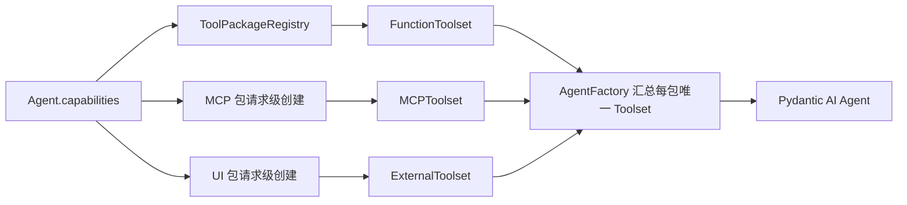

# DeepAgent 工具包与工具目录设计

> 实施状态：v0.3.2已按本文完成；v0.3.18起Skill已从ToolPackage分离；v0.3.23起文件读取是自动注入的系统工具；v0.4.4～v0.4.5删除已下线的预制MCP，当前数据库head为006。

## 1. 目标与边界

本方案解决三个长期混淆：产品页面展示什么、Agent 保存什么、Pydantic AI 最终运行什么。

统一层级为：

```text
category（分类属性）
  → Tool Package（产品配置和 Agent 选择单位）
    → Toolset（Pydantic AI 运行对象，可静态或请求级创建）
      → Tool（模型看到并调用的稳定协议）
```

分类只用于目录分组，不新增分类类或数据库表。Agent 在 v0.3.2 仍然选择整个工具包，不提供包内
工具授权。Output Tool 是本轮 Run 的终止契约，不属于工具包，也不进入
`agents.capabilities`。

## 2. 三个相邻概念

### 2.1 Tool Package

DeepAgent 产品概念，承担：

- 稳定包编码、分类、中文名称、来源和说明。
- 默认启用状态和包级可用状态。
- Console 目录与 Agent 配置选择。
- 工具数量及可用工具目录。
- 恰好一个预定义 Toolset，或请求级创建该 Toolset 所需的元数据。

原自研 `Capability`/`CapabilityRegistry` 改名为 `ToolPackage`/`ToolPackageRegistry`，避免与
Pydantic AI 同名概念混淆。

### 2.2 Toolset

Pydantic AI 运行对象，负责把工具定义交给模型并执行或转发调用。它既可以在启动时定义，也可以
根据当前 Agent、MCP 配置、用户 Header 或 UI 数据库成员在请求时创建。一个 Tool Package
严格包装一个 Toolset；AgentFactory 只负责汇总所选包各自的单个 Toolset。

### 2.3 AbstractCapability

Pydantic AI 的运行扩展，负责 History Processor、Hook、重试、模型设置等横切行为。DeepAgent
上下文压缩继续使用这一层，不进入工具目录，也不因本次产品改名而改变。DeepSeek V4 已在
v0.3.9 改由 Pydantic AI 官方 Provider/Profile 处理，不再保留项目自定义重试能力。

## 3. 工具包目录

| category | code | label | 来源 | 默认 | 工具 |
| --- | --- | --- | --- | --- | --- |
| `builtin` | `builtin:general` | 通用工具 | code | 开 | `get_current_time` |
| `builtin` | `builtin:sandbox` | Python 沙箱 | code | 关 | `execute_python`、条件式 `execute_skill_script` |
| `mcp` | `mcp:<name>` | MCP 配置名称 | builtin/database | 关 | URL 检测快照 / Builtin 运行时发现 |
| `ui` | `ui:builtin` | 通用交互 | code | 关 | `builtin__confirm`、`builtin__choice` |
| `ui` | `ui:deepcube` | DeepCube 助手 | database | 关 | `deep_cube__clarify`、`deep_cube__config_fill` |

`builtin:general` 和 `builtin:sandbox` 是两个独立包级开关。文件读取不属于 ToolPackage；
`read_file` 根据当前会话附件或 Agent 已选 Skill 自动注入。Python Sandbox 后端不可用时，
`builtin:sandbox` 不进入可选目录。`execute_skill_script` 只作为管理员可见的条件式工具元数据；
运行时还必须选择含脚本Skill并启用 `builtin:sandbox`才注入模型。

## 4. 编码和稳定协议

- 包编码只用于 Agent 配置和目录：`builtin:*`、`mcp:*`、`ui:*`。
- 工具协议名继续用于模型调用、SSE、历史、Pending 与恢复。
- Console 展示名是独立元数据，不使用 `RenamedToolset` 做纯 UI 美化。
- URL MCP 名称是可维护的稳定编码，但不能作为普通字段直接修改。独立重命名操作在同一事务中
  迁移 MCP 主键和全部 Agent 工具包引用；不改写历史工具协议名，也不重新检测远端服务。
- 不保留旧 `native`、`python-sandbox`、`attachment`、`ui:<tool_name>` 运行兼容分支。
- 旧数据由 Alembic 002完成工具包转换，004从显式 Agent能力中删除已废弃的
  `builtin:attachment`；未知 UI 引用必须阻止002迁移。
- Alembic 005和006依次删除已下线的预制MCP Server记录及对应能力引用，不改写历史工具调用。

## 5. 数据库

新增 `ui_tool_packages`：

| 字段 | 约束 | 说明 |
| --- | --- | --- |
| `code` | PK | `ui:<业务编码>` |
| `label` | 非空 | Console 名称 |
| `description` | 可空 | 包说明 |
| `source` | 非空 | 首版数据库记录固定 `manual` |
| `enabled` | 非空 | 包级可用状态 |
| `created_at` / `updated_at` | 非空 | 审计时间 |

`ui_tool_definitions` 新增非空 `package_code`，外键指向 `ui_tool_packages.code`，删除策略
`RESTRICT`，并建立查询索引。代码内置 `ui:builtin` 不落库；数据库只管理手工 UI 包。

## 6. Alembic 002

升级顺序：

1. 创建包表并为工具表增加临时可空 `package_code`。
2. 确认现有手工工具只有两个 DeepCube 工具，创建 `ui:deepcube` 并归包。
3. 检查不存在未归包工具、未知 UI 引用或错误外键。
4. 将 `package_code` 改为非空并建立外键和索引。
5. 一次性重写 Agent 配置：
   - `native` → `builtin:general`。
   - `python-sandbox` → `builtin:sandbox`。
   - `attachment` → `builtin:attachment`。
   - 两个 DeepCube 单工具引用 → `ui:deepcube`。
   - confirm/choice 单工具引用 → `ui:builtin`。
   - `mcp:*`、`skill:*`、`null` 和 `[]` 在 002 中保持语义；003 会在迁移前拒绝遗留
     `skill:*`，由管理员先明确迁移到独立 `agents.skills`。

降级时先按当前包成员展开旧工具引用，再删除外键、字段和包表。迁移覆盖 SQLite、MySQL、
PostgreSQL；共享 Test 必须先用 001 工具备份，部署 002 后再用新版工具备份。

## 7. 运行装配



不新增统一 Resolver 抽象。沿用现有构建过程：静态包从 Registry 取 Toolset，MCP 按配置创建，
UI 按数据库包成员创建，最后由 AgentFactory 汇总。UI 包无启用且 Schema 有效的成员时不向模型
暴露空工具，并记录诊断。

## 8. API

`GET /api/v1/tools` 直接返回统一工具包目录：

```json
{
  "code": "builtin:general",
  "category": "builtin",
  "label": "通用工具",
  "source": "builtin",
  "description": "...",
  "enabled": true,
  "default_enabled": true,
  "tool_count": 1,
  "tool_catalog_status": "complete",
  "tools": [
    {
      "name": "get_current_time",
      "display_name": "获取当前时间",
      "description": "...",
      "execution_type": "function",
      "enabled": true
    }
  ]
}
```

v0.3.19 起 URL MCP的检测快照保存完整工具定义，运行时据此完成 Tool Search和Schema披露；
`GET /tools`与Console仍只返回管理员需要的数量、快照状态和披露方式，不把大Schema传给页面。
Builtin MCP继续按其运行时目录生成工具定义。

新增 `/api/v1/ui-tool-packages` CRUD。`ui:builtin` 可查询但不可修改或删除；手工工具创建必须
选择手工包，允许更新时移动。包含工具或被 Agent 引用时禁止删除；工具所属包被 Agent 引用时
也禁止删除。Agent 创建和更新只接受存在且启用的工具包编码，未知或禁用编码返回 422。

## 9. Console

Agent 能力页直接按后端 `category` 分组，不再通过旧 `kind` 猜测。卡片整包开关，展开后只读
显示协议名、展示名和说明，不显示工具级复选框。

配置中心结构：

- 内置工具：只读展示通用工具和Python沙箱。
- 系统工具：按Skill、文件、工具结果、MCP工具发现、MCP Resource展示来源和自动注入条件；不可配置。
- Skill：独立列表、安装和Agent选择，不属于工具包。
- MCP服务：展示Server检测状态、工具快照状态和数量；通过“检测并更新”刷新快照。
- UI 工具：左侧按来源展示工具包树，右侧只展示当前包的工具表；手工包 CRUD，内置包只读；工具编辑必须选择包。

页面错误、空包、无有效工具、引用冲突和保存后刷新失败沿用现有反馈规范。

## 10. 配置备份

配置备份增加 `ui_tool_packages`，完整保存包数据和 `ui_tool_definitions.package_code`。新版 ORM
验证必须读取包和工具关系；会话、消息与 Checkpoint 仍只复制表结构，不复制运行数据。

## 11. 验证

- `001 → 002 → 001 → 002`，以及真实 v001 配置快照迁移。
- 未归包工具、未知 UI 引用和错误外键明确失败。
- Registry 的 `null` 默认、显式列表与 `[]` 语义。
- 每个内置 Function、系统 `read_file`、Sandbox、UI Deferred 和 MCP 安全只读调用。
- 工具包 CRUD、Agent 422、Builtin 403 和引用 409。
- Console 分类、整包回填、无工具级复选框。
- Function、文件、Sandbox、MCP、UI 的 Tool Call/Result 配对与上下文压缩、Checkpoint、SSE。
- 完整 Python、Console Node、配置备份、静态检查和浏览器四主题/窄屏。

002的历史迁移验证已在隔离 SQLite完成；共享 Test曾完成 revision 004真实验收。当前仓库head为
006，后续发布应始终按“源版本备份 → 部署并自动升级 → 核对revision和物理结构 → 新版本备份”
执行，不再使用旧001/002发布步骤描述当前环境。

## 12. 后续演进

只有真实 MCP 或业务包出现部分授权需求后，才设计包内工具选择结构。该结构应把包编码与工具稳定
协议名分开存储，并明确默认、禁用工具、目录刷新和历史工具消失的语义；运行时可在包的唯一
Toolset 上增加 `filtered()` / PreparedToolset 过滤，不改变一包一 Toolset 的边界。v0.3.2
不提前增加复杂字段。ToolSearch、审批和 CombinedToolset 继续按 [`../TODO.md`](../TODO.md) 的阈值推进。
