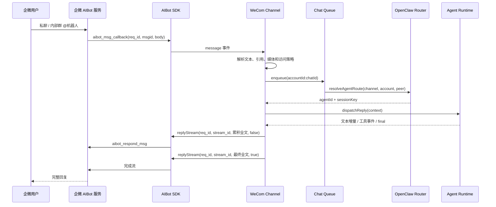

# 企微 Channel 上游研究

## 结论

OpenClaw 的企微接入不是“给 Agent 加一个企微 MCP”，而是由长驻 Gateway 承接消息渠道，
再通过 `ChannelPlugin` 把企微消息路由到 Agent Runtime。`wecom-openclaw-plugin` 的实时聊天主链
直接使用企微 AIBot SDK；它附带的 CLI Tool、Skills、Bot Webhook 和自建应用 Agent Mode 是独立能力，
不应与双向聊天混成一个模块。

对 DeepAgent 最值得借鉴的是“**Channel Gateway 承接渠道协议，Agent Runtime 保持渠道无关**”的边界。
官方 SDK 的连接、心跳、重连、媒体和流式回复可以复用或参考；OpenClaw 的 Plugin SDK、SessionKey、
Binding 和运行调度必须按 DeepAgent 自己的 Event Store、身份、SSE 与 Deferred 机制适配。

实施说明（0.7.0，2026-09-04）：本研究固定版本对照继续保留。当前代码已拆分公共 `channels/gateway/`
宿主、`channels/` 调度与 `channels/adapters/wecom/` 官方 SDK 包装，尚未实现飞书；底层能力直接调用
`wecom-aibot-python-sdk==1.0.2`，不复制本文引用的 Node 或其他项目的 WebSocket/加密代码。
渠道 `/stop`、`/new` 在普通任务队列之外处理，避免控制命令被长任务阻塞；完整语义以
[当前设计](wecom-channel-design.md) 和 [使用指南](../../guides/wecom-channel.md) 为准，不照搬上游全部命令。

## 研究口径

本文整理自另一 Agent 提供的固定版本研究，基线如下：

| 项目 | 固定版本 |
| --- | --- |
| `wecom-openclaw-plugin` | `2026.8.17`，提交 `3b1cbe3` |
| `aibot-node-sdk` | 提交 `80615b9` |
| `wecom-aibot-python-sdk` | 提交 `6bcb59a` |
| DeepAgent | 研究基线 `0.6.7@1497dfc`；实施版本 `0.7.0` |

固定提交链接用于保留研究可复核性；进入实施前必须重新检查企微官方文档、插件最新提交和 SDK 版本。
本文没有记录真实 Bot ID、Secret、成员 ID、群 ID 或 Session ID。

## 上游角色边界

| 对象 | 定位 | 是否承担实时聊天 |
| --- | --- | --- |
| OpenClaw | Agent Runtime + 长驻 Gateway + 会话路由与调度 | 是，作为运行宿主 |
| `wecom-openclaw-plugin` | `ChannelPlugin<ResolvedWeComAccount>` | 是，作为企微 Channel Adapter |
| AIBot Node/Python SDK | 企微 WebSocket、消息、媒体与回复协议客户端 | 是，作为协议客户端 |
| `wecom-cli` Tool / Skills | 文档、日程、消息等企微业务能力 | 否，是 Agent 可选工具 |
| 企微 MCP | 业务域 API 的模型工具入口 | 否，不是机器人消息入口 |
| 传统群机器人 Webhook | 单向或弱交互通知入口 | 否，不等同于 AIBot 双向 Channel |

OpenClaw 架构见 [OpenClaw Architecture](https://github.com/openclaw/openclaw/blob/main/docs/concepts/architecture.md#L8-L31)，
企微插件类型和 Adapter 面见固定提交的
[channel.ts](https://github.com/WecomTeam/wecom-openclaw-plugin/blob/3b1cbe3e664352821758d99ae5907f5620fce26e/src/channel.ts#L107-L590)。

## WebSocket 主链

官方长连接文档说明入站场景为用户私聊机器人或在内部群中 `@机器人`：
[企微智能机器人长连接](https://developer.work.weixin.qq.com/document/path/101463)。

## OpenClaw 源码调用链

| 阶段 | 上游入口 | 关键函数 | 输入 → 输出 |
| --- | --- | --- | --- |
| 建立连接 | [SDK `ws.ts`](https://github.com/WecomTeam/aibot-node-sdk/blob/80615b987ef69c6028ad764924609247c0725955/src/ws.ts#L23-L220) | `connect` / `sendAuth` | Bot ID、Secret → `aibot_subscribe` |
| 接收帧 | [SDK `ws.ts`](https://github.com/WecomTeam/aibot-node-sdk/blob/80615b987ef69c6028ad764924609247c0725955/src/ws.ts#L230-L313) | `handleMessage` | WS Frame → 消息或事件回调 |
| SDK 分发 | [`message-handler.ts`](https://github.com/WecomTeam/aibot-node-sdk/blob/80615b987ef69c6028ad764924609247c0725955/src/message-handler.ts#L32-L106) | `MessageHandler` | `aibot_msg_callback` → 类型事件 |
| Channel 监听 | [`monitor.ts`](https://github.com/WecomTeam/wecom-openclaw-plugin/blob/3b1cbe3e664352821758d99ae5907f5620fce26e/src/monitor.ts#L917-L1102) | `monitorWeComProvider` | SDK 消息 → `prepareWeComMessage` |
| 解析与权限 | [`monitor.ts`](https://github.com/WecomTeam/wecom-openclaw-plugin/blob/3b1cbe3e664352821758d99ae5907f5620fce26e/src/monitor.ts#L695-L813) | `prepareWeComMessage` | body → 标准内容、媒体、授权结果 |
| 消息解析 | [`message-parser.ts`](https://github.com/WecomTeam/wecom-openclaw-plugin/blob/3b1cbe3e664352821758d99ae5907f5620fce26e/src/message-parser.ts#L222-L317) | `parseWeComMessage` | text/mixed/voice/file → 标准内容 |
| 会话串行 | [`chat-queue.ts`](https://github.com/WecomTeam/wecom-openclaw-plugin/blob/3b1cbe3e664352821758d99ae5907f5620fce26e/src/chat-queue.ts#L3-L53) | `enqueueWeComChatTask` | `accountId:chatId` → 顺序执行 |
| 路由 | [`monitor.ts`](https://github.com/WecomTeam/wecom-openclaw-plugin/blob/3b1cbe3e664352821758d99ae5907f5620fce26e/src/monitor.ts#L204-L317) | `buildMessageContext` | peer/account → agent、sessionKey |
| 动态 Agent | [`dynamic-routing.ts`](https://github.com/WecomTeam/wecom-openclaw-plugin/blob/3b1cbe3e664352821758d99ae5907f5620fce26e/src/dynamic-routing.ts#L71-L118) | `resolveDynamicAgentRoute` | 默认路由 → 确定性 Agent |
| Agent 调度 | [`monitor.ts`](https://github.com/WecomTeam/wecom-openclaw-plugin/blob/3b1cbe3e664352821758d99ae5907f5620fce26e/src/monitor.ts#L491-L687) | `routeAndDispatchMessage` | 上下文 → Agent 流式输出 |
| 流式回复 | [`message-sender.ts`](https://github.com/WecomTeam/wecom-openclaw-plugin/blob/3b1cbe3e664352821758d99ae5907f5620fce26e/src/message-sender.ts#L42-L120) | `sendStreamMessage` | 累积文本 → 同一 stream 更新 |
| SDK 回写 | [SDK `client.ts`](https://github.com/WecomTeam/aibot-node-sdk/blob/80615b987ef69c6028ad764924609247c0725955/src/client.ts#L189-L209) | `replyStream` | reqId、streamId、finish → 企微 |

## 三种接入模式

| 项目 | Bot WebSocket | Bot HTTP Webhook | 自建应用 Agent Mode |
| --- | --- | --- | --- |
| 消息格式 | JSON WebSocket Frame | 加密 JSON HTTP | 加密 XML HTTP |
| 凭证 | Bot ID + 长连接 Secret | Token + EncodingAESKey | CorpID、CorpSecret、AgentID、Token、EncodingAESKey |
| 公网 HTTPS | 不需要 | 需要 | 需要 |
| 流式回复 | 原生 stream update | 初始响应 + refresh/response URL | 无 Bot 原生流 |
| 主动消息 | WS `aibot_send_msg` | response URL 或其他通道 | 企业应用 HTTP API |
| 适用判断 | 双向实时 Agent、无公网回调 | 已有稳定回调基础设施 | 企业应用通知与传统应用集成 |

普通模式由企微内部承载模型、知识、API/MCP 和工作流，OpenClaw 不参与 Agent Runtime：
[企微智能机器人说明](https://open.work.weixin.qq.com/help2/pc/21663)。OpenClaw 官方帮助的接入顺序也是
先配置 Bot ID/Secret，再单独授权文档 MCP：[OpenClaw 接入帮助](https://open.work.weixin.qq.com/help2/pc/21657)。

## 会话、权限和身份

- 私聊 peer 为 `body.from.userid`；群聊 peer 为 `body.chatid`。
- 多 Bot 路由必须包含 `accountId`，避免相同 peer 在不同 Bot 间串会话。
- OpenClaw 默认 `session.dmScope=main` 不适合多用户高权限场景，应显式使用
  `per-channel-peer` 或 `per-account-channel-peer`。见
  [Channel Routing](https://github.com/openclaw/openclaw/blob/main/docs/channels/channel-routing.md#L31-L55)。
- 插件支持 `open`、`pairing`、`allowlist`、`disabled` 四种 DM 策略；群策略还包含群与成员两层 allowlist。
- 非超级管理员创建的机器人可能收到企业范围内的加密成员身份。插件把它当稳定 opaque ID，
  没有实现“加密身份 → 企业成员”的转换。

OpenClaw 配对请求和允许项持久化在 SQLite，配对码约一小时有效：
[Pairing](https://github.com/openclaw/openclaw/blob/main/docs/channels/pairing.md#L18-L34)。

## 回复、主动消息和媒体

| 能力 | 固定版本实现 |
| --- | --- |
| 流式文本 | 使用同一回调 `req_id` 和 `stream.id` 持续发送累积全文 |
| 最终完成 | 最后一帧设置 `finish=true` |
| 模板卡片 | JSON 解析后主动发送；点击事件重新进入 Agent |
| 图片/文件/视频 | `uploadMedia` 后通过 `sendMessage` 发送 |
| 语音 | AMR 作为语音，其他格式降级为文件 |
| 主动发送 | 优先 WS，必要时回退自建应用 HTTP API |

SDK 主动发送使用 `aibot_send_msg`：
[SDK `client.ts`](https://github.com/WecomTeam/aibot-node-sdk/blob/80615b987ef69c6028ad764924609247c0725955/src/client.ts#L322-L353)。
主动消息要求目标用户或群此前与机器人发生过会话。固定版本研究记录的限制为：每分钟 30 条、
每小时 1000 条、回调后 24 小时内可回复，当前官方流完成窗口为 10 分钟；实施前应以届时官方文档复核。

入站媒体由 SDK 下载密文并使用独立 `aeskey` 解密，插件再保存为 Agent 附件；出站媒体走 SDK
`uploadMedia`，不依赖 MCP。源码见
[SDK `crypto.ts`](https://github.com/WecomTeam/aibot-node-sdk/blob/80615b987ef69c6028ad764924609247c0725955/src/crypto.ts#L15-L57)
和 [`media-handler.ts`](https://github.com/WecomTeam/wecom-openclaw-plugin/blob/3b1cbe3e664352821758d99ae5907f5620fce26e/src/media-handler.ts#L80-L248)。

## 连接、高可用和已知缺口

Node SDK 已提供 30 秒心跳、失联断开、指数退避重连，以及认证失败和网络失败区分；但同一 Bot
只允许一个有效连接，新连接会踢掉旧连接。固定版本插件没有 Leader Election、分布式锁、fencing token
或共享排重，因此“能重连”不等于“多实例 HA”。

固定版本的主要缺口：

- WebSocket 主链没有持久化 `msgid` 排重；Webhook 排重也只是进程内缓存。
- 会话队列、活动流、模板卡片缓存和最近 `reqId` 都是进程内状态。
- 默认 DM `open` 和默认 `dmScope=main` 不适合高权限、多用户部署。
- 加密身份没有企业成员转换。
- WebSocket/Webhook 配置同时存在时，模式选择优先级不够清晰。
- 健康探测不能充分证明 Bot 已认证在线。
- 部分 6 分钟常量落后于当前官方 10 分钟流窗口。
- WebSocket 媒体临时文件清理配置没有完整落地。

## MCP 与“七天授权”

| 凭证或限制 | 用途 | 是否影响双向聊天 |
| --- | --- | --- |
| Bot ID | 机器人身份 | 是 |
| WebSocket Secret | `aibot_subscribe` 鉴权 | 是 |
| CLI Bearer/缓存凭证 | `wecom-cli` 业务调用 | 否 |
| MCP 授权/API Key | 文档、日程、邮件、业务消息等 | 否 |
| 消息历史七天范围 | 历史查询 `begin_time` 范围 | 否 |

当前只确认“七天”是消息历史查询窗口；没有确认“所有企微 MCP 授权固定七天过期”的正式协议。
运行观察或 GitHub Issue 不能代替企微官方合同式文档。

## 事实、推论与待实测

### 已确认事实

- 企微插件是 OpenClaw `ChannelPlugin`，实时聊天直接使用 AIBot SDK。
- WebSocket 聊天、CLI Tool、Skills、Bot Webhook、自建应用 Agent Mode 是解耦链路。
- WebSocket 支持文本流、主动消息、媒体和多 Bot account。
- 同一 Bot 只能保留一个有效 WebSocket 连接。
- 固定版本缺少持久化排重和多实例 Leader Election。

### 0.7.0 实施取舍

- DeepAgent 不应把 WebSocket 客户端嵌进每个 API Pod。
- 同仓、同镜像新增可选单副本 Channel Gateway，采用官方 Python SDK `1.0.2`。
- 首版只增加 Account、Session Binding、Message Run 三张表；不预埋 Outbox、Lease 或身份映射表。
- 企微 Peer 映射到 DeepAgent Session，Session 归属渠道 Account 的 `session_user_id`，由管理员配置；
  普通聊天请求不能指定用户。当前三表取舍见 [消息链路与表设计复核](message-lifecycle-review.md)。
- 只实现 WebSocket；Webhook、多副本高可用、主动消息与用户级权限映射按真实需求后续设计。

### 真实环境持续验收

- 当前企微环境的单聊、内部群、mixed、独立媒体和卡片事件投递矩阵。
- 主动消息 24 小时窗口、频率限制和流式 10 分钟窗口的真实错误码。
- 非超级管理员 Bot 返回的加密身份稳定性与企业成员转换接口。
- WebSocket 连接被新实例替换时的服务端事件、恢复时间和消息重投行为。
- Python SDK 在当前 Bot 上的 text、mixed、图片、文件、语音和视频投递结构及错误码。
