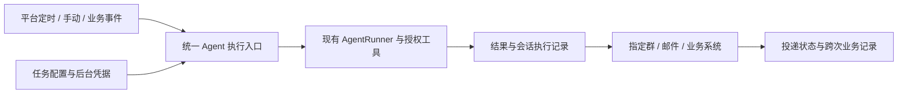

# 平台自动化任务：触发、Agent 执行与业务交付

2026-09-16，继续讨论稿，未批准开发。用户补充了真实消费入口和工单群通知例子；本文调整此前以 Console 查看新会话为主要交付的前提。下文推荐路线仍需评审，不是已落地能力。

## 1. 最新产品事实

- Console 主要用于配置与测试，业务用户不会日常在这里查看定时结果。
- 示例：每天 10:00 统计指定业务范围中当天或昨天未处理完的工单，形成重点清单并发送到指定企微群。业务期间、筛选口径和群目标尚未正式配置。
- 平台数据流、工作流已有定时能力，应评估由现有平台触发 DeepAgent，而不是预设必须再建一套定时中心。
- 用户接受配置固定后台鉴权，类似渠道的 App 与空间 API Key；不要求模拟一个在线浏览器。
- 另有跨周期连续性诉求，例如 GitHub 推荐避免重复。复用会话、历史检索与压缩可以辅助，但不应自动认定已实现长期记忆或可靠投递去重。

因此当前研究对象应是“平台自动化 Agent 任务”：何时触发、以什么权限执行、执行什么、交付到哪里、跨次保留什么状态。会话是执行记录，不是业务用户必须使用的入口。

## 2. 建议架构

触发不需要伪装成群里某个人发了一条消息，也不需要已有人工聊天会话。业务调用携带任务、触发身份、业务输入与授权上下文，服务端建立运行记录，底层按策略新建或复用会话。这里的统一入口是设计建议，不能视为现有 API 已完整支持幂等、后台身份与异步结果交付。

如果由数据流或工作流负责调度，DeepAgent 提供可后台调用的执行能力。若用户只需“到点让 Agent 做一件事”，以后可以加轻量内置计划入口，同样调用该执行能力；同一任务只设一个调度所有者，避免两边重复触发。现有平台具体如何接入、是否有可直接使用的节点，需独立核验。

## 3. 以谁的名义，以及结果发给谁

| 配置 | 决定什么 |
| --- | --- |
| 任务负责人 / 配置人 | 谁维护任务、查看执行记录、处理失败 |
| 执行凭据与 App/Space | MCP 和业务接口实际使用的身份与权限；参考现有渠道 API Key 装配方式 |
| 会话归属用户 | DeepAgent 内部历史与诊断的访问归属，不代表群接收者，也不自行签发业务授权 |
| 发送连接与目标 | 用哪个机器人/企微应用/邮件账号，对哪个明确群或用户发送 |

查询用的空间 Key 与对外发送用的凭据可以是两套；平台按 Key 实际授权主体执行，不假定 Key 就代表配置人或每个接收人。后台固定配置可行性以选定 MCP/接口的支持与授权为准。凭据引用保存在受控配置中，不放到模型提示词里。

## 4. 工单清单的两种执行方式

推荐先用确定步骤的业务流程：定时触发 → 按明确条件取数（数据流/API 或 Agent 已授权 MCP）→ Agent 归纳重点与说明 → 确定的发送步骤发到配置的企微群 → 保存发送回执。

Agent 负责需要理解、归纳、排序或生成的环节；时间、业务期间、接收目标和发送条件尽量由配置和运行输入确定。纯固定筛选与格式化若无需模型，可继续由现有流程完成。

另一种可行方式是任务直接交给 Agent，让它通过 MCP 查询并发送。实现短，但模型决定是否调用发送工具及重试；若采用，发送工具仍必须执行目标范围校验、运行级幂等与结果记录。一个消息只能有一个发送所有者，避免 Agent 发一次、宿主最终通知又发一次。

现有企微会话接入与主动投递是不同能力。需要单独验证选定机器人/API/MCP 是否能在无入站消息时主动发到目标群，不能仅凭“渠道已连接”承诺可以推送。本次没有发送任何真实消息。

## 5. 跨周期连续性

| 路径 | 能解决什么 | 局限 |
| --- | --- | --- |
| 固定任务会话 + 历史/压缩 | 延续讨论、偏好与前期结论，适合尽力避免重复 | 摘要有损，模型可能漏看，无法保证去重 |
| 每次新会话 + 任务摘要 | 只带与本轮相关的上下文，避免历史无限增长 | 摘要更新与持久化需实现 |
| 任务业务记录 | 精确保存已发送项目、比较基线、最近成功时间等 | 是窄范围业务状态，需要明确读写与成功条件，不等于通用长期记忆 |

GitHub 示例：按任务和投递目标保存稳定的仓库 ID/规范化 URL、发送时间与发送状态，运行时过滤已成功发送项目，再让 Agent 选择和撰写。只生成未发送的内容不能算已发送；失败可重试投递，结果未知不盲目重复发送。永久去重还是一定时间内去重、重大版本更新能否再次推荐，属于业务规则。

工单场景不同：昨天未解决的高优先级工单今天可能仍应出现，不能复用“推荐过永不再发”规则。可以按任务需要保存上次状态，突出新增、升级和仍未处理项。

会话策略因此重新开放讨论：独立日报倾向每次新建；持续研究可绑定任务专属会话；不要偷偷拼接该 Agent/用户“最新的人工会话”。前稿“首版固定每次新建”不再作为不可调整的要求。

## 6. 当前建议与研究边界

先以“10:00 工单清单发群”为代表场景，核验现有平台触发、后台凭据、Agent 执行和主动发送四段链路。结果应有运行和投递两个状态；发送失败优先重试已生成内容，不重新跑整轮分析。

此路线不是要求 DeepAgent 自建工作流平台，也不要求先完成通用记忆或 Sandbox。是否独立建设定时管理、采用哪种会话策略、是否新增任务状态，按首个真实场景决定。错过多次只补一次等既有方向仍可保留，具体补跑业务期间需要显式传入。

参考：OpenClaw 官方把自动化会话上下文与结果投递分开，并支持新会话或固定会话；Dify 的 Trigger 以计划/事件触发工作流。这说明平台自动化可以以任务及交付为中心，不必模拟聊天窗口。以下为 2026-09-16 官方资料补充，未部署验证，也未改变历史调研中的版本基线。

- [OpenClaw 自动化上下文](https://docs.openclaw.ai/automation/cron-jobs/payloads)
- [OpenClaw 投递](https://docs.openclaw.ai/automation/cron-jobs/delivery)
- [Dify Trigger](https://dify.ai/blog/introducing-trigger)

本文更新旧课题的产品前提；开发待办仍只维护在 `../TODO.md` 的 `SCHEDULE-001`。
