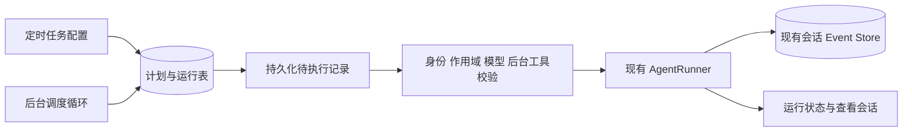

# DeepAgent 定时任务初步设计

2026-09-14，当前讨论稿，已按最新线上场景重整。用户认可错过多次只补一次，并倾向每次创建新会话，暂未确定首个具体业务场景。下文把用户方向与助手的建议默认值分开描述，不表示已经批准开发。上游依据见 [调研](scheduled-tasks-research.md)。

## 1. 产品概念与入口

将功能定义为「定时 Agent 任务」：服务器在指定时间，使用指定 Agent 为指定平台用户执行一轮工作，并新建归属于该用户的会话留存过程和结果。用户不必在线，客户端不必启动，也不要求用户事先与该 Agent 聊过天。

一条任务 = 名称＋Agent＋目标平台用户＋业务作用域＋提示词＋时间规则。首版一个任务对应一个用户；多用户批量分发、用户组展开暂不做，以免把会话权限和通知扩散混在一起。使用目标用户所属作用域还需校验配置人是否有权替其创建任务。

建议同时支持两个入口，但只有一套记录和 API：统一「定时任务」页用于看全局启停、失败和下次时间；Agent 详情中的「定时任务」入口只筛选当前 Agent，新增时预填 Agent。用户尚未决定最终导航位置；如果先做 Agent 内入口，也不需要把任务塞进 Agent 配置 JSON，之后可直接补全局视图。

任务引用 Agent，沿用其模型、Skill、工具与提示词；任务提示词说明本次工作。不是新 Agent 类型，也不挂在企微应用之下。一个 Agent 可以服务不同用户与多个计划，每个计划有自己的生命周期和运行记录。

列表建议：任务名、Agent、平台用户、计划、下次运行、最近结果、启停、操作。配置弹窗只有任务内容、归属与作用域、时间规则三组；第一版不显示会话模式选择和补跑策略选择。运行记录展示计划时间、实际开始时间、状态、用时、查看会话；未实际执行成功时不能只凭“已派发”显示成功。

首版以后台配置为主，后续可提供 schedule_create/list/update/delete 工具。模型创建任务应走同一服务与权限校验，不直接写数据库。

## 2. 时间规则

建议首版支持「指定时间一次」与「循环」。循环使用标准五段 Cron：分钟、小时、日、月、星期；如 `0 9 * * 1-5` 表示周一到周五 09:00。另存 IANA 时区，如 `Asia/Shanghai`，持久时间点统一用 UTC。

普通用户选择每天/每周/每月及时间，系统生成规则；高级模式再显示 Cron。保存前展示可读解释和未来五次触发时间。第一版不同时开放 Cron、RRULE、固定间隔三个高级语法体系，也不开放秒级频率；Codex 的 RRULE 是另一套合理方案，但不是必须跟随的格式。

具体解析库需锁定版本，验证日与星期的 AND/OR 语义、时区、夏令时缺口和重复小时，不能让前后端各用一套算法。最终约定应展示在预览中。时区不读取浏览器临时时区作为执行时的隐式来源。

## 3. 平台用户、执行身份和新会话

用户当前没有续接旧会话的现场需求，因此首版固定每次新建。这里“最新会话”指本次任务刚创建的会话，**不能实现成查询 Agent＋用户下的 latest session 再追加消息**，否则会误接入人工对话。

每次运行建立 task_run_id → session_id → agent_run_id 关联。重试入队或重复扫描必须复用同一次运行身份，不能为了“每次新建”重复创建多个会话。会话标题可为「预算指标巡检 · 09-15 09:00」，并保存定时来源与 task_id，供筛选。会话按目标用户及既有权限规则可见，管理员查看沿用现有诊断授权；不因为定时来源就扩大普通用户可见范围。

新会话不载入个人聊天历史，但仍有 Agent 的系统提示词、Skill、工具、任务提示词、App/Space、计划时间和本次明确提供的业务参数。若任务需要上次指标值或告警状态，后续增加任务业务状态或查询权威数据，不通过拼接旧聊天历史充当数据库。

| 概念 | 用途 | 首版建议 |
| --- | --- | --- |
| 配置人 | 谁创建、维护和停止任务 | 记录 created_by，并校验其配置权限 |
| 目标平台用户 | 会话归属、结果查看 | 必填一个 user_id，执行前确认账号及作用域有效 |
| 执行身份 | 数据查询与工具操作的授权主体 | 优先与目标用户一致；必须通过合法的后台认证链路，不把 user_id 当凭据 |
| 通知接收人 | 邮件等主动通知实际送给谁 | 是可选动作的收件人，可与会话归属用户不同；不能由模型自行猜测 |

平台用户可被明确选择，意味着“结果归谁”可确定；不意味着无需后端授权就能代该用户查数据，也不意味着已知 user_id 就一定能获得有效邮箱。首版不开放独立切换执行身份来增加复杂度；如果平台只能通过服务账号执行，需要另行确定其权限边界和审计方式。

Agent 修改配置后默认下次运行用最新配置；运行记录保留实际使用的模型和任务配置版本，便于排查。不要把每个计划都复制成隐藏 Agent。Agent 删除或模型未配置，应显示 blocked 并提示修复。

## 4. 停机与补跑

用户认可的方向：每个任务错过多个周期时，合并补一次，之后恢复正常时间表。建议首版固定 latest，不提供 all，也先不增加 skip/期限等选项。此前提出的一小时补跑期限未被确定，不作为当前默认卡控。只有具体业务要求“过时不得执行”时，再显式引入有效期。

| 场景 | 建议行为 |
| --- | --- |
| 每天09:00，页面没开但服务在 | 正常运行；结果留在运行记录和会话中 |
| 09:00服务关闭，09:20恢复 | 补一次，记录 scheduled_for=09:00、started_at=09:20 |
| 停了三天，今天09:20恢复 | 合并补一次，对应最近的今天09:00，前两天不重放 |
| 停了三天，今天15:00恢复 | 仍补一次；不默认套用此前建议的一小时期限 |
| 一次性任务逾期 | 建议恢复后补一次；明确的业务过期限制优先 |
| 人工暂停后重新启用 | 从重新启用时间算下一次，不补暂停期间；一次性已过期需重新设时间或手动运行 |
| 前一轮执行中又到时间 | 同一任务不并行；最多合并保留一个待执行机会，完成后再运行 |
| 进程在模型/工具执行中崩溃 | 记 interrupted/unknown；首版不盲目重放整轮，尤其是外部写操作 |

对于巡检类重复任务，“补最近一次”默认分析当前状态。若业务要求补某个历史账期，提示词必须明确使用 scheduled_for 或传入的业务期间；补跑日报不能偷偷变成重复生成今天日报。

这是“每个任务最多一次”，不是整个系统只补一个任务。恢复后多个任务仍需按全局并发上限分批运行。用户关掉浏览器、离线或退出登录，不等于任务暂停；授权是否仍然有效由后台认证机制判断。

## 5. 存储建议：两张表

与数据库现有命名、ID、时间字段风格对齐，以下为概念字段，不是已确定的 DDL。

### scheduled_tasks：用户维护的配置与调度游标

| 字段组 | 内容 |
| --- | --- |
| 身份与归属 | id、name、created_by、target_user_id、agent_id、app_id/space_id（平台业务明确保存） |
| 任务内容 | prompt；首版固定新建会话，不保存 target_session_id，不开放 session_mode |
| 时间 | schedule_kind、cron_expression 或 run_at、timezone、next_run_at |
| 策略 | enabled；首版合并补一次作为统一规则，不强制增加用户策略字段 |
| 治理 | config_version、created_at、updated_at、paused_at（可选） |

规则形态用少量明确字段，扩展非核心设置才用 JSON。不能只保存“每天早上”这样的自然语言作为执行依据。Token/Secret 不放在提示词或任务 JSON 中；如后台认证需要持久凭据，引用受控凭据配置。平台部署的任务明确业务作用域，不从一个不存在的前端页面推断 App/Space。

### scheduled_task_runs：每次触发及执行结果

| 字段组 | 内容 |
| --- | --- |
| 触发身份 | id、task_id、config_version、scheduled_for、trigger_type（scheduled/manual） |
| 运行归属 | session_id、agent_run_id、owner_token / lease_expires_at（需要跨进程执行时） |
| 生命周期 | queued / running / waiting_user / succeeded / failed / skipped / blocked / interrupted |
| 时间与排查 | queued_at、started_at、finished_at、error_code、简短错误、skipped_count（合并遗漏时） |
| 可追溯配置 | 本次提示词与规则快照或可恢复的版本引用、实际模型 |

定时触发的唯一约束建议 `(task_id, config_version, scheduled_for)`；手动运行单独生成 request id，不消耗下一个定时时点。调度入队事实与推进 next_run_at 在同一数据库事务中完成。消息和工具正文继续存现有 Event Store，不复制到此表。

“同一触发只生成一条运行记录”只能防止重复准入；不能保证某个外部工具只执行一次。运行结果未知时应如实展示。

## 6. 运行结构

建议首版使用单独的后台调度/执行角色，通过现有进程监督方式部署。不要让每个 Web worker 都各自启动 timer。具体是独立进程还是单实例后台服务，在实施设计时按当前部署方式选择；关键是只有明确的调度所有者，运行队列持久化。

调度循环可以每 15～30 秒查 due 行，不需要为每条任务启动永久线程。查到任务后先计算补跑策略和唯一触发身份，在短事务内认领/入队并推进时间，提交后才执行模型。不要在数据库事务中等待 Agent 输出。

启动顺序：等待数据库迁移和运行依赖就绪 → 确认调度所有权 → 对运行中的旧记录做 owner/租约核验 → 处理未启动的持久 queued 记录 → 按策略处理错过的时间点 → 进入正常轮询。分批启动并限制并发，避免把模型初始化堆到服务启动瞬间。

SQLite 与部署数据库都要有经过验证的原子认领方案，不能直接复制 Dify 的 SELECT FOR UPDATE SKIP LOCKED 到 SQLite。现有 `db/run_ownership.py` 明确是进程本地存活作用域，不是已实现的数据库租约。

服务正常退出停止新认领，尽力完成或记录当前运行。重启后的 queued 工作可以继续；已经可能发生副作用的 running 工作，不能和“尚未开始”一起无条件重试。

## 7. 接入现有运行链路

源码已确认 `AgentRunner` 是不依赖 FastAPI 的封装，run/run_stream 接受 session id、prompt 和 AgentDeps，负责历史和执行。`api/v1/chat.py` 还承担身份、Agent/模型解析、ActiveRunRegistry、SessionLive 与事件持久化接入。

因此可以复用 Runner，但不能简单定时调用裸 Pydantic Agent.run 而绕开权限和会话体系。实施时提取或复用统一执行入口，由普通聊天与调度共同调用，传入 user、Agent、App/Space、conversation/run id、文件服务和可信工具上下文。

这里有两个必须在开发前解决的实际约束：

1. **后台身份有效期**：用户浏览器里的临时平台 Token 可能在下次运行前过期。首版需要明确运行账号和后台凭据来源；不能把创建任务时的 Cookie 当成长期凭据。权限失效时 blocked/failed 并提示修复，不自动换管理员执行。
2. **无人值守交互**：UI 工具依赖打开的页面，HITL 需要用户选择。默认应限定可后台执行的工具；若进入人工审批/输入，显示 waiting_user，并设定等待/超时行为，不能报成功或偷偷同意。

固定新建会话后，首版不需要设计向人工历史会话插入定时消息的排队逻辑；仍需同任务互斥、全局并发上限与运行身份防重复。超时、停止、诊断、Usage 与 SSE 观察继续沿用现有机制。用户后来打开本次正在运行的会话时，普通交互仍遵守现有单会话运行约束。

## 8. 候选业务场景与结果投递

当前不是已经确定的预算预警产品，而是能承载此类任务的公共定时执行能力。建议用一个足够具体的场景验收，而不预先建设通用规则引擎。

| 场景 | 一轮工作 | 通知与状态要求 |
| --- | --- | --- |
| 预算指标监控 | 查询明确模型、期间、组织和指标，按规则判断，生成简要结论 | 正常可只留记录，达到阈值才通知；阈值宜确定性计算，Agent 负责解释 |
| 定期分析报告 | 取数、分析、生成报告 | 每次新会话保留产物；是否邮件发送可独立配置 |
| 定时邮件 | 根据固定内容或查询结果发送邮件 | 若完全是固定文案和固定收件人，可能无需调用模型；有生成/分析需要时才使用 Agent |

预算示例（仅作产品说明，不代表已有可用配置）：每天09:00，预算监控 Agent 为负责人A，在指定 App/Space 查询本月预算执行率；达到明确阈值时生成说明并按配置通知指定用户。本次计划时间、实际时间、查询条件和结果均可追溯。

“只在异常时通知”与“异常持续时每次都通知”是不同规则。真正实施预警场景时，还需要确定连续告警去重、恢复后通知、冷却时间和比较基线。首版定时引擎不自动承担这些业务规则，不能只凭自然语言让模型每轮猜是否应该再次报警。后续可引入按任务保存的小型业务状态，仍不复用旧会话来承载该状态。

首版结果进入定时任务运行记录和对应会话，有“查看会话”。完成、失败、待处理分开显示。模型输出一句“已完成”不作为唯一成功依据，要有执行终态和工具状态。

用户下次登录可查看属于自己的定时会话；计划与运行详情提供对应入口。是否增加站内未读提醒属于后续产品呈现，不应作为无人值守执行的前置条件。大量周期任务形成的会话建议支持按定时来源筛选，后续再确定归档和保留期限。

当前先考虑平台用户，不做企微等渠道推送。邮件如果进入首个场景，需要确认已有发送工具或服务、后台凭据、收件地址来源和授权；没有真实发送回执时不能宣称已送达。指定会话归属用户不会自动触发邮件，也不意味着用户有有效邮箱。

以后需要消息通知时，增加结果投递配置和独立投递状态，不把“模型执行成功”和“通知发送成功”混成一个字段。

## 9. 下次从这里继续

当前收敛：绑定一个 Agent＋一个平台用户＋明确作用域，每次新建会话；服务端无人值守执行；错过多次合并补一次；结果留在已有会话/Event Store；第一版不做历史会话续接、查找最新会话、多用户群发和渠道适配。

建议默认：统一任务管理＋Agent 内快捷入口，一次性/五段 Cron，时区与未来执行时间预览，启停、立即运行和运行记录；人工暂停不补、同任务不并行、未知副作用不自动重跑。两张表保存计划与运行，不复制消息存储，也不为此引入整套 Dagster/Prefect。

真正留待确认的只有两类：

1. **首个验收场景**：预算指标监控还是报告/邮件；具体指标、数据作用域、判断条件、目标用户及期望结果是什么。用户目前尚未确定，不催促立即拍板。
2. **后台执行与投递可行性**：平台允许怎样合法代用户执行，凭据怎样保持有效；该场景的工具能否不依赖页面，若发邮件，用哪个服务及明确的收件人。先核验现有平台链路，不预设必须新建一套身份系统。

入口布局可以在原型阶段确认，不再让已有会话模式和多种补跑策略阻塞首版。预算业务告警去重、精确跨进程恢复和多副本属于按真实需求继续扩展的范围。

关键验收集中在假时钟与故障边界：用户离线触发、首次无历史会话、每次新会话归属正确、跨多周期仅补一次、人工暂停、重复扫描、queued 重启、运行中崩溃、凭据失效、越权指定目标用户被拒、HITL 挂起。当前仅完成文档研究，未执行这些测试。
