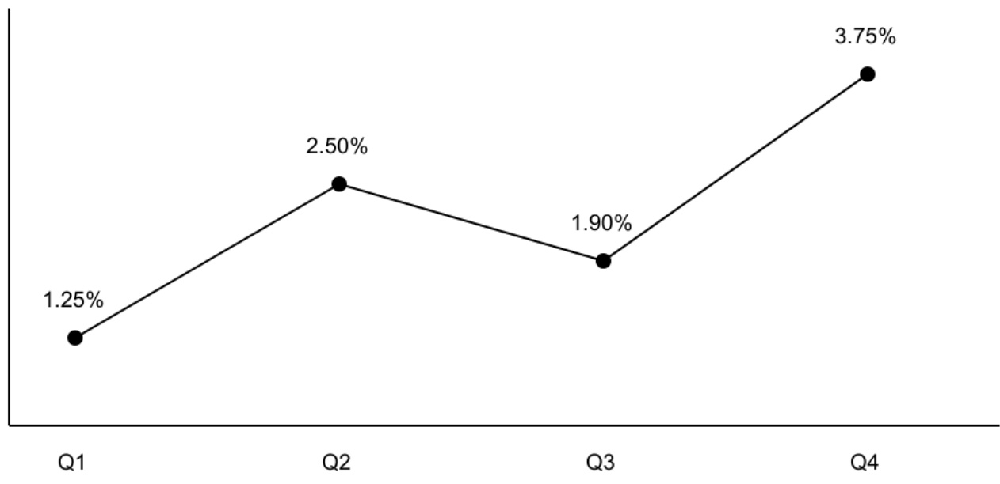

## 复杂表格与数字精度测试

注意单位、合并表头、负数、千分位、百分号和千分号。

<table><tbody><tr><td rowspan="2">指标 / Metric</td><td colspan="2">2025 财年</td><td colspan="2">2026 财年</td></tr><tr><td>金额（万元）</td><td>比例</td><td>金额（万元）</td><td>比例</td></tr><tr><td>营业收入 / Revenue</td><td>1,234,567.89</td><td>12.50%</td><td>1,345,678.90</td><td>13.05%</td></tr><tr><td>净利润 / Net profit</td><td>(12,345.67)</td><td>-0.80%</td><td>23,456.78</td><td>1.75%</td></tr><tr><td>坏账率 / Bad debt</td><td>0.003</td><td>3.00‰</td><td>0.0025</td><td>2.50‰</td></tr><tr><td>跨行金额 / Wrapped</td><td>1,234,567.89</td><td>12.50%</td><td>9,876.54</td><td>0.25‰</td></tr><tr><td>缺失和零 / Missing</td><td>-</td><td>0.00%</td><td>0.00</td><td>N/A</td></tr></tbody></table>

图 1:示意折线图（单位:%）

注:括号表示负数；— 为缺失值；‰ 不等于 %。表内换行不可造成列错位。

## 复杂表格与数字精度测试

注意单位、合并表头、负数、千分位、百分号和千分号。

<table><tr><td rowspan="2">指标 / Metric</td><td colspan="2">2025 财年</td><td colspan="2">2026 财年</td></tr><tr><td>金额(万元)</td><td>比例</td><td>金额(万元)</td><td>比例</td></tr><tr><td>营业收入 / Revenue</td><td>1,234,567.89</td><td>12.50%</td><td>1,345,678.90</td><td>13.05%</td></tr><tr><td>净利润 / Net profit</td><td>(12,345.67)</td><td>-0.80%</td><td>23,456.78</td><td>1.75%</td></tr><tr><td>坏账率 / Bad debt</td><td>0.003</td><td>3.00‰</td><td>0.0025</td><td>2.50‰</td></tr><tr><td>跨行金额 / Wrapped</td><td>1,234,567.89</td><td>12.50%</td><td>9,876.54</td><td>0.25‰</td></tr><tr><td>缺失和零 / Missing</td><td>—</td><td>0.00%</td><td>0.00</td><td>N/A</td></tr></table>

图1:示意折线图（单位:%）

注:括号表示负数；一为缺失值；%。不等于%。表内换行不可造成列错位。