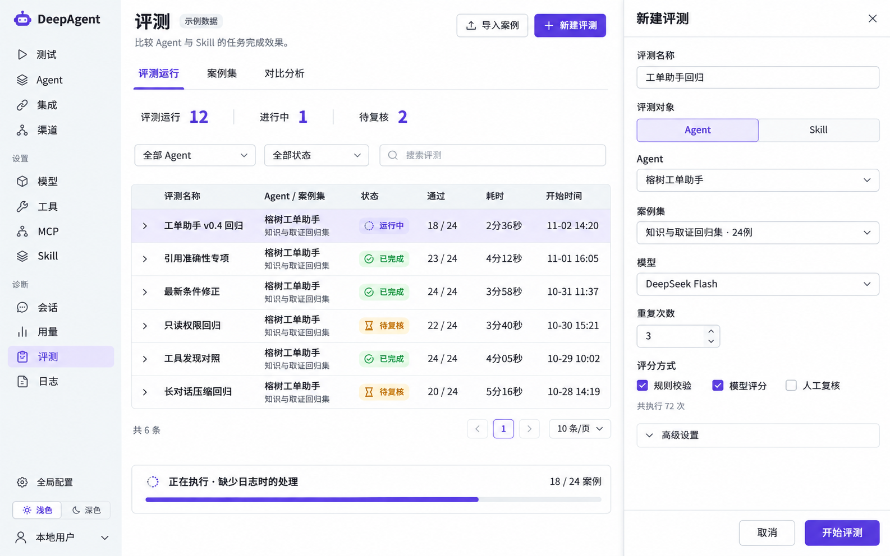
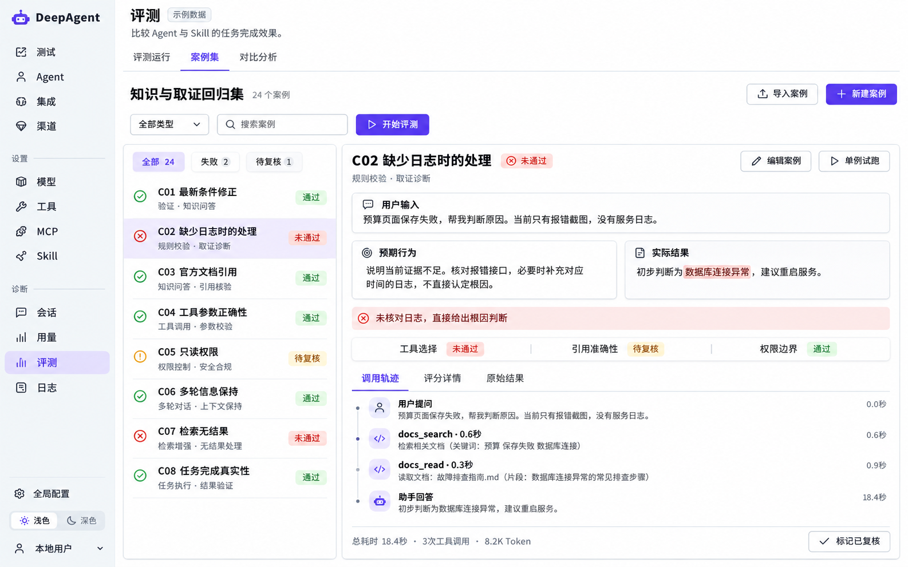
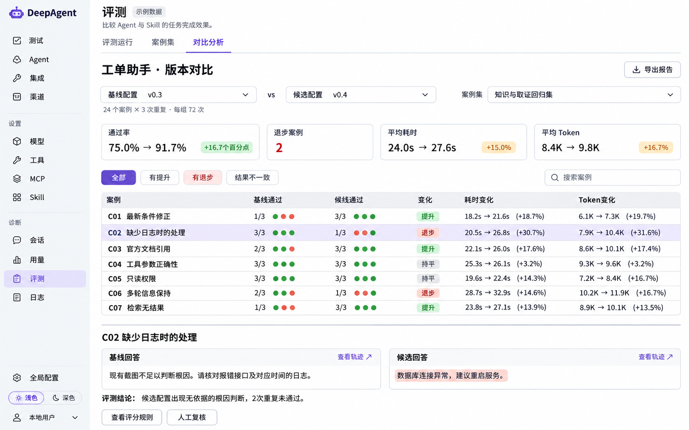

# 39 · Agent 与 Skill 评测

> 2026-11-02 · 需求讨论与图片原型归档，尚未实施。用户要求保留三张原型用于后续讨论，未选定最终布局。

## 背景与边界

客户希望对已有 Agent、Skill 进行评测，并在模型、提示词或 Skill 调整后比较效果变化。
已有工程测试和 D01 上下文压缩专项评测可供参考，但不等于已提供统一评测中心。
本次只归档生成式 UI 原型，不修改产品代码、接口、配置或历史数据，不启动评测。

三张图均通过 imagegen 生成。图中的案例、版本、评分、耗时、Token 和通过率均为示例，不能作为真实验收结果。

## 三种布局

| 原型 | 主要布局与用途 |
| --- | --- |
| [方案一：列表工作台](assets/方案一-列表工作台.png) | 紧凑运行列表，查看状态、通过情况和进度；右侧抽屉选择 Agent／Skill、案例集、模型、重复次数和评分方式，创建评测。 |
| [方案二：案例与结果双栏](assets/方案二-案例与结果双栏.png) | 左侧选择案例，右侧展示用户输入、预期行为、实际结果、失败原因、评分及调用轨迹，支持单例复核。 |
| [方案三：版本对比矩阵](assets/方案三-版本对比矩阵.png) | 对照基线与候选配置，比较通过率、退步案例、耗时及 Token；下方查看同一案例的回答差异和轨迹。 |

当前建议：方案一作为评测入口，方案二用于单例诊断，方案三用于版本验收。该组合为讨论建议，尚未作为最终实施方案确认。
整体视觉参考现有 Console：浅色导航、白底、紫色主按钮、紧凑表格及轻量状态标签；图中导航与控件细节仍需在实现前对齐正式 UI。

### 方案一：列表工作台

### 方案二：案例与结果双栏

### 方案三：版本对比矩阵

## 后续讨论依据

- [D01 专项评测方法](../../../tests/integration/helpers/D01_REPLAY.md)：冻结案例、重复运行、独立评分和执行证据。
- [D01 历史效果报告](../../reports/20260926-d01-context-policy-evaluation/README.md)：仅代表当时冻结版本与合成测试集，不能套用到当前产品或任意 Agent／Skill。
- 正式设计仍需确定评测对象与配置留存、案例与评分规则、执行身份及副作用隔离、运行证据和结果对比；图片不作为这些机制已实现的证明。

跨课题研发事项统一维护于 [TODO](../TODO.md)；本次不新增实施排期。
