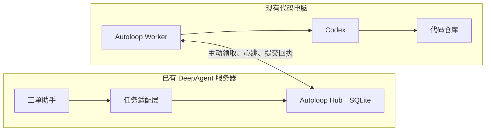

# 41 · 工单助手委派本地仓库排查

2026-11-03 建立，2026-11-04 补充复用选型与部署形态。当前为方案研究，尚未安装、改造或完成真实联调。

## 用户目标与选型偏好

现有 Cloud 工单助手需要委派一台已经安装 Codex、持有代码仓库的电脑排查问题，并把结果带回原 DeepAgent 会话。首阶段用于内部，允许先做原型，效果稳定后再考虑通用化。

- **优先方便、少改造、复用现成实现**。能自己写不等于应该从零写，不因框架包装或知名度决定选型；比较实际省掉的任务、会话和故障恢复工作。
- **业务入口仍是 DeepAgent 工单助手**。外部框架主要提供执行侧任务管理，不先建设另一套面向用户的工单产品。
- **优先沿用现有 Codex 电脑与仓库**。DeepSeek Harness 可以评估，但不是已决定替换的执行器。
- **同一工单可追问和补资料**。新工单建立独立任务；同一工单继续原任务，不按问题文字相似度合并，不把每次补问都变成新执行会话。
- 第一阶段重点是只读排查、证据和处理建议；自动改代码、PR、发布流水线不作为接通的前提。该范围尚需实施前最终确认。

当前研究建议：先验证 Autoloop 能否以外部适配接上，Agent Orchestrator 为补充候选；若关键续跑或接入机制不合适，再评估直接连接 Codex App Server 的薄任务服务。此顺序是研究建议，不是用户已确认的技术定案。

## 接入方式

用户在现有 DeepAgent 工单助手里发起排查、补资料、看结果。工单助手通过仓库排查适配入口委派任务。下图暂以薄 MCP 表达固定的工具契约，原型也可评估由 Skill 脚本调用执行侧现有 HTTP API，二者不要求同时建设。持有代码仓库的机器负责运行 Coding Agent，首版优先复用已配置的 Codex。

```text
DeepAgent 工单助手（现有服务和用户会话）
  → 仓库排查 MCP（提交、查询、补资料、取消）
  → 执行机（代码仓库 + Codex App Server 或 DeepSeek Harness SDK）
```

部署上分两侧。DeepAgent 所在侧提供 MCP 和任务入口，仓库所在侧安装执行器。云端无法直接访问执行机时，优先让执行机主动连接任务入口并领取任务。两侧都在同一受控网络时，可评估直连。首版按白名单仓库和固定 Git revision 做只读诊断，返回结论、代码路径、行号及证据。会话归属由可信调用方绑定，查询、续跑和取消都要核对任务归属。

## 原会话与人工介入

- **新工单**。提交后立即返回 `task_id`。执行服务保存 DeepAgent 会话、工单、提交者与执行会话 ID 的映射。独立工单分别建执行会话，同一个工单可以续跑多轮。
- **补资料**。例如执行器发现缺少失败请求日志，返回 `needs_input` 和具体问题「请补一条失败请求的 trace ID」。DeepAgent 在原对话里问用户。用户补充后，按原 `task_id` 恢复 Codex thread 或 DeepSeek Harness session。按任务归属和关联 ID 定位，避免按问题文字相似度串单。
- **人工审核**。首版只读诊断，用户可以在原工单确认结论。若后续需要修改代码并开 PR，正式批准在 GitHub PR 完成，DeepAgent 可展示待审核状态和链接。
- **结果回到原会话**。首版在当前轮有结果时直接展示，长任务后续可在原会话查询。如果需要用户离开后主动推送，另行设计后台事件到 Console／原渠道的投递。现有 `channel_message` 用于当前渠道运行内发送。[渠道 Message 设计](../32-new-channels/channel-tools-abstraction.md)

## 候选项目能复用什么

| **路径** | **现有机制** | **适用条件与接入工作** |
| --- | --- | --- |
| Autoloop＋Codex | 已有 HTTP 事件、去重、排队、Worker、Codex 续跑、结果回执和人工回答 | 内部原型优先验证。争取保留核心，仅增加 DeepAgent 任务／会话适配和业务规则。原生个人身份接口、原会话恢复语义仍需核验。[仓库](https://github.com/KKKKhazix/agent-autoloop) · [通信协议](https://github.com/KKKKhazix/agent-autoloop/blob/main/docs/protocol.md) |
| 直接接 Codex App Server 或 DeepSeek Harness SDK | 可程序化启动或续跑本地执行会话 | 作为外围框架不适用时的简化备选。复用执行器，适配层自行承担排队、任务状态、身份映射、恢复和结果回读。[Codex App Server](https://developers.openai.com/codex/app-server/) · [DeepSeek Harness SDK](https://github.com/deepseek-ai/deepseek-harness/blob/master/docs/user/guide/python-sdk.md) |
| Symphony＋Codex | 从外部工单系统取任务，管理工作区、重试和 Codex 生命周期。收到 `turn/completed` 后再查工单状态，决定是否在同一个 thread 续跑 | 已有 GitHub Issue、Linear 等工单入口时更容易复用。DeepAgent 直接发起任务时，需要接任务来源和结果回传。上游为工程预览。[部署与 Tracker](https://github.com/openai/symphony/blob/main/elixir/README.md) · [Runner](https://github.com/openai/symphony/blob/main/elixir/lib/symphony_elixir/agent_runner.ex) |
| SuperAgent＋DeepSeek Harness | Worker 用 `orchestrator_report` 上报业务状态。`human_action` 通过 `worker_attention` 进入主调度会话，再回到原话题。关联 PR 后可等待 GitHub 审核事件 | 飞书／GitHub 已作为任务入口时能复用完整插件。改接 DeepAgent 时需补入站 `Source` 和回传 `Channel`。上游为研究原型。[执行机制](https://github.com/deepseek-ai/dsh-superagent-prototype/blob/main/docs/003-execution.md) · [沟通规则](https://github.com/deepseek-ai/dsh-superagent-prototype/blob/main/docs/004-prompts.md) · [渠道适配](https://github.com/deepseek-ai/dsh-superagent-prototype/blob/main/docs/008-cookbook.md) |

SuperAgent 自己的 `<stateDir>/orchestrator.sqlite` 保存入口事件、话题与 Ticket 的绑定、执行分派、Worker 报告、投递队列和回执。主会话 ID 也在插件状态中。Worker 的完整聊天历史由 DeepSeek Harness 管理。若直接接 Harness SDK，任务状态和执行会话映射由仓库排查服务管理。[SuperAgent 持久化结构](https://github.com/deepseek-ai/dsh-superagent-prototype/blob/main/docs/007-architecture.md#persistence)

### 三个项目的模块、进程与服务器

逻辑模块不等于独立微服务；先明确哪个常驻进程装在哪里，再比较是否需要拆分部署。

| 项目 | 开源范围与运行形态 | 调度与数据 | 接现有 Codex 的影响 |
| --- | --- | --- | --- |
| Autoloop | MIT；开源内核、Node HTTP 外壳、接单程序、CLI／MCP、事件／Agent／通知／交付插件及场景模板。同机 Hub、Worker、Channel 可合在一个 Node 进程；Coding CLI 按任务另起进程 | 规则调度，不要求主调度 Agent；Hub 用 SQLite 保存事实与投影。等待人回答时执行进程可退出，中台继续运行 | 内置 Codex 插件调用 `codex exec`，按 thread ID 尝试 `resume`。不需要修改 Codex 源码 |
| Symphony | Apache-2.0；开源语言无关规范及 Elixir/OTP 参考服务。调度服务管理每个任务的 Codex App Server 和工作区；可选 SSH Worker 扩展 | 程序轮询 Tracker，按状态调度；调度状态主要在内存，重启靠工单状态和保留工作区恢复，不是恢复原活跃进程 | 原生使用 Codex；改接 DeepAgent 主要涉及 Tracker／任务入口与结果回传 |
| SuperAgent | MIT；开源 DeepSeek Harness 插件包，含 Source、任务状态机、主调度会话、Worker 管理及面板。运行专用 Harness profile，通常先同机部署 | 主调度 Agent 与程序状态机协作；插件 SQLite 与 Harness 会话历史分开管理 | 原版 Worker 是 Harness 会话。若坚持由 Codex 执行，需要额外执行适配，不能视为原生支持 |

依据：[Autoloop 启动实现](https://github.com/KKKKhazix/agent-autoloop/blob/main/host/up.ts)、[Codex 插件](https://github.com/KKKKhazix/agent-autoloop/blob/main/plugins/codex/agent.ts)、[Symphony 规范](https://github.com/openai/symphony/blob/main/SPEC.md)、[SuperAgent 部署](https://github.com/deepseek-ai/dsh-superagent-prototype/blob/main/docs/006-deployment.md)。上游说明不等于本地已验收。

### Autoloop 与 DeepAgent 的最小适配

可以沿用现有两侧机器，不必新增第三台服务器。以下是建议拓扑，尚未实施：



Hub 在服务器时，代码电脑主动连接它，不要求服务器能访问电脑入站端口。若受控网络允许直连，也可先把 Hub 与 Worker 都放在代码电脑上。角色由配置决定，不要求把所有插件拆成服务。[多机器部署](https://github.com/KKKKhazix/agent-autoloop/blob/main/skills/agent-autoloop/SKILL.md#放到服务器加电脑)

适配工作先限定为三块：

1. **入站与关联**：用稳定工单标识提交事件，保存调用人、DeepAgent 会话、事项／执行编号的映射。重复提交与同工单补充分别表达，避免重复启动或串单。
2. **结果与人工介入**：回读结果、待回答事项、错误和取消状态；把补问交给原 DeepAgent 会话，回答送回对应事项。查询式回读先跑通；用户离开后的主动投递单列，不默认已有后台唤醒聊天能力。
3. **业务规则与 Skill**：指定仓库、revision、只读范围、证据格式与完成条件；复用现有 Codex 插件，不先搬运整套 CI/CD。

已有 HTTP 协议提供 `POST /v1/events`、`GET /v1/state`、卡片回答及执行取消；但接入方式不能只等同于开放一个通用 URL。原生 owner 身份可以读取全局状态，适配层需掌握凭据并按用户／工单映射限制回读，不能把它直接当成 DeepAgent 的用户权限。

需要验证两个实际缺口：

- **严格续原会话**：Autoloop 协议把 `session` 定义为尽量复用，恢复失败允许新建。若我们要求原 thread 不可用就阻塞，需增加明确处理；不能因任务 ID 没变就声称聊天上下文完整。
- **平台条件**：当前支持 macOS／Linux、要求 Node 24+，暂不支持 Windows。同事电脑系统尚未在本课题确认。后台 `codex exec` 也不能仅凭桌面 Codex 已登录，就认定已具备相同浏览器工具。

依据：[协议与恢复](https://github.com/KKKKhazix/agent-autoloop/blob/main/docs/protocol.md)、[安装要求](https://github.com/KKKKhazix/agent-autoloop/blob/main/INSTALL.md)、[插件边界](https://github.com/KKKKhazix/agent-autoloop/blob/main/docs/plugins.md)。以上缺口可能通过外侧适配解决，也可能需要小范围修改，尚未实测，不承诺零改核心。

### Symphony 接入点

- **用 GitHub Issues 快速验证**。DeepAgent 通过 MCP 把已确认的排查任务同步到受控的 GitHub Issue，Symphony 沿用内置 GitHub Tracker。结果由适配层按任务映射回读，DeepAgent 负责向用户回复。GitHub Issues 是任务入口，代码仓库由执行机的工作区准备流程决定，两者可分开配置。首轮用脱敏工单验证。[GitHub Issues 适配器](https://github.com/openai/symphony/blob/main/elixir/README.md#github-issues-adapter) · [工作区准备](https://github.com/openai/symphony/blob/main/SPEC.md#9-workspace-management-and-safety)
- **接自有工单或任务服务**。按 Symphony `Tracker` 增加适配器，提供按状态取候选任务和按 ID 刷新，复用原调度循环、工作区与 Codex Runner。当前 Elixir 实现需要在代码中注册新适配器。结果、补料和完成状态要另接回写接口。等待补料时用任务源的状态控制是否继续调度，补料后重新开放执行。是否能恢复同一个 Codex thread 需要单独验证，特别是调度器重启后。[Tracker 源码](https://github.com/openai/symphony/blob/main/elixir/lib/symphony_elixir/tracker.ex) · [重启恢复规范](https://github.com/openai/symphony/blob/main/SPEC.md#143-partial-state-recovery-restart)

### SuperAgent 的调度职责

DeepAgent 决定是否派单、给哪些资料、何时向用户补问以及怎样呈现结论。SuperAgent 可作为执行侧任务管理服务，负责排队、工作区、Worker 会话、暂停续跑和状态上报。仓库分析由 Worker 执行。

原版 SuperAgent 的主调度会话会参与判断接单、归并任务和发消息。按飞书示例只增加一个 `Source` 和 `Channel`，仍会走这套路由。若由 DeepAgent 统一调度，建议适配器把已授权的请求转成明确的提交、补料、查询和取消命令，复用插件的 Ticket 和执行机制，并回传结构化状态。插件内部有显式请求的接单逻辑，仍需实现对 DeepAgent 的调用入口。这样用户补资料可以按 `task_id` 送回指定 Worker，DeepAgent 统一回复。[Engine 职责](https://github.com/deepseek-ai/dsh-superagent-prototype/blob/main/docs/007-architecture.md) · [Source 与 Channel 接法](https://github.com/deepseek-ai/dsh-superagent-prototype/blob/main/docs/008-cookbook.md)

## 首版验证口径

用一条只读工单验证完整路径。DeepAgent 发起任务后拿到任务 ID，执行机在指定 revision 排查。模拟缺少 trace ID，用户从原 DeepAgent 会话补上，原执行会话续跑并返回可复核的文件与行号。同时验证另一个用户无法查询或续跑该任务、重复事件不重复派单，以及执行机／中台重启后的状态与续跑。

必须分别记录「事项还在」「原执行会话恢复」「原上下文仍可用」，并覆盖恢复失败，不能把重新开会话算作原会话续跑通过。先核验这条链路，再决定是否采用外部框架；不为选型先建设多执行器、自动发布或独立管理产品。研发状态见[设计台账](../TODO.md)。

## 其他候选与文章的参考边界

2026-11-04 核验：以下为项目文档与关键源码调研，均未为本课题安装或完成业务验收。社区关注度不替代接入质量和维护状态判断。

| 项目 | 值得复用的能力 | 对本需求的取舍 |
| --- | --- | --- |
| [Agent Orchestrator／Orchestrator.inc](https://github.com/OrchestratorInc/agent-orchestrator) | Go 常驻服务、桌面管理、Codex 等多执行器、工作区、REST／SSE 与会话生命周期 | 若同事需要直观看任务、接管会话，列为第二候选。当前主仓是 Go 实现，不沿用旧资料的 TypeScript 描述；整体比 Autoloop 更重。[架构](https://github.com/OrchestratorInc/agent-orchestrator/blob/main/docs/architecture.md) |
| [Happy](https://github.com/slopus/happy) | 原有 CLI 包装、本地会话远程控制、客户端与中继服务 | 更偏人跨设备使用 Coding Agent，不是直接可用的 DeepAgent 工单执行接口；自动派单仍需适配 |
| [Vibe Kanban](https://github.com/BloopAI/vibe-kanban) | 看板、Coding Agent 工作区、审查和本地 MCP | 原公司已关闭，官方公告宣布远程服务于公告后 30 天关闭，源码转社区维护，本地工作区继续存在。不要写成整个开源项目不能用了，但不作为新增接入首选。[官方公告](https://www.vibekanban.com/blog/shutdown) |

用户分享的[卡兹克文章](https://mp.weixin.qq.com/s/2R9xtPdgYr3kF6L-LGr8aA)同时谈了内部系统反馈、AIHOT 开发、运维和个人例行任务。它不是针对一个固定仓库的自我优化算法；「loop」主要是执行、等待回答／延后复查、再继续，以及代码交付后的检查反馈。微信正文受验证页限制，本次通过[中文转载](https://www.zhengdianxue.com/archives/3271)阅读，Autoloop 能力另核对官方仓库。作者个人效率与成本数字不作为我们的验收依据。

## 交给主会话继续确认的事项

1. 代码电脑的系统、持续在线条件，以及它到 DeepAgent 服务器的网络条件。
2. 第一阶段是否明确只读排查；先覆盖哪个仓库和一条什么工单。
3. 继续原 thread 是否为硬要求；恢复失败时应阻塞、提示补资料，还是允许显式另开任务。
4. 先用 Skill 直接调用 HTTP，还是提供薄 MCP 工具；按现有能力和实测改造量决定，不先同时做两套。
5. 首版查询式回读是否够用；是否确有离开页面后主动推送的需求。

本课题当前仅完成研究文档，尚未安装上述框架或修改 DeepAgent 代码、配置与数据库结构。后续安装、接入与发布另按明确任务推进。
