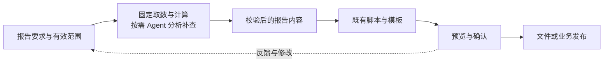

# 43 · 中间产物管理与报告流水线

> 首次整理：2026-11-06；2026-11-07 合入 Dot 中间产物交接、财务分析实施规范及同行再研究。
> 状态：方向研究与设计收敛。用户希望落地，尚未批准具体功能、数据库结构或迁移实施；本轮仅更新资料。

## 当前结论与文档入口

要补的是**页面、Agent 和业务程序都能直接读取、持续修改和消费的同一份当前内容**。预算报告、合同草稿、BOM 填报计划和对账配置是不同用例；共同底层不必统一执行这些业务。

建议将其做成 DeepAgent 内的**可选中间产物模块**：启用时提供产物接口与工具，未启用时继续原有聊天、结构化输出、Skill／Python／PTC 和文件链路。不以插件体系、独立微服务、Mission 或通用工作流为前置条件。

| **资料** | **负责的内容** |
| --- | --- |
| [Dot 原文交接](sources/dot-artifact-handoff-20261106.md)及[来源核验](sources/README.md) | 原始讨论、候选字段／patch、历史代码证据和原调研；正文逐字符归档，原 Page 未修改 |
| [可选产物模块设计](optional-artifact-module-design.md) | 本轮新增：装配、关闭、故障隔离、当前代码接点和首版建议 |
| [产品与框架再研究](artifact-product-research.md) | Pigment、Claude、Deepnote、ADK、Mastra、Trustcall、AG-UI；补充用户试用后的 Deepnote 报告产品方向及商业依据 |
| [Pigment 与工作台原型依据](pigment-and-prototype-research.md) | Mission／Output／Export，以及原工作台交接包能证明的范围 |
| [财务分析实施与交付规范](financial-analysis-delivery-standard.md) | 财务 BP 资产迁移上线的实施流程、数据交接、分层验收及交付责任 |

原文保留历史日期和原始内容；本页维护当前决策及报告场景，不重复字段表、SQL、patch 算法和所有同行清单。旧稿的“固定报告脚本优先”仅适用于能被现有资产覆盖的有界场景，不限制开放报告维护多种产物。

## 已确认与尚待选择

| **状态** | **内容** |
| --- | --- |
| 已确认方向 | 可控规模配置／草稿直接存原生 JSON：MySQL JSON、PostgreSQL JSONB；上层同一 patch 协议，不先维护生产 TEXT 兼容路径 |
| 已确认方向 | Agent 提交增量，服务端校验、合并及条件保存，不要求每轮重写完整大 JSON |
| 已确认方向 | 可以先保留最新版与 revision，不强制完整版本历史；附件和大结果继续用受控文件引用 |
| 已确认边界 | 通用层不统一执行业务；专业程序负责校验、采用、计算／渲染和反馈；不让模型任意写数据库 |
| 本轮新增要求 | 能力可选，不使用也完全能正常使用原聊天和工具，不先建设插件系统 |
| 研究建议，未拍板 | 先做一个会话关联的一类业务草稿，复用能力选择和工具装配，模块随现有服务部署 |
| 未决定 | Mission、跨会话关联、schema 管理、首个业务客户端、删除联动、停用后的只读策略及反馈持久化 |

原生 JSON 是存储方向，不代表已批准具体表结构。现有结构能否复用、MySQL／PG 版本与 SQLite 本地开发适配仍须核对；新增表、字段、索引或迁移须单独评审确认。

## 报告场景：三种做法及 AI 的位置

| **做法** | **适用情况** | **AI 的位置** | **程序负责什么** |
| --- | --- | --- | --- |
| 固定报告流水线 | 周期、口径、查询与模板稳定 | 可只帮助设计和配置；运行时可不用模型 | 参数校验、取数、计算、填模板、导出 |
| 有界的分析报告助手 | 结构基本稳定，但关注点、重点对象及下钻路径会变化 | 选择已支持的分析动作、补查、解释和组织结果 | 真实查询／计算、结果校验、有限区块渲染、版本与发布 |
| 开放式探索分析 | 问题、方法和产物都不确定 | 持续对话，必要时使用代码与工具 | 工具执行、来源与文件管理；不能承诺固定模板覆盖所有要求 |

工作台相对普通聊天的价值，在于保存要求、绑定范围、复跑、比较和交付。**仅把问答换成“任务”名称，没有这些能力，价值有限。**
是否需要执行期 AI，应以它能否改善分析质量或减少维护成本判断，而不是为了报告入口必须调用模型。

## 产物、历史、文件和运行分开

业务产物保存当前草稿；会话历史记录发生过的对话与调用；File ID 管附件、大结果和交付文件；Run／PTC／沙箱状态服务执行。详细职责统一见[可选模块](optional-artifact-module-design.md#内容历史文件与运行的关系)。

08 课题的 Artifact 是大工具结果外置及文件交付，不能因同名就当作可编辑业务产物已经实现。结构化输出 accepted 也不等于草稿保存、业务采用、人审或执行成功。

报告可以分别维护 POV／范围、查询计划、处理脚本、命名结果或数据引用、HTML 模板／报告内容；不强制拆成固定数量的文件或表，完整组成见[原交接第四节](sources/dot-artifact-handoff-20261106.md#四-报告产物应拆成什么)。

### JSON 不是万能执行器

用户提出的担心成立：自然语言增加一个分析方法，不代表固定程序就自动拥有该方法。

- JSON 用来记录要求时，可以包含自由文字；这些文字由 Agent 理解，不是交给解释器直接执行的查询指令。
- JSON 交给固定渲染器时，必须符合已支持的字段、区块及约束。例如现有报告资产的 `presentation_sections` 只支持 `comparison`／`change`／`impact`；不能新增一个任意图表类型就假定程序会画。
- 将来如需可重放的查询计划，应单独定义有限操作及参数，由执行器逐项实现和校验。没有执行器消费的计划只能称为分析记录。
- 超出能力范围时，需要澄清、缩小要求或显式扩展实现；不能通过忽略字段、猜数据或静默改成自由脚本伪装成功。

### 有界报告复用现有资产，开放报告允许扩展

能够覆盖时优先复用交接包资产：Agent 整理有界报告输入，调用 `analysis_report.py` 和 `report-template.html`。
现有字段包括 `analysis_overview`、`kpi_cards`、`presentation_sections`、`analysis_trace` 等，足以承载一类报告的变化内容。

自由脚本适合标准工具没有覆盖的分析或新方法验证，允许 Agent 持续维护；它会增加审阅、复跑、环境和版本管理成本，不必成为每份报告的必需产物。这套区块限制属于既有资产，不是平台全部报告的最终上限。
HTML 只是交付形式；业务草稿与源数据引用不能只剩在一份难以修改的 HTML 中。

## 有界报告的业务闭环示例

这里的阶段用于说明职责，不要求每次固定调用全部 Skill，也不要求增加一层主调度 Agent。

1. **准备要求**：允许通过对话逐步明确，再保存可复用的范围、口径和关注点。关键条件缺失时保留草稿并提问。
2. **生成本次结果**：按本次有效期间和权限取数；需要判断时由 Agent 补查。缺失不补零，数值变化不自动等于业务成因。
3. **校验和预览**：数值／引用／结构校验与人工阅读分别进行；候选结果校验通过不代表业务内容已被采纳。
4. **确认和交付**：生成实际文件，按需要发布；发布成功以真实回执为准，失败或结果未知时先核对，不重复发布。

“停止”“待补充”“生成成功”“已确认”“已发布”应按各自事实表达。首版是否需要这些状态的正式业务持久化仍待评审，本轮不新增数据结构。

## 连续修改、复跑与事实复用

| **用户变化** | **应如何处理** |
| --- | --- |
| 只换 Clean／Forest 等主题 | 有效事实与内容保持，重新渲染，不重新查数 |
| 只改措辞／章节顺序 | 在模板支持范围内更新报告内容；保留原事实与来源 |
| 改期间、组织、比较版本或数据对象 | 重新绑定并校验查询范围，不能套用旧数字 |
| 改关注点、阈值或下钻要求 | 判断已有证据能否覆盖；不足才补查，不能把所有改动都当成纯样式变化 |
| 底层数据更新、权限或口径改变 | 旧结果不能仅因配置相同就视作仍有效；应明确数据时点和重查要求 |
| 定时运行期间需要澄清 | 不能假设用户在线；按事先定义的缺项／失败策略停止或等待，不能自行补关键条件 |

现有原型以配置键演示事实复用，**未实现生产级数据新鲜度、权限和依赖失效判断**。
后续业务结果应区分报告定义版本、本次运行结果和用户修改版本，能指回相应会话／轨迹；不直接把平台 `run_id` 当成报告版本。

## 当前已有基础与尚缺部分

| **范围** | **当前依据／边界** |
| --- | --- |
| 报告工作台交接包 | 本地交互原型：配置、生成过程、预览、停止、主题、历史和 HTML 下载；人工样例数据，浏览器存储 |
| 报告 Skill 资产 | 前次交接包核对包含分析 Skill、脚本、模板及结构化样例；本轮未重新执行或更新线上 Skill |
| DeepAgent 通用底座 | 已有对话、结构化输出、MCP／Skill／Python／PTC、文件发布及轨迹；不等于已有报告任务平台 |
| 业务产物对象 | 原生 JSON 与 patch 方向已明确；可选模块、任务容器、schema、权限和反馈的具体实施仍待评审 |
| 自动运行 | 定时、批量与主动投递另有生命周期要求，不是本原型已有能力 |
| 框架支撑 | Pydantic AI／Harness 可提供运行与校验原语；领域草稿、结果采用和业务发布仍需应用明确实现 |

前次材料中的本地脚本样例校验，不等于工作台已接通真实 Agent／MCP／下载中心。原型说明和验证记录不能当作产品验收。

## 接下来需要确定的产品选择

- 先用合同／BOM 风格可控 JSON 验证跨端读写，还是先做报告多产物？当前建议先验证较小闭环；首个业务未确定。
- 能力启用、关闭后的只读策略、删除联动、数据库结构和反馈复用如何约定？详见[可选模块设计](optional-artifact-module-design.md)。
- 首个高频需求究竟是固定月报，还是每期都需要调整下钻的分析报告？用一份真实报告区分，避免泛化立项。
- 页面先做“配置＋预览”，还是增加“对话＋产物”双视图？对话应服务于修改同一份要求／草稿。
- 首版只提供现有有界报告区块，还是确实需要扩展图表与内容类型？后者必须同时扩展校验和渲染器。
- 报告主要归属于电子表格业务客户端，还是独立应用？这会决定配置、版本、权限和发布由谁持有。
- 是否先保留用户确认再发布？自动运行、自动采用和自动外发应分别确认。

跨课题状态统一登记在 [TODO](../TODO.md) 的 `REPORT-PIPELINE-001`，本页不另建实施待办副本。

## 资料与相关课题

- [08 · Artifact 与出站产物](../08-artifact-export/README.md)：现有文件外置与交付；旧课题部分段落为当时能力快照，以当前实现为准。
- [09 · 结构化输出](../09-structured-output/README.md)：格式接受与业务采用边界。
- [20 · PTC](../20-code-mode/README.md)：单次运行的编排能力，不代替报告草稿存储。
- [26 · 定时任务](../26-scheduled-tasks/README.md)、[07 · 沙箱](../07-python-sandbox/README.md)：仅在确定自动化／工作区需求后衔接。
- [38 · 框架能力采用](../38-pydantic-ai-harness-upgrade/README.md)：运行时状态不自动成为领域业务对象。
