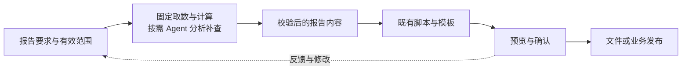

# 43 · 预算报告流水线与持续分析产物

> 整理日期：2026-11-06。状态：讨论回顾、需求研究，尚未批准产品实施。
> 本轮仅整理课题；不修改 Agent、Skill、接口、数据库或报告生成程序。

## 回顾结论

讨论的核心是：**把一次分析中值得复用的要求和结果保存下来，让用户能调整、复跑并交付报告。**
报告任务可以先做得很轻，不必先建设一套通用 Mission／任务调度平台。

- 数据范围、查询、计算和版式都固定时，普通程序可以一键完成；AI 可以只参与最初配置，不必每次运行。
- 需要因本期异常调整下钻、补查证据、结合业务备注和组织文字时，才体现执行期 Agent 的价值。
- 自然语言要求与程序消费的结构化结果是两种契约。不能因为都能存成 JSON，就把它们合成一个可以任意执行的配置。
- 现有报告已有固定脚本和模板，不要求每轮重新生成自由 Python／HTML。
- 同一份报告可以多轮完善；“能聊天”“有执行轨迹”“有可编辑业务草稿”分别是不同能力。

当前建议从**一个有界报告场景＋可复用要求＋按需分析＋固定渲染**起步。这是研究建议，尚未选择最终产品形态。

## 名词从哪里来

| 名称 | 本轮来源与含义 | 不应额外推导的内容 |
| --- | --- | --- |
| 报告任务 | 用户交接包已有任务列表、配置保存和运行记录的原型 | 不代表已有服务端任务实体、调度器或持久运行 |
| 报告流水线 | 用户对“要求 → 查询／分析 → 结构化产物 → 渲染／发布”的工作称呼 | 不等于已经确定一个可执行 JSON DSL |
| Mission | Pigment 官方产品概念，见[参考核验](pigment-and-prototype-research.md) | 不直接套成 DeepAgent 的产品字段、会话或 Run |
| 业务草稿 | 为讨论方便，指用户持续完善、可由业务程序校验和消费的内容 | 聊天摘要、模型记忆或 REPL 变量不会自动成为业务事实源 |

## 三种做法，先判断需求属于哪一种

| 做法 | 适用情况 | AI 的位置 | 程序负责什么 |
| --- | --- | --- | --- |
| 固定报告流水线 | 周期、口径、查询与模板稳定 | 可只帮助设计和配置；运行时可不用模型 | 参数校验、取数、计算、填模板、导出 |
| 有界的分析报告助手 | 结构基本稳定，但关注点、重点对象及下钻路径会变化 | 选择已支持的分析动作、补查、解释和组织结果 | 真实查询／计算、结果校验、有限区块渲染、版本与发布 |
| 开放式探索分析 | 问题、方法和产物都不确定 | 持续对话，必要时使用代码与工具 | 工具执行、来源与文件管理；不能承诺固定模板覆盖所有要求 |

工作台相对普通聊天的价值，在于保存要求、绑定范围、复跑、比较和交付。**仅把问答换成“任务”名称，没有这些能力，价值有限。**
是否需要执行期 AI，应以它能否改善分析质量或减少维护成本判断，而不是为了报告入口必须调用模型。

## 中间产物到底是什么

| 层次 | 存什么 | 谁消费／校验 |
| --- | --- | --- |
| 报告要求 | 目标、对象引用、范围、期间、比较口径、阈值、关注点、格式偏好 | Agent 理解；程序只消费已定义的参数 |
| 分析依据与结果 | 数据来源、有效范围、查询结果、确定性计算、发现、未确认项 | Agent 继续分析，程序核对数值、类型和引用 |
| 报告内容 | 标题、KPI、有限类型的图表区块、文字解读、来源及分析链路 | 固定渲染器校验、排版 |
| 最终文件／发布回执 | HTML／PDF 等实际文件、真实 File ID 或发布记录 | 用户和业务系统查看、下载、采用 |

这些是逻辑职责，不强制拆成四个文件或四张表。保存什么、由谁持有，须在确定客户端和跨会话需求后设计。

### JSON 不是万能执行器

用户提出的担心成立：自然语言增加一个分析方法，不代表固定程序就自动拥有该方法。

- JSON 用来记录要求时，可以包含自由文字；这些文字由 Agent 理解，不是交给解释器直接执行的查询指令。
- JSON 交给固定渲染器时，必须符合已支持的字段、区块及约束。例如现有报告资产的 `presentation_sections` 只支持 `comparison`／`change`／`impact`；不能新增一个任意图表类型就假定程序会画。
- 将来如需可重放的查询计划，应单独定义有限操作及参数，由执行器逐项实现和校验。没有执行器消费的计划只能称为分析记录。
- 超出能力范围时，需要澄清、缩小要求或显式扩展实现；不能通过忽略字段、猜数据或静默改成自由脚本伪装成功。

### 不一定需要“JSON＋每次新写的脚本”

推荐优先复用当前资产：Agent 整理有界报告输入，调用现有 `analysis_report.py` 和 `report-template.html`。
现有字段包括 `analysis_overview`、`kpi_cards`、`presentation_sections`、`analysis_trace` 等，足以承载一类报告的变化内容。

自由脚本适合标准工具没有覆盖的分析或新方法验证，但它会增加审阅、复跑、环境和版本管理成本，不能作为每份报告的默认必需产物。
HTML 只是交付形式；业务草稿与源数据引用不能只剩在一份难以修改的 HTML 中。

## 建议的最小闭环

这里的阶段用于说明职责，不要求每次固定调用全部 Skill，也不要求增加一层主调度 Agent。

1. **准备要求**：允许通过对话逐步明确，再保存可复用的范围、口径和关注点。关键条件缺失时保留草稿并提问。
2. **生成本次结果**：按本次有效期间和权限取数；需要判断时由 Agent 补查。缺失不补零，数值变化不自动等于业务成因。
3. **校验和预览**：数值／引用／结构校验与人工阅读分别进行；候选结果校验通过不代表业务内容已被采纳。
4. **确认和交付**：生成实际文件，按需要发布；发布成功以真实回执为准，失败或结果未知时先核对，不重复发布。

“停止”“待补充”“生成成功”“已确认”“已发布”应按各自事实表达。首版是否需要这些状态的正式业务持久化仍待评审，本轮不新增数据结构。

## 连续修改、复跑与事实复用

| 用户变化 | 应如何处理 |
| --- | --- |
| 只换 Clean／Forest 等主题 | 有效事实与内容保持，重新渲染，不重新查数 |
| 只改措辞／章节顺序 | 在模板支持范围内更新报告内容；保留原事实与来源 |
| 改期间、组织、比较版本或数据对象 | 重新绑定并校验查询范围，不能套用旧数字 |
| 改关注点、阈值或下钻要求 | 判断已有证据能否覆盖；不足才补查，不能把所有改动都当成纯样式变化 |
| 底层数据更新、权限或口径改变 | 旧结果不能仅因配置相同就视作仍有效；应明确数据时点和重查要求 |
| 定时运行期间需要澄清 | 不能假设用户在线；按事先定义的缺项／失败策略停止或等待，不能自行补关键条件 |

现有原型以配置键演示事实复用，**未实现生产级数据新鲜度、权限和依赖失效判断**。
后续业务结果应区分报告定义版本、本次运行结果和用户修改版本，能指回相应会话／轨迹；不直接把平台 `run_id` 当成报告版本。

## 和 BOM、租赁合同流程的共同点

用户之前举的两个类比都可以保留：BOM 蓝图与层级、合同字段与澄清问题，都是 Agent 协助完善领域产物，再由业务程序校验、展示和采用。
预算报告的对应物是分析范围、证据、报告内容和交付文件。

共同模式是“对话帮助完善领域草稿”，差异在于各领域的字段、交互及最终执行语义。
不建议为了共同点先造一个可执行所有领域 JSON 的总平台；先复用对话、结构化输出、工具与文件能力。

## 当前已有基础与尚缺部分

| 范围 | 当前依据／边界 |
| --- | --- |
| 报告工作台交接包 | 本地交互原型：配置、生成过程、预览、停止、主题、历史和 HTML 下载；人工样例数据，浏览器存储 |
| 报告 Skill 资产 | 交接包包含既有分析 Skill、脚本、模板及结构化样例；本轮核对其职责，没有更新线上 Skill |
| DeepAgent 通用底座 | 已有对话、结构化输出、MCP／Skill／Python／PTC、文件发布及轨迹；不等于已有报告任务平台 |
| 报告业务对象 | 要求如何保存、跨会话继续、结果版本、人审和发布关系尚未设计落地 |
| 自动运行 | 定时、批量与主动投递另有生命周期要求，不是本原型已有能力 |
| 框架支撑 | Pydantic AI／Harness 可提供运行与校验原语；领域草稿、结果采用和业务发布仍需应用明确实现 |

本地脚本校验样例通过，不等于工作台已接通真实 Agent／MCP／下载中心。原型说明和验证记录不能当作产品验收。

## 接下来需要确定的产品选择

- 首个高频需求究竟是固定月报，还是每期都需要调整下钻的分析报告？用一份真实报告区分，避免泛化立项。
- 页面先做“配置＋预览”，还是增加“对话＋产物”双视图？对话应服务于修改同一份要求／草稿。
- 首版只提供现有有界报告区块，还是确实需要扩展图表与内容类型？后者必须同时扩展校验和渲染器。
- 报告主要归属于电子表格业务客户端，还是独立应用？这会决定配置、版本、权限和发布由谁持有。
- 是否先保留用户确认再发布？自动运行、自动采用和自动外发应分别确认。

跨课题状态统一登记在 [TODO](../TODO.md) 的 `REPORT-PIPELINE-001`，本页不另建实施待办副本。

## 资料与相关课题

- [Pigment 与原型依据核验](pigment-and-prototype-research.md)：外部事实、原型证据和未核验项分开记录。
- [09 · 结构化输出](../09-structured-output/README.md)：格式接受与业务采用边界。
- [20 · PTC](../20-code-mode/README.md)：单次运行的编排能力，不代替报告草稿存储。
- [26 · 定时任务](../26-scheduled-tasks/README.md)、[07 · 沙箱](../07-python-sandbox/README.md)：仅在确定自动化／工作区需求后衔接。
- [38 · 框架能力采用](../38-pydantic-ai-harness-upgrade/README.md)：运行时状态不自动成为领域业务对象。
