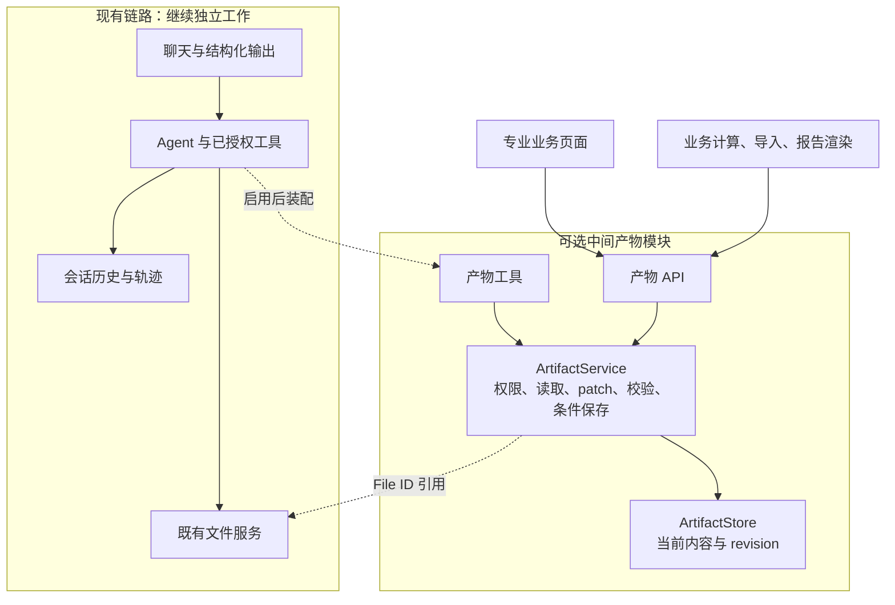

# 中间产物作为可选模块：边界与首版建议

> 2026-11-07。依据用户交接及本轮“可以加上、不用也完全正常”的要求整理。
> 状态：设计建议，未实施。原生 JSON 与受控 patch 沿用[已确认方向](README.md)；本页的开关、工具名、接口形状及存储接入方式仍待评审。

## 建议形态

在 DeepAgent 内增加一个有明确接口的可选业务模块，先随现有服务部署。复用现有能力装配方式，不先建设插件市场、上传可执行扩展包或独立微服务。

模块管理当前内容、身份、类型和修订；会话提供交流和来源；业务页面及程序负责展示、确认、计算、导入或渲染。是否有 Mission、工作流和定时运行由上层场景决定。



上图是模块职责，不代表新增这些服务器或 API 已存在。API 与工具调用同一套服务，避免页面保存和模型保存各有一套合并规则。

## “可选”需要验收哪些行为

建议复用 Agent 已有的能力选择做显式启用，历史 Agent 缺省不启用；具体编码与配置入口后续确认。部署是否提供服务，与某个 Agent 是否获得写工具，是两个不同条件。

| **情况** | **建议行为** |
| --- | --- |
| 部署未接入产物模块 | 普通聊天、结构化输出、文件、Skill、Python、PTC 按现状工作；不构建产物存储连接 |
| 部署提供模块，Agent 未启用 | 不给模型增加产物工具、产物提示或全量草稿；不为每轮聊天额外查询产物 |
| Agent 已启用且当前用户有权限 | 装配产物工具，按需读写；专业页面可以用同一 API 查看和编辑 |
| 用户打开需要产物的业务页面，但模块不可用 | 页面明确提示该能力未启用／不可用；不显示成空列表或已保存；普通聊天仍可使用 |
| 保存失败、超时或冲突 | 返回真实失败或待核对状态；模型可以继续说明问题，不能声称产物已更新 |
| 关闭已经使用过的能力 | 停止给新 Run 装配写工具；保留已有产物及历史引用，不能因关闭而删除内容 |
| 同一实例还有未启用的其他 Agent | 不受产物错误、查询耗时或渲染逻辑影响 |

建议后续保留一个可授权的只读查询／导出路径，方便关闭后查看既有资料；是否停用整个服务由部署方决定。重新启用复用原数据。若完全移除模块，现有聊天仍能显示历史工具名、摘要和引用，实时产物入口则明确不可用。

这不承诺“任何升级都无需迁移”。功能是否启用与数据库发布是两回事：生产若新增表、字段、索引或迁移，仍需按仓库规则单独评审和批准。具体数据库接入／初始化门禁也要设计，不能把未经批准的迁移塞进功能开关。

## 内容、历史、文件与运行的关系

| **对象** | **权威内容和生命周期** |
| --- | --- |
| 当前产物 | 可直接 GET 的当前 JSON；由模块保存，跨 Run 留存 |
| 会话历史 | 对话、调用、结果和来源的历史事实；不会因为当前产物变化重写旧消息 |
| 文件 | PDF、图片、附件、超大数据及交付文件；继续使用既有 File ID 和授权 |
| 沙箱临时文件／PTC 变量 | 当前执行过程的计算材料，不作为产物的唯一保存位置 |
| 执行输入与反馈 | 业务消费者使用的那一份内容、修订、结果和错误；不能事后指向另一版当前草稿 |

首期可以只存最新版与递增 revision，不强制完整版本历史。但这意味着旧 revision 的内容可能已不可读取，不能承诺任意历史版本回滚或 GET。执行开始时由消费者取定一份输入，保留其修订及必要快照／摘要；是否长期保存完整输入按业务需要决定，不先引入全量版本库。

会话删除时是否同时删除产物尚待确定。建议首版先关联单会话并给产物稳定 ID；删除联动必须显式约定并提示。不要把这个 ID 设计成只能用消息序号查找；也不提前开放跨会话／跨用户共享权限。

## 最小调用契约

建议先提供创建、列表、读取、增量更新四个操作；工具名可暂称 `create_artifact`、`list_artifacts`、`read_artifact`、`patch_artifact`，并非本轮新增接口。

- 列表返回标题、类型、修订和更新时间等摘要，不把所有正文塞给模型。
- 读取返回完整受控大小的内容，或调用者明确选择的字段；投影读取必须标明不完整，不能误当全量用于覆盖保存。
- 更新提交 `artifact_id + base_revision + operations`；服务端原子应用、校验、条件写入并返回新修订。
- 已有产物的普通整份覆盖不作为模型默认更新方式；首次创建完整基线与后续 patch 分开表达。
- 类型没有专业渲染器时可提供通用只读 JSON 查看，不自动执行脚本或 HTML。

下面仅说明跨端使用同一内容和修订的形状；操作顺序、路径、空值、数组及幂等细节沿用[原交接第九至十一节](sources/dot-artifact-handoff-20261106.md#九-候选-patch-接口和处理过程)。

```json
{
  "artifact_id": "artifact_demo",
  "artifact_type": "report_spec",
  "schema_version": "1",
  "revision": 7,
  "content": {
    "scope": {"period": "2026-09"},
    "requirements": {"focus": "收入与预测差异"}
  }
}
```

```json
{
  "artifact_id": "artifact_demo",
  "base_revision": 7,
  "operations": [
    {"op": "replace", "path": "/requirements/focus", "value": "收入与预测差异，补充区域贡献"}
  ]
}
```

成功返回修订 8 及变更摘要；如果页面已经保存到修订 8，旧请求必须返回修订冲突，重新读取后再决定修改。`base_revision` 由读取结果取得，用户、App／Space、允许类型与路径由可信服务端上下文和策略确定，不能让模型自行决定归属或权限。

涉及企业租户时沿用平台可信身份范围，不能把 App 过滤参数、namespace 或关联记录单独当鉴权。新关联不自动授权读取其他会话、产物或文件。

## 具体业务怎样接，怎样不接

| **业务** | **启用后的使用方式** | **未接入时** |
| --- | --- | --- |
| 合同／BOM 专业页面 | 页面和 Agent 更新同一个草稿，业务模块校验并采用指定修订，执行反馈带回同一产物 | 原客户端结构化输出及草稿回放继续工作，不强制迁移旧会话 |
| 预算报告 | 分别维护范围、计划、受控脚本／模板或结果摘要；报告程序按依赖决定重查、重算或重渲染 | 继续现有 Skill 查询、脚本渲染及文件发布 |
| 普通问数／闲聊 | 只有确实需要留一份可维护内容时才创建产物 | 直接回答，不为每轮问答创建空壳产物 |

已有合同和 BOM 的 schema／patch 协议不要求一次全换。先选一个调用方做适配，确认共性后推广。业务草稿的 type/schema/version 由相应产品维护；通用层管 JSON 结构、修订、权限、资源边界，不能把租金算法或 BOM 环路规则写进通用存储。

验证器和渲染器先由代码中明确登记的业务实现提供，不因此开放上传任意 Python 作为插件。服务端没有某个专业校验器时，应明确当前只做结构检查，业务采用前仍由专业模块完整校验。

## 与现有技术的接点

2026-11-07 本地只读核验：分支 `test`，`77e4179c / 0.15.14`，依赖仍为 Pydantic AI `2.46.0`、Harness `0.32.0`。图谱返回旧路径，以下以当前源码为准。

| **当前入口** | **可复用的部分／需要补的部分** |
| --- | --- |
| [`agent/factory.py`](../../../src/deep_agent/agent/factory.py) 的 `_toolsets_for_spec`、`build_agent` | 已按能力条件组装 toolset；可选产物 toolset 可接在这个装配边界，不需要替换 Agent loop |
| [`agent/deps.py`](../../../src/deep_agent/agent/deps.py) 的 `AgentDeps` | 已携带可信用户、会话、App／Space及每轮服务依赖；未来注入产物服务句柄，不注入任意数据库访问给模型 |
| [`db/models.py`](../../../src/deep_agent/db/models.py) 的 `ChatSession`、`ChatSessionEvent` | 当前会话与历史事件可提供来源；事件 JSON 不直接变成可编辑的权威草稿行 |
| [`agent/structured_output.py`](../../../src/deep_agent/agent/structured_output.py) | 当前接受输出与纠错机制可继续保留；accepted 不代表已保存草稿、用户确认或实际业务执行成功 |
| `session_file_artifacts` 与既有 FileStore | 解决会话文件授权与引用；不复用 File ID 冒充可变 JSON 产物 ID，避免与大工具结果外置混淆 |

框架现有工具组合原语足以作为起点。官网最新动态 Toolset 示例仅作参考，不能未经版本核对直接复制新 API；本需求不以升级框架、接入 AG-UI 或统一脚本沙箱为前置条件。

PTC／Python／Skill 是否直接读写产物，首版不强制决定；先走正常产物工具即可。以后如开放给 PTC，仍调用同一服务，不能获得另一套宽松权限或绕开修订检查；脚本通过宿主句柄／API接入时也遵守同一规则。

## 首版收敛与验收门槛

建议先验证“一个会话＋一种 JSON 业务草稿＋页面与 Agent 共同修改＋一个既有业务消费者”。保留最新内容和 revision，明确大小保护及失败行为；不把 Mission 表、全文版本库、调度器或任意插件体系放进前置条件。

需要证明的结果：

1. 不启用时现有聊天、结构化输出、文件及工具行为不变；没有额外产物查询和模型上下文。
2. Agent 首次创建、后续 patch；页面直接 GET 和保存，刷新／新 Run 后仍是同一内容。
3. 页面先保存后，迟到的 Agent patch 被拒绝；失败、非法类型／路径、空值与数组操作不污染原内容。
4. 业务消费者取定输入和修订，反馈能被页面、Agent 读取；保存、确认、业务采用和执行成功分别表达。
5. 权限隔离有效，File ID 引用不扩权；禁用／故障时不影响普通 Agent，不自动删数据或静默改用历史猜测。

立项前仍需确认：首个业务及客户端、删除联动、schema 管理、SQL／SQLite 开发适配、生产 DDL、反馈复用入口和关闭后的只读策略。跨课题状态统一登记在 [REPORT-PIPELINE-001](../TODO.md)。
