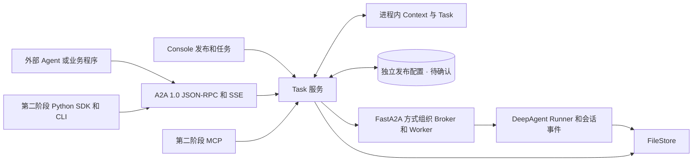

# DeepAgent A2A 服务端 · 两阶段实施总案

2026-11-12 · 原评审稿。以下保留评审时的阶段划分和选型记录。实际一期采用官方 a2a-sdk，FastAPI 直接挂载协议入口，Task 服务和 Runner 由 DeepAgent 管理。实施后的地址、鉴权和依赖见[A2A 服务端指南](../../guides/agent-service.md)，实测见[验收记录](server-validation.md)。

**首阶段让 DeepAgent 成为可独立调用的 A2A 1.0 服务端。** 支持发现、提交、查列表、跟踪、取消、补材料续跑和取件；Console 有独立「集成」页。第二阶段再做面向普通程序和其他 Agent 的 Python SDK、CLI 和 MCP，三者共用同一份任务、权限、文件和错误契约。DeepAgent 主动调用远端 Agent 以后单独立项。

## 从一笔真实业务看设计

1. 管理员把「预算分析助手」发布成 `budget-variance-report`，多选允许的财务应用。每次请求带平台凭据并指定一个 App，Agent 在核验后的范围内运行，返回本次实际生成的摘要或文件。
2. 调用方从 Agent Card 获得接入地址，用 `SendMessage(returnImmediately=true)` 提交“做预算执行差异报告”。服务端先将任务登记到本进程的内存仓储，回传 Task ID 和 Context ID，工作者独立启动 DeepAgent Run。
3. 助手缺少期间，调用 A2A 专用的提问能力，请求期间；当前 Run 在事件落库后结束，任务进入「待补材料」。调用方可断开，之后从 `GetTask` 看到原问题。原消息的工具调用 ID 不对外。
4. 调用方用同一个 Task 和 Context、新的 Message ID 发送结构化期间 `2026-10`；纯文本客户端按问题回 `Q7M4 2026-10`。后端核验当前问题和回执，开启同一 Task 的第二个 Run。文件发布到 FileStore 并可取件后，再提交任务成功及交付引用。
5. 调用方从原 Task 获取摘要及报告。它随后说“再按部门做一份”，用相同 Context、不带旧 Task ID，得到新 Task，历史仍可引用原任务。若直接对已完成任务提交补答，按协议拒绝。
6. 观察连接断开不取消任务。明确调用取消才申请停止；取消和结果落库竞速有唯一提交胜者。需要审批的业务动作要有独立授权和受控审批，模型或原调用方的“同意”不能代替人审。

## 设计和实现顺序

| 顺序 | 开发包 | 工作与验收出口 |
| --- | --- | --- |
| 1A · 协议与依赖验证 | 发布卡、规范接入层、可替换 Adapter | 选择互相兼容的 FastA2A、验证 SDK、FastAPI 和 Pydantic 版本，按实现需要升级并锁定已验版本。用隔离确定性 Worker 重测 FastAPI 挂载、代理子路径、核心操作和关键状态。依赖变化涉及既有运行路径时做对应回归。 |
| 1B · 接收与执行 | 发布、可信身份、Task/Context 仓储、Runner 接线 | 先以单个只读预算 Agent 跑通文本提交、授权、Task/Run 关联、轮询和流式。Task、Context 和受理去重用进程内仓储，经稳定的任务服务对外提供协议；以后按需替换仓储并复跑同一契约用例。协议验收先注入测试发布配置。正式发布配置候选为独立 A2A 表，结构另行确认后才写迁移。 |
| 1C · 暂停、文件与故障 | 补材料、可续状态、取消、产物、并发 | 同 Task 跨 Run 补答、验证失效回执、断线/重订阅、重启清空、到期淘汰、文件鉴权与摘要、追溯。续跑时按原主体和 App 重新校验。需要业务人审的场景在阶段门槛独立确认。 |
| 1D · Console 和互通 | 独立服务端页、可观察性、旧功能回归 | 保存发布、启停、复制 Card 地址、任务列表、进度／补材料／产物详情与诊断入口。通过官方客户端、Inspector/TCK，以及一个有实际版本的第三方客户端互通。原 HTTP Chat、Console、渠道、UI 工具、附件、权限与配置导出不变。只做本地或隔离环境验证，保留可评审版本。 |
| 2A · 调用工具 | Python SDK、CLI | 先把 Python SDK 的请求、回执与下载跑通，再将 CLI 包装同一 SDK。分别验证最低支持 Python、打包、无浏览器登录态、自动化退出码、失败恢复、重试和文件摘要。 |
| 2B · 面向 Agent | MCP 及接入 Skill | 连接已授权的发布，验证工具发现、提交→补材料→取件。同一主体跨入口读取同一 Task。明确普通 MCP 工具与 Tasks 扩展的区别；先跑真实 MCP 客户端再决定扩展。阶段 2 独立验收，仍不发布。 |

课题在 `codex/a2a-server` 独立 worktree 评审。开发前核对版本、数据库 head 与依赖镜像。阶段 2 不得另建任务生命周期，也不要求打开 DeepAgent 出站功能。

实施交付单列「依赖变更（运维）」。按生产运行、沙箱和测试区分新增、升级、降级及移除，记录包名、旧版与新版、原因、回归结果和镜像配套要求。涉及生产固定基础镜像的变更，交接时明确是否需要重建。

## 配套设计与验收

- [发布选路、全部协议操作与联调](server-routing-and-testing.md)说明多个 Agent 如何分别发布、所有协议操作及现有会话映射。
- [协议、状态机、ID 和 UI 工具桥接](server-wire-lifecycle.md)：1.0 各方法、暂停与补答的真实载荷、取消、协议兼容边界。
- [状态、执行、鉴权及产物](server-state-artifacts.md)：内存生命周期、发布配置边界、文件权限和迁移门槛。
- [CLI、Python SDK 与 MCP](server-clients.md)：分发、调用语法、认证、上传/续跑/查询/下载、结构和错误。
- [隔离验证与实施验收矩阵](server-validation.md)：实测结果、复现步骤、协议/产品/运维门槛。
- [服务端页面设计](server-console-design.md)和[交互原型](<Prototype A2A服务端接入/index.html>)：页面布局和字段。后续入口示例留作预览，阶段 1 不把未交付客户端标为可用。
- [原始 Dot 交接稿](https://chatgpt.com/space/page_dd86da26ca8c8191b5c07d19ef7ff85f)及[授权专题](access-control-design.md)。执行方案中与本计划冲突的旧口径以本计划为准。

## 范围和决策点

| 评审点 | 当前建议 | 何时必须确认 |
| --- | --- | --- |
| 协议框架 | **FastA2A 为实施基线**，沿用 Worker / Broker / Storage 和 Starlette ASGI 方式。为关键 1.0 行为设计项目自己的严格入口和 Task 服务，官方 SDK 用于互通和独立验证。可逐项评估上游修复后缩减本地适配。 | 1A：明确实际复用哪些公共接口、锁定版本与包摘要。 |
| 状态与配置 | 首期单进程，Task/Context 放内存。发布配置独立管理，候选 `agent_publications` 表。 | 1B 确认部署的进程与流量路由。确认配置表具体结构后进入迁移。跨实例运行另立项。 |
| 业务身份 | 首个测试使用已验证的平台主体和一个允许的 App。真实链路覆盖 Token 和 Key 的权限、App／Space 一致性及凭据过期。 | 1B：指定实际客户和授权机制；1C：如需用户委托/续期，在扩大范围前实测。 |
| UI 工具 | 首期发布预检识别依赖浏览器执行的 UI 工具，按发布配置拒绝或排除；用专门的 A2A 补材料能力完成跨端追问。现有普通 Chat 的表单与审批原路径保持。 | 1B：确认预算 Agent 不依赖页面组件；1C：客户若需要人审，再确定审批对象、独立审批人和可信回执。 |
| 互通范围 | JSON-RPC+SSE 1.0 为首期验收对象。0.3 视指定客户端真实请求加独立适配；HTTP+JSON、gRPC、Webhook、Extended Card 与签名按需求扩展。 | 1A：确认 Inspector 与 CodeBuddy 版本、真实 1.0 支持以及客户端可以处理的文件和暂停交互。 |
| 执行与保留 | 运行、等待输入、任务历史、文件过期分别定义；同进程、在保留期内可从待补材料继续。重启后 Task/Context 清空，历史和日志用于排查，不自动重跑。 | 1C：给出压测后的限额、清理和恢复策略；待定值不得写进上线承诺。 |

交付验收用三个发布验证选路和权限。预算用例验证提交缺参、断开、查问题、同 Task 补答与取件。重启后发布仍可查，近期任务为空，旧 Task 不可继续。仅浏览器原型、成功返回 200 或官方 SDK 能解析 Card，均不足以称服务已接通。
