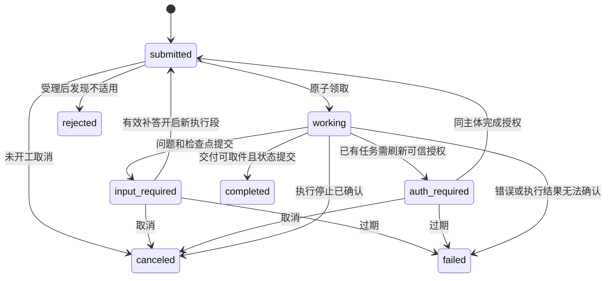

# A2A 1.0 协议、任务状态与跨端续跑

[总案](server-implementation-plan.md) · 以下为开发契约草案。对外以 [A2A 1.0 规范](https://a2a-protocol.org/latest/specification/)和锁定版本的官方 SDK/TCK 为准。示例域名仅作说明；兼容层不承诺产品内部 SSE 或 Pydantic 的事件格式。

## 发现、版本与操作

- 启用后从 `GET /api/v1/agent-service/a2a/{publication}/agent-card.json` 取得 Card。发布编码保持 URL 稳定，关联 Agent 可以编辑，新任务读取生效配置。停用时关闭 Card 与新任务入口，已有任务保留原执行范围。对端从 `supportedInterfaces[]` 读取规范地址和版本。入口建议 `POST /api/v1/agent-service/a2a/{publication}`，支持网关子路径。服务根据部署配置生成 URL。路由尾斜杠行为要在无自动重定向客户端测试。
- `A2A-Version: 1.0`；规范将缺失版本解释为 0.3，纯 1.0 入口返回版本不支持。不匹配返回协议版本错误，不因方法名相似静默降级。JSON-RPC 与 HTTP 的鉴权和错误层分开。公共 Card 只放安全可公开的能力元数据；私有发布的发现是否需认证按部署策略配置，并用目标客户端确认。注册目录、Extended Card 都不依赖公开暴露所有 Agent。
- 只广告已实测的接口、媒体类型和能力；首期仅 `JSONRPC`、`streaming=true`、`pushNotifications=false`。不对外宣称全传输、全扩展或已认证。试验包接受旧方法名并不意味着 0.3 互通；如目标强制 0.3，另设显式版本／接口，复用服务并独立验收。

```json
{
  "name": "预算执行差异报告",
  "description": "按指定期间生成差异摘要和 XLSX。",
  "version": "1.0.0",
  "supportedInterfaces": [
    {"url":"https://deepagent.example.com/api/v1/agent-service/a2a/budget-variance-report","protocolBinding":"JSONRPC","protocolVersion":"1.0"}
  ],
  "capabilities": {"streaming":true,"pushNotifications":false},
  "defaultInputModes": ["text/plain","application/json"],
  "defaultOutputModes": ["application/json","application/vnd.openxmlformats-officedocument.spreadsheetml.sheet"],
  "securitySchemes": {"serviceBearer":{"httpAuthSecurityScheme":{"scheme":"bearer"}}},
  "securityRequirements": [{"schemes":{"serviceBearer":{"list":[]}}}],
  "skills": [
    {"id":"budget-variance-report","name":"预算执行差异报告","description":"生成只读预算差异报告","tags":["budget","report"]}
  ]
}
```

| 1.0 JSON-RPC 方法 | 阶段 1 契约 | 旧版名称（只供对照） |
| --- | --- | --- |
| `SendMessage` | 本产品对发布业务总返回 Task，不走直接 Message 快捷分支。按规范 §3.2.1 的具体配置说明：`returnImmediately=true` 在内存受理后即回；`false` 或缺省等待到终态或输入／鉴权暂停。规范 §3.1.1 的抽象描述与该配置说明措辞有差异，按明确字段行为和锁定 TCK 验证。观察超时不会取消 Worker；不能把超时假装成成功。 | `message/send` |
| `SendStreamingMessage` | 首个 data 帧为 Task；随后 status/artifact 更新。在首阶段实现中，运行段到终态或暂停时发最终状态后结束本段 stream；补答可开新 stream。 | `message/stream` |
| `GetTask` | 当前状态、已公开产物、按 `historyLength` 投影历史；0 省略历史，缺省有服务器上限。读取无副作用，不裁剪存储历史。 | `tasks/get` |
| `ListTasks` | 调用主体／发布范围内分页；支持规范的 context、状态、最近更新时间、分页参数与返回量控制；过滤、计数和游标都从授权范围计算。错误或不同筛选条件的游标不能泄露其他范围。 | `tasks/list`（非所有旧实现都有） |
| `CancelTask` | 排队或等待用户的任务可原子取消；运行任务需实际停止回执，返回可确认的更新状态。若在服务允许的等待内未停止，返回最新仍在运行的状态及本产品的取消处理中提示，随后查询最终状态；此行为需通过锁定 TCK/客户端确认，若标准客户端要求同步终态，以其验收为准。不可取消或已终态使用标准错误，不把完成改成取消。 | `tasks/cancel` |
| `SubscribeToTask` | 非终态开始先给原子快照，随后状态／产物更新；终态用 `GetTask`，规范要求终态订阅拒绝。处于暂停状态可读快照；本产品当前段结束，后续由补答或再次订阅建立观察。验证暂停关闭策略与目标客户端/TCK。 | `tasks/resubscribe` |
| Push CRUD、Extended Card（逐项映射见[操作表](server-routing-and-testing.md#a2a-10-操作表)） | 本期不提供可用实现；根据未声明能力返回规范错误，不能成功接收回调却不发送。后续另定回调所有权、签名、重试和撤销。 | 仅按明确兼容目标加，不复用旧方法作 1.0。 |

标准错误至少覆盖：请求结构／方法错误、跨作用域或不存在 `TaskNotFoundError`（`-32001`）、不可取消 `-32002`、不支持操作 `-32004`、媒体不支持 `-32005`、版本不支持 `-32009`。权限在 API 接收层拒绝时为 HTTP 401/403 或部署统一的认证响应；需要隐藏具体 Task 时用统一的不可访问结果。应用层冲突（同 ID 不同载荷、上下文忙、过期回执）使用规范允许的错误信封及项目错误标识；最终编码在锁定 TCK 时定，不能占用官方已分配错误码。提交前无权不创建 Task；已受理后才可成为失败或拒绝的任务记录。

## ID 与状态

| ID | 生成者与作用域 | 关键规则 |
| --- | --- | --- |
| `publication` | 管理员录入的稳定编码 | 不等于 Agent ID；版本更改不能把已有 Context 静默切到另一 Agent／App。 |
| `contextId` | 服务端生成的外部不透明 ID | 属于发布、调用主体、可信企业及 App/Space；映射一条专用 DeepAgent Session。一个 Context 可有多个 Task，首期同 Context 串行。不可作为身份凭据。 |
| `taskId` | 服务端生成、外部稳定 | 一次业务工作可包含多个 Run；终态不可重新进入工作。URL、输入和查询中的 ID 一律先授权。 |
| `messageId` | 发送方生成的唯一消息 ID | 新用户输入用新 ID；网络重试沿用原 ID 和原载荷。新 Task 按作用域去重；同 Task 内所有补答按自己的 ID 去重。JSON-RPC 的 `id` 只做传输相关性。 |
| `requestId` | DeepAgent 在一次暂停时生成 | A2A 扩展元数据中的挑战标识，绑定 Task、暂停版本和内部未消费调用；不是 `tool_call_id`，也不授权。SDK 使用它，通用客户端用问题中的短回执码。 |
| `session_id / run_id / turn_id` | DeepAgent 生成 | Session 属于 Context；Runner 每个执行段用新的 Run，原历史事件规则不改。只给有诊断权的 Console 展示内部 ID。 |
| `artifactId` | Task 服务生成 | 对一个已发布交付物稳定。与内部 File ID、存储键和临时 URL 分开。 |

路由规则：无两个 ID → 新 Context + Task；有 Context 没 Task → 新 Task（可带已授权的 `referenceTaskIds`）；有 Task 没 Context → 从 Task 推出；两者均有 → 必须匹配。不存在的客户端 Context 不当作新建授权；外部 Task ID 不可由客户端指定创建。另一个活跃／暂停 Task 占用同 Context 时，明确提示继续、取消或另起 Context；不在同一内部 Session 混跑。首期 `working` 时不接受任意插话／改指令，只接受取消；需要对运行中的 Task 增补消息时另定并发语义。

更换关联 Agent、执行身份或 App／Space 后，旧 Context 只用于仍获授权的已有 Task。用旧 Context 创建新 Task 时，返回明确的范围不匹配提示，调用方重新发起时省略 Context ID。文案、输出说明等不改变执行范围的编辑允许沿用原 Context。



`input-required/auth-required` 是可续的暂停态；`completed/failed/canceled/rejected` 才是终态。`cancel_requested_at` 是内部标记，不扩充标准枚举。「进程中断且无法确认执行结果」用 `FAILED` 和脱敏原因表达，不能等同于等用户补材料。

## 补材料的报文

示例均发送到同一个发布的 RPC 路径，认证由 HTTP 层负责。

```json
{"jsonrpc":"2.0","id":1,"method":"SendMessage","params":{
  "configuration":{"returnImmediately":true},
  "message":{"messageId":"request-001","role":"ROLE_USER","parts":[{"text":"生成预算执行差异报告"}]}
}}
```

`GetTask` 或 SSE 状态事件返回问题。下面是 `GetTask` 的 result（不是整个信封）：

```json
{"id":"task-demo-0065","contextId":"ctx-demo-03","status":{
  "state":"TASK_STATE_INPUT_REQUIRED","timestamp":"2026-11-12T02:42:31Z",
  "message":{
    "messageId":"question-001","role":"ROLE_AGENT","taskId":"task-demo-0065","contextId":"ctx-demo-03",
    "parts":[{"text":"请提供预算期间（YYYY-MM），例如回复 Q7M4 2026-10。"}],
    "metadata":{"https://deepagent.example.com/extensions/interaction/v1":{"requestId":"ask-demo-q7m4","kind":"clarification","field":"period","format":"YYYY-MM"}}
  }
}}
```

```json
{"jsonrpc":"2.0","id":3,"method":"SendMessage","params":{
  "configuration":{"returnImmediately":true},
  "message":{"messageId":"answer-001","role":"ROLE_USER","taskId":"task-demo-0065","contextId":"ctx-demo-03",
    "parts":[{"data":{"period":"2026-10"}}],
    "metadata":{"https://deepagent.example.com/extensions/interaction/v1":{"requestId":"ask-demo-q7m4"}}}
}}
```

用户也可将上述 data 和 metadata 换为 `"parts":[{"text":"Q7M4 2026-10"}]`。短码只在其 Task 的当前暂停有效；多轮分别签发。它避免陈旧补答误填下一个问题，没有授权含义。机器端提供 schema 校验；通用文本客户端从问题读出格式并返回。校验失败不消费问题、不启动 Run，重复成功回执返回原 Task；无正文的认证续跑由 SDK 通过重新验证的同主体请求和明确的继续消息表达，不发 Token 给模型。正常运行期间上游令牌过期：只在具备安全暂停点、可重新验证授权时进入 `AUTH_REQUIRED`；首期固定服务身份取不到授权直接给可解释失败，不假装可由普通文本解锁。

## 现有 UI 工具与 A2A 的边界

目前 [UI 工具指南](../../guides/ui-tools-external.md) 和 [deferred 校验](../../../src/deep_agent/agent/deferred.py)的链路是：模型产生前端工具调用 → 普通 Chat SSE `final.pending` + 持久调用事件 → 对应客户端执行 widget 或收集人审 → 回传 `deferred_tool_results` → Runner 加锁验证当下 pending 和原模型档位 → 续跑。**A2A 的 `INPUT_REQUIRED` 只是远端任务等待消息；它不会替调用方加载 DeepAgent 的表单、页面动作或用户审批。** 因此不把现有 `final.pending`、工具清单和 raw tool IDs 透传给 A2A 客户端。

| 类型 | 首阶段处理 |
| --- | --- |
| 文字追问／补参数／补文件 | 增加发布范围内专用的 A2A 提问能力。模型可请求用户补一个字段或附件；服务端保存问题 Schema、输入限制和暂停回执。先基于受控 deferred 请求验证能复用既有 Runner 续跑；普通自然语言问号不自动视为暂停。 |
| 既有只读表单 | 默认不对 A2A 装载。已知包里只有收集业务参数时，可在后续做显式白名单映射；原 Console 使用方式不变。 |
| 浏览器专有 UI 工具或执行动作 | 发布预检显示受影响工具。默认拒绝依赖此工具的发布；管理员可在发布配置明确排除并在只读场景试跑。A2A 输入不能指定 UI 包、组件、工具结果或权限。 |
| 人工审批、写入或支付等副作用 | 与普通补答区分。首期不开放这种远端动作。若首场景必须审批，加入可信审批人、原动作/参数摘要、风险说明、权限重查、一次性决策与失效流程；在本产品受控 UI 审批后才恢复，远端原发起者提交“同意”本身无效。 |

补答流程：在 Context 互斥及 Task 版本条件下读当前 checkpoint → 确认归属、授权、问题版本、期限、输入、附件 → 原子保留消息幂等凭据与续跑意图 → Worker 绑定原执行配置和新的 Run，重新校验当前真实 pending → 只用可信映射构建 `DeferredToolResults` 或对应语义。原 Runner 已消费但状态未更新时按已提交事件对账，不能再执行。原模型、工具或权限失效则停止，提示按新配置重发。现有 Console Chat 不得进入 A2A 专用 Session 续跑；诊断只读区仍按权限查看。

## 流式与取消细节

- `GetTask` 是权威快照；SSE 是观察，使用标准单选信封 `task/statusUpdate/artifactUpdate`。服务端先注册观察，再读快照水位，丢弃旧水位更新，避免快照到订阅之间漏终态。通知失败以数据库重读补齐；终态落库后才发送。慢订阅者用有界缓冲或断开重查，不能拖住任务。
- 首期不承诺逐 Token 回放或标准 Last-Event-ID。断线客户端先查快照，非终态再订阅；暂停和文件引用在状态中可回读，客户端可在新流继续。使用 RFC 3339 UTC 时间，心跳由部署验证配置。
- 对已排队的任务取消用原子条件阻止领取；运行中记录取消意图并通知实际 Worker。Worker 停止、清理或证明未开始后才能写 CANCELED。若成功已提交，取消不得重写；若进程丢失且副作用未知，按中断失败处理。两个客户端同任务竞争、订阅和取消竞速都列入验收。

## 查询、取消、订阅与产物示例

```json
{"jsonrpc":"2.0","id":4,"method":"GetTask","params":{"id":"task-demo-0065","historyLength":0}}
```

```json
{"jsonrpc":"2.0","id":5,"method":"ListTasks","params":{"contextId":"ctx-demo-03","status":"TASK_STATE_INPUT_REQUIRED","pageSize":20,"historyLength":0,"includeArtifacts":false}}
```

`ListTasks` 可接 `pageToken`、`statusTimestampAfter`，按状态更新时间倒序、Task ID 决定同时间顺序。响应为 `tasks, nextPageToken, pageSize, totalSize`，末页 token 为 `""`。页长 1–100，缺省最多 50；`includeArtifacts=false` 省略每个 Task 的 artifacts 字段，不能回 null 或空数组当作省略。游标绑定发布、主体和筛选条件，不公开内部数据库键。并发状态变化时以当前快照为准，客户端可用 Task ID 去重；不承诺冻结整个任务列表。

```json
{"jsonrpc":"2.0","id":6,"method":"SubscribeToTask","params":{"id":"task-demo-0065"}}
```

```json
{"jsonrpc":"2.0","id":7,"method":"CancelTask","params":{"id":"task-demo-0066"}}
```

流式的 JSON-RPC `result` 中，以下对象是一个文件已发布的更新。实际首帧为 Task，最后发终态更新；完整清单仍从 `GetTask` 回读。

```json
{
  "artifactUpdate":{
    "taskId":"task-demo-0065","contextId":"ctx-demo-03","append":false,"lastChunk":true,
    "artifact":{"artifactId":"report-xlsx","name":"预算差异报告.xlsx","parts":[{
      "url":"https://deepagent.example.com/api/v1/agent-service/a2a/budget-variance-report/tasks/task-demo-0065/artifacts/report-xlsx/download",
      "filename":"预算差异报告.xlsx",
      "mediaType":"application/vnd.openxmlformats-officedocument.spreadsheetml.sheet"
    }]}
  }
}
```

大附件输入可先走拟议的 `POST /api/v1/agent-service/a2a/{publication}/uploads`（授权 multipart），拿本服务认可的受控 URL 再作为 `Part.url` 提交。必须核验它是本服务签发且属于当前调用者/发布的引用，不能把任意 URL 当作抓取命令。小文件使用 `Part.raw`。阶段 1 的 A2A 交付与取件不能等阶段 2 SDK 才可用。
