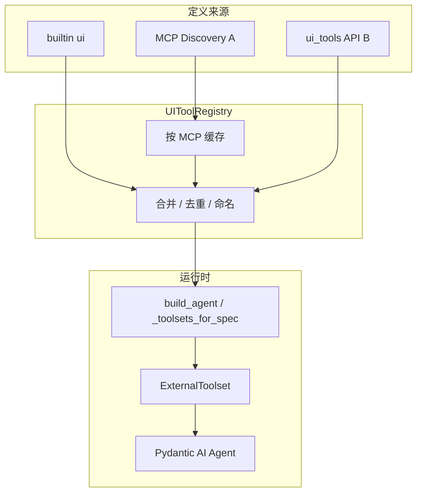

# RFC 0001：可扩展 UI 工具（方案 A + B）

| 字段 | 值 |
|------|-----|
| **状态** | Implemented |
| **作者** | deep-agent 平台组 |
| **关联** | [ui-tools-extension-proposals.md](../ui-tools-extension-proposals.md)、[ui-tools-external.md](../../guides/ui-tools-external.md) |
| **范围** | 方案 A（MCP UI 发现）+ 方案 B（UI 工具配置 API） |

---

## 1. 摘要

本 RFC 定义如何让**外部开发者**在不修改 deep-agent 源码的前提下扩展人机交互（UI）工具：

- **方案 A**：MCP Server 通过约定接口上报 UI 工具定义；平台在注册/刷新 MCP 时拉取并编译为 `ExternalToolset`。
- **方案 B**：平台提供 `ui_tools` 资源配置 API 与持久化；支持手工注册、覆盖、按 Agent 绑定。

二者合并为统一 **UI Tool Registry**，在 Agent 组装时与内置 `ui` 能力一并注入。执行语义保持现有 HITL 协议：`final.pending` + `deferred_tool_results` 续跑。

**非目标（本 RFC 不包含）**：

- 请求体动态 `ui_tools`（原方案 C）
- 平台内置每种 widget 的渲染实现（由集成方客户端负责）
- 在 MCP `call_tool` 内阻塞等待用户操作

---

## 2. 背景与动机

当前 UI 工具硬编码于 `capabilities/ui/builtin.py`，外部集成方只能使用 `confirm_action` / `ask_user_choice`。  
外部团队通常已有 **MCP Server（业务工具）** 与 **自建聊天客户端**；希望：

1. UI 工具 schema 与 MCP 同仓库迭代；
2. 运营可通过 Admin/API 配置或覆盖；
3. 不破坏现有 SSE / deferred 协议。

---

## 3. 术语

| 术语 | 含义 |
|------|------|
| **UI 工具** | `execution=client` 的工具：模型可调用，服务端不执行，run 以 pending 结束 |
| **Server 工具** | 现有 MCP 工具：在 deep-agent 侧 `call_tool` 同步执行 |
| **发现（Discovery）** | 平台连接 MCP 并获取 UI 工具 manifest 的过程 |
| **规范名（Canonical name）** | 注入模型前的全限定工具名，如 `acme__pick_date` |
| **Widget** | 客户端渲染提示符，非服务端逻辑 |

---

## 4. 架构



### 4.1 合并优先级（冲突时）

同一**规范名**仅保留一条定义，优先级从高到低：

1. **manual**（方案 B，`source=manual` 且 `override=true` 或未关联 MCP）
2. **mcp**（方案 A 发现，DB 快照 `source=mcp`）
3. **builtin**（平台内置）

冲突时记录 warning 日志；`GET /api/v1/ui-tools` 返回 `effective` 与 `shadowed` 元数据供排查。

### 4.2 Agent 可见性

某 UI 工具对 Agent **可见**当且仅当：

```
tool.enabled == true
AND f"ui:{tool.name}" ∈ agent.capabilities
AND (
  tool.mcp_server_name 为空
  OR (
    f"mcp:{tool.mcp_server_name}" ∈ agent.capabilities
    AND mcp server enabled
  )
)
```

内置 `ui` 工具始终注入（与今日 `_toolsets_for_spec` 行为一致）。

---

## 5. 方案 A：MCP UI 工具发现协议

### 5.1 协议版本

Manifest 根字段 `protocol_version`：`"1.0"`（本 RFC）。

### 5.2 发现方式

MCP Server 配置（扩展现有 `mcp_servers.config` JSON）：

```json
{
  "command": "...",
  "args": [],
  "ui_tools": {
    "enabled": true,
    "mode": "tool",
    "refresh_seconds": 300
  }
}
```

| `ui_tools.mode` | 行为 |
|-----------------|------|
| `tool` | 调用约定 MCP Tool（默认，见 §5.3） |
| `resource` | 读取约定 Resource URI（见 §5.4） |
| `none` | 不发现 UI 工具 |

缺省：`enabled=true`，`mode=tool`，`refresh_seconds=300`。

### 5.3 模式 `tool`：约定工具 `ui_tools_list`

**工具名（固定）**：`ui_tools_list`  
**暴露给模型**：**否** — 平台在 `tools/list` 过滤，不加入 Agent toolset。

**调用**：无参数，`{}`。

**返回**：JSON 字符串或 MCP structured content，符合 §5.5 Manifest。

**失败语义**：

| 情况 | 行为 |
|------|------|
| 工具不存在 | 视为该 MCP 无 UI 工具；server 工具照常 |
| 调用超时/错误 | 使用上次成功缓存；若无缓存则跳过 UI；打 error 日志 |
| Manifest 校验失败 | 同上，不阻塞 MCP server 工具注册 |

### 5.4 模式 `resource`：约定 Resource

**URI**：`ui://tools/manifest`  
**MIME**：`application/json`  
**Body**：§5.5 Manifest。

### 5.5 Manifest JSON Schema

```json
{
  "protocol_version": "1.0",
  "mcp_server": "acme",
  "tools": [
    {
      "name": "pick_delivery_date",
      "description": "Ask the user to pick a delivery date in the client UI.",
      "parameters_json_schema": {
        "type": "object",
        "properties": {
          "prompt": { "type": "string", "description": "Label shown above the picker." },
          "min_date": { "type": "string", "format": "date" },
          "max_date": { "type": "string", "format": "date" }
        },
        "required": ["prompt"]
      },
      "widget": "date_picker",
      "result_schema": {
        "type": "object",
        "properties": {
          "date": { "type": "string", "format": "date" }
        },
        "required": ["date"]
      },
      "metadata": {}
    }
  ]
}
```

| 字段 | 必填 | 说明 |
|------|------|------|
| `protocol_version` | 是 | 当前 `"1.0"` |
| `mcp_server` | 否 | 若提供须与 DB `mcp_servers.name` 一致 |
| `tools` | 是 | 可为 `[]` |
| `tools[].name` | 是 | MCP 内局部名：`^[a-z][a-z0-9_]{0,63}$` |
| `tools[].description` | 是 | 给模型的工具说明 |
| `tools[].parameters_json_schema` | 是 | JSON Schema object |
| `tools[].widget` | 否 | 客户端渲染提示，见 §7 |
| `tools[].result_schema` | 否 | 文档化 `result` 形状，供集成方与 Agent instructions |
| `tools[].metadata` | 否 | 透传至 `GET /ui-tools` 与 SSE（不发给模型） |

### 5.6 规范名映射

```
canonical_name = f"{mcp_server_name}__{tools[].name}"
```

示例：`acme__pick_delivery_date`。

平台注入 `ToolDefinition.name = canonical_name`，`ExternalToolset.id = f"ui-mcp:{mcp_server_name}"`。

### 5.7 发现时机

| 事件 | 动作 |
|------|------|
| **Agent 组装**（`build_agent` / `prepare_ui_toolset_for_spec`） | 仅当 Agent `capabilities` 含**非 builtin** 的 `mcp:<name>` 时，按需连接 MCP 发现并写入 DB |
| `POST /mcp/{name}/ui-tools/refresh` | Admin 手动刷新（见 §6.4） |
| **builtin MCP**（`mcps/<name>/`） | **不参与** UI 发现，视为无 UI 工具 |
| 服务启动 / `load_and_register_mcp` | **不**批量发现（避免拖慢启动） |
| MCP `enabled=false` | 该 MCP 来源的 UI 工具在可见性过滤中不可见 |

### 5.8 MCP Server 实现清单（集成方）

1. 实现业务 server 工具（照常）。
2. 实现 `ui_tools_list` **或** 暴露 resource `ui://tools/manifest`。
3. 在 deep-agent Admin 注册 MCP，确保 Agent `capabilities` 含 `mcp:<name>`。
4. 在 Agent `instructions` 中说明何时调用 `acme__pick_delivery_date` 及 `result` 字段含义。
5. 自建客户端：对 `tool_call.tool` 匹配规范名，按 `widget` 渲染，提交 `deferred_tool_results`。

---

## 6. 方案 B：UI 工具配置 API

### 6.1 数据模型

**表名**：`ui_tool_definitions`

| 列 | 类型 | 说明 |
|----|------|------|
| `name` | `VARCHAR(191)` PK | 规范名；manual 创建时建议 `^[a-z][a-z0-9_]{1,120}$` |
| `description` | `TEXT` | 模型可见描述 |
| `parameters_json_schema` | `JSON` | 参数 schema |
| `widget` | `VARCHAR(64)` NULL | 渲染提示 |
| `result_schema` | `JSON` NULL | 结果文档 |
| `metadata` | `JSON` NULL | 客户端扩展 |
| `source` | `VARCHAR(16)` | `builtin` \| `mcp` \| `manual` |
| `mcp_server_name` | `VARCHAR(191)` NULL FK → `mcp_servers.name` ON DELETE SET NULL |
| `enabled` | `BOOLEAN` | 默认 true |
| `override` | `BOOLEAN` | manual 覆盖同名的 mcp 定义时为 true |
| `discovered_at` | `TIMESTAMPTZ` NULL | MCP 发现时间 |
| `created_at` | `TIMESTAMPTZ` | |
| `updated_at` | `TIMESTAMPTZ` | |

**索引**：`(mcp_server_name)`、`(source, enabled)`。

内置工具（`confirm_action` 等）可迁移为 `source=builtin` 行，或继续代码内置 + DB 只存外部工具（**推荐后者**，减少迁移风险）。

### 6.2 REST API

基础路径：`/api/v1/ui-tools`  
认证：与现有 Admin API 一致（本 RFC 不规定，实现时复用项目既有鉴权）。

#### `GET /api/v1/ui-tools`

查询参数：

| 参数 | 类型 | 说明 |
|------|------|------|
| `mcp_server` | string? | 仅某 MCP 来源 |
| `source` | enum? | `builtin` \| `mcp` \| `manual` |
| `enabled` | bool? | 默认 true |

**响应 200**：

```json
{
  "items": [
    {
      "name": "acme__pick_delivery_date",
      "description": "...",
      "parameters_json_schema": {},
      "widget": "date_picker",
      "result_schema": {},
      "metadata": {},
      "source": "mcp",
      "mcp_server_name": "acme",
      "enabled": true,
      "override": false,
      "discovered_at": "2026-06-23T10:00:00Z",
      "created_at": "...",
      "updated_at": "..."
    }
  ],
  "total": 1
}
```

#### `GET /api/v1/ui-tools/{name}`

返回单条；404 若不存在。

#### `POST /api/v1/ui-tools`

创建 **manual** 工具。

**请求体**：

```json
{
  "name": "myapp__custom_form",
  "description": "Collect user input via custom form widget.",
  "parameters_json_schema": {
    "type": "object",
    "properties": {
      "title": { "type": "string" }
    },
    "required": ["title"]
  },
  "widget": "custom",
  "result_schema": {
    "type": "object",
    "properties": {
      "fields": { "type": "object" }
    }
  },
  "metadata": { "form_version": "1" },
  "enabled": true,
  "override": false
}
```

| 状态码 | 条件 |
|--------|------|
| 201 | 创建成功 |
| 409 | `name` 已存在 |
| 422 | schema 校验失败 |

**约束**：

- `source` 固定为 `manual`（请求体不可选）
- `name` 不得与 builtin 保留名冲突（`confirm_action`、`ask_user_choice`）除非 `override=true` 且平台允许

#### `PATCH /api/v1/ui-tools/{name}`

可更新：`description`、`parameters_json_schema`、`widget`、`result_schema`、`metadata`、`enabled`、`override`。

- `source=mcp` 的行：默认仅允许改 `enabled`、`override`（覆盖开关）；改 schema 需 `force=true` 查询参数（审计用）
- `source=builtin`：禁止 PATCH（501 或 403）

#### `DELETE /api/v1/ui-tools/{name}`

- `manual`：物理删除
- `mcp`：删除 DB 行；下次发现可再写入
- `builtin`：403

#### `POST /api/v1/mcp/{name}/ui-tools/refresh`

触发对该 MCP 的 UI 发现；响应：

```json
{
  "mcp_server": "acme",
  "discovered": 3,
  "upserted": 2,
  "removed": 1,
  "errors": []
}
```

### 6.3 扩展 `GET /api/v1/tools`

在现有 capability 列表中增加：

```json
{
  "name": "ui-client",
  "kind": "ui-client",
  "description": "Client-executed UI tools (deferred HITL).",
  "tools": [
    {
      "name": "acme__pick_delivery_date",
      "description": "...",
      "widget": "date_picker",
      "source": "mcp",
      "mcp_server_name": "acme"
    }
  ]
}
```

内置工具可继续列在 `kind=ui`；动态工具列在 `kind=ui-client`（或合并为 `ui` 子集，实现时二选一，文档以 **`ui` + `ui-client` 分离** 为准）。

### 6.4 扩展 `PATCH /api/v1/mcp/{name}`

`McpServerUpdate` 增加可选字段 `ui_tools`（与 config 内 `ui_tools` 同步，顶层优先）。

---

## 7. Widget 契约（客户端）

Widget 为**建议性**字符串；客户端未知时回退 `custom`（展示 JSON args 表单）。

| `widget` | 建议 args | 建议 `result` | 备注 |
|----------|-----------|---------------|------|
| `confirm` | `message`, `confirm_label?`, `cancel_label?` | `{ "confirmed": bool }` | 兼容内置 `confirm_action` |
| `choice` | `prompt`, `options[]`, `allow_multiple?` | `{ "selected": string \| string[] }` | 兼容内置 `ask_user_choice` |
| `text` | `prompt`, `placeholder?`, `multiline?` | `{ "text": string }` | |
| `date_picker` | `prompt`, `min_date?`, `max_date?` | `{ "date": "YYYY-MM-DD" }` | |
| `custom` | 任意 schema | 符合 `result_schema` | 默认回退 |

**SSE 扩展（可选，Phase 2）**：在 `tool_call` 事件增加 `widget`、`metadata`（来自 DB），便于客户端不写死映射：

```json
{
  "type": "tool_call",
  "tool": "acme__pick_delivery_date",
  "args": {},
  "tool_call_id": "...",
  "widget": "date_picker",
  "metadata": {}
}
```

`final.deferred.calls[]` 同样携带 `widget` / `metadata`。

---

## 8. 运行时组装

### 8.1 `UIToolRegistry`（新模块）

```
deep_agent/capabilities/ui/registry.py
```

职责：

- `load_builtin()` → `list[UIToolDefinition]`
- `load_from_db(session, agent_id?)` → 应用可见性过滤
- `discover_mcp(server_name)` → 调用 MCP → upsert DB
- `build_external_toolset(definitions)` → `ExternalToolset`

### 8.2 `build_agent` 变更

```python
def _toolsets_for_spec(registry, spec, db, agent_id?) -> list[AbstractToolset]:
    toolsets = list(registry.toolsets(spec.capabilities))
    ui_defs = ui_registry.effective_definitions(db, agent_id=agent_id, capabilities=spec.capabilities)
    toolsets.append(ui_registry.build_external_toolset(ui_defs))
    return toolsets
```

移除仅硬编码 `build_ui_toolset()` 的路径，改为 registry 含 builtin 定义。

### 8.3 执行路径

无变更：仍为 Pydantic AI `ExternalToolset` → `DeferredToolRequests` → `AgentRunner` pending final。

---

## 9. 安全与限制

| 项 | 限制 |
|----|------|
| 每 MCP UI 工具数 | ≤ 32 |
| 全局 UI 工具数 | ≤ 256 |
| `parameters_json_schema` 序列化大小 | ≤ 16 KB / 工具 |
| `description` 长度 | ≤ 2 KB |
| 发现超时 | 10s |
| API 权限 | `ui-tools` 写操作需 Admin；读可对集成方只读开放 |

**保留名**：`ui_tools_list` 不得作为业务 MCP 工具名（平台 reserved）。

---

## 10. 实现分期

### Phase 1 — 数据层 + API B（2–3 周）

- [ ] Alembic `009_ui_tool_definitions.py`
- [ ] `UIToolDefinition` model + repository
- [ ] `api/v1/ui_tools.py` CRUD
- [ ] `UIToolRegistry` + `build_agent` 接 DB manual 工具
- [ ] 扩展 `GET /api/v1/tools`
- [ ] 单元测试：合并优先级、`ui:<name>` 精确加载

### Phase 2 — MCP 发现 A（2 周）

- [ ] MCP config `ui_tools` 解析
- [ ] `ui_tools_list` + resource 发现实现
- [ ] `load_and_register_mcp` 钩子：发现 → upsert
- [ ] `POST /mcp/{name}/ui-tools/refresh`
- [ ] 发现缓存与 TTL
- [ ] 集成测试：fixture MCP server 返回 manifest

### Phase 3 — 客户端契约 + 文档（1 周）

- [ ] SSE `tool_call` 增加 `widget` / `metadata`（可选）
- [ ] 更新 `ui-tools-external.md`
- [x] Admin UI：ui-tools 列表、MCP 刷新按钮
- [ ] 示例 MCP：`mcps/ui_tools_demo/`

---

## 11. 迁移与兼容

| 项 | 策略 |
|----|------|
| 内置 `confirm_action` / `ask_user_choice` | 保留代码内置；DB 无行时行为与今日一致 |
| 现有会话 pending | 无迁移；`tool_call_id` 不变 |
| UI 工具与 Agent 关联 | Alembic 018 删除 `agent_ids`；在 `agents.capabilities` 中使用 `ui:<name>` |
| 旧客户端 | 忽略未知 `widget`；对规范名做字符串匹配或 JSON 回退 |
| MCP 未实现发现 | `ui_tools.enabled=false` 或缺省；仅 server 工具 |

---

## 12. 开放问题

| # | 问题 | 建议 |
|---|------|------|
| 1 | manual 工具是否允许无 `__` 前缀 | 允许，但与 MCP 工具命名空间分离；文档鼓励 `app__tool` |
| 2 | 发现结果是否默认写 DB 还是仅内存 | **写 DB**，便于 Admin 查看与 `override` |
| 3 | 多实例部署发现竞争 | DB upsert 幂等；refresh 加分布式锁（可选） |
| 4 | `ui-client` 与 `ui` capability 是否合并展示 | API 分开展示，Agent 注入合并为一个 ExternalToolset |

---

## 13. 附录 A：OpenAPI 片段（`POST /ui-tools`）

```yaml
paths:
  /api/v1/ui-tools:
    post:
      summary: Register a manual UI tool
      requestBody:
        required: true
        content:
          application/json:
            schema:
              $ref: '#/components/schemas/UiToolCreate'
      responses:
        '201':
          description: Created
          content:
            application/json:
              schema:
                $ref: '#/components/schemas/UiToolResponse'
        '409':
          description: Name already exists

components:
  schemas:
    UiToolCreate:
      type: object
      required: [name, description, parameters_json_schema]
      properties:
        name:
          type: string
          pattern: '^[a-z][a-z0-9_]{1,120}$'
        description:
          type: string
          maxLength: 2048
        parameters_json_schema:
          type: object
        widget:
          type: string
          maxLength: 64
        result_schema:
          type: object
        metadata:
          type: object
        enabled:
          type: boolean
          default: true
        override:
          type: boolean
          default: false
    UiToolResponse:
      allOf:
        - $ref: '#/components/schemas/UiToolCreate'
        - type: object
          properties:
            source:
              type: string
              enum: [builtin, mcp, manual]
            mcp_server_name:
              type: string
              nullable: true
            discovered_at:
              type: string
              format: date-time
              nullable: true
            created_at:
              type: string
              format: date-time
            updated_at:
              type: string
              format: date-time
```

---

## 14. 附录 B：MCP 发现伪代码

```python
async def discover_ui_tools(mcp_server: McpServer) -> list[UIToolDefinition]:
    cfg = mcp_server.config.get("ui_tools") or {}
    if not cfg.get("enabled", True):
        return []
    mode = cfg.get("mode", "tool")
    toolset = build_mcp_toolset(mcp_server.name, mcp_server.transport, mcp_server.config)
    async with toolset:
        if mode == "tool":
            raw = await toolset.call_tool("ui_tools_list", {}, ...)
        elif mode == "resource":
            raw = await read_resource("ui://tools/manifest")
        else:
            return []
    manifest = UiToolsManifest.model_validate_json(raw)
    return [
        UIToolDefinition(
            name=f"{mcp_server.name}__{t.name}",
            description=t.description,
            parameters_json_schema=t.parameters_json_schema,
            widget=t.widget,
            result_schema=t.result_schema,
            metadata=t.metadata,
            source="mcp",
            mcp_server_name=mcp_server.name,
        )
        for t in manifest.tools
    ]
```

---

## 15. 附录 C：相关文档索引

| 文档 | 用途 |
|------|------|
| [ui-tools-external.md](../../guides/ui-tools-external.md) | 集成方使用与续跑协议 |
| [ui-tools.md](../../guides/ui-tools.md) | 平台内部扩展内置工具 |
| [sse-protocol.md](../../guides/sse-protocol.md) | `final.pending` / deferred |
| [ui-tools-extension-proposals.md](../ui-tools-extension-proposals.md) | 方案对比与决策背景 |
