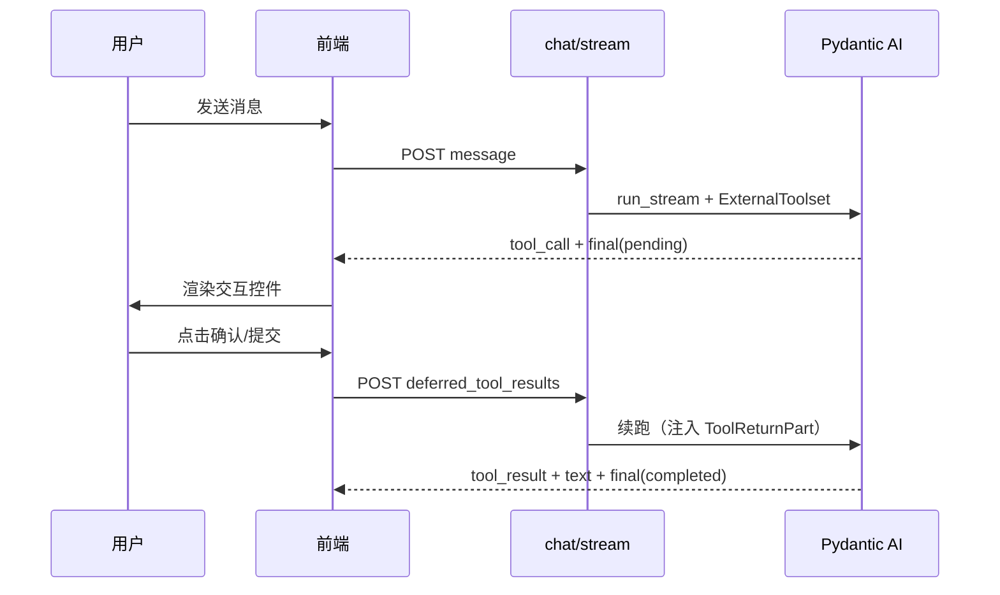

# UI 工具扩展指南（Human-in-the-Loop）

> **读者**：deep-agent **仓库贡献者**（需修改 `deep_agent/`、`frontend/` 代码）。
>
> 若你仅**使用已部署的服务**、自建客户端或配置 Agent，请参阅
> [`ui-tools-external.md`](ui-tools-external.md)。

MCP 自动发现等历史方案及废弃原因见
[`UI 工具设计历史`](../design/01-ui-tools/ui-tools-history.md)。

相关协议见 [`sse-protocol.md`](sse-protocol.md) 中 `final.status=pending` 与 `deferred_tool_results`。

---

## 1. 架构概览



| 层级 | 职责 |
|------|------|
| **后端** | 用 `ExternalToolset` 向模型暴露工具 schema；不实现执行函数 |
| **前端** | 根据 `tool` 名称渲染控件；收集结果后 `deferred_tool_results` 续跑 |
| **Agent 配置** | 通过 `ui:<package>` 工具包编码决定本 Agent 可使用哪组 UI 工具 |
| **Agent 指令** | 告诉模型何时应调用哪个 UI 工具 |

内置 UI 工具定义在 [`deep_agent/capabilities/ui/builtin.py`](../../deep_agent/capabilities/ui/builtin.py)。
前端控件在 [`frontend/console/chat.js`](../../frontend/console/chat.js) 的 `renderHitlWidget`。

---

## 2. 扩展检查清单

向代码内置 `ui:builtin` 增加 UI 工具通常需要改 **3 处**：

| # | 位置 | 做什么 |
|---|------|--------|
| 1 | `deep_agent/capabilities/ui/builtin.py` | 增加 `UIToolRecord`（name、description、JSON Schema、widget） |
| 2 | `frontend/console/chat.js` → `BUILTIN_UI_TOOLS` | 把新工具名加入 Set |
| 3 | `frontend/console/chat.js` → `renderHitlWidget` | 根据 `tool` 名渲染控件并调用 `onSubmit` |

可选：

- **Agent instructions**：说明何时调用新工具
- **单元测试**：[`tests/unit/test_hitl_deferred.py`](../../tests/unit/test_hitl_deferred.py) 参考 deferred 流程
- **样式**：[`frontend/console/workspace.css`](../../frontend/console/workspace.css) 中 `.hitl-*` 类

---

## 3. 后端：注册工具 schema

UI 工具必须是 **`ExternalToolset`** 中的 `ToolDefinition`，**不要**写 `@tool` 执行函数。

DeepAgent 会在 `ExternalToolset` 外补充两层保护：

- 按工具的 `parameters_json_schema` 校验模型生成的参数；`clarify` 等表单还会做最低可渲染语义校验。
- 参数 JSON 无法解析或校验失败时，将错误反馈给模型并允许修正一次；第二次仍失败才终止本轮。

不要依赖 Pydantic AI 原生 `ExternalToolset` 完成上述保护：其默认参数验证器只负责解析参数，且默认重试次数为 `0`。

### 3.1 示例：新增 `ask_user_text`

在 [`builtin.py`](../../deep_agent/capabilities/ui/builtin.py) 中：

**① 定义参数 JSON Schema**

```python
_ASK_USER_TEXT_SCHEMA = {
    "type": "object",
    "properties": {
        "prompt": {
            "type": "string",
            "description": "展示给用户的输入提示。",
        },
        "placeholder": {
            "type": "string",
            "description": "输入框占位符。",
            "default": "",
        },
        "multiline": {
            "type": "boolean",
            "description": "是否多行输入。",
            "default": False,
        },
    },
    "required": ["prompt"],
}
```

**② 加入 `builtin_ui_records()` 的列表**

```python
UIToolRecord(
    name="ask_user_text",
    package_code="ui:builtin",
    description=(
        "Show a text input and wait for the user to type a response. "
        "Execution happens in the UI."
    ),
    parameters_json_schema=_ASK_USER_TEXT_SCHEMA,
    widget="text",
    source="builtin",
),
```

**③ 让工具包目录展示该工具**

`GET /api/v1/tools` 会从 `builtin_ui_records()` 生成一个 `ui:builtin` 工具包。新增 builtin
后应确认包的 `tool_count` 和 `tools` 已更新；Agent 选择 `ui:builtin` 后包内全部内置工具都
对模型可见。

### 3.2 注册与注入规则

- builtin 和 manual UI 工具都按所属 `package_code` 与 Agent 正向关联。
- `prepare_ui_tool_packages_for_spec()` 只加载 Agent 已选且 Schema 有效的定义，并保证每个包只生成一个 `ExternalToolset`。
- `capabilities`为空数组或未包含对应 `ui:<package>` 时，该包不进入模型工具列表。
- Alembic `002` 一次性把旧单工具引用转换为包编码，运行时不保留旧编码兼容。

**注意**：不要在 `factory.py` 里无条件注入 `build_ui_toolset()`，否则会绕过 `ui:builtin`
的包选择规则，并可能触发工具名冲突。

### 3.3 Schema 设计建议

- `description` 优先用简洁中文写清楚「由 UI 执行、需等待用户」——模型靠它决定是否调用
- 参数尽量结构化（`options`、`labels`），避免让模型拼 HTML
- `required` 只放必要字段；可选字段在 description 里说明默认值语义
- 工具名全局唯一，不与 MCP / Function 工具重名

### 3.4 SSE 上的 `widget` / `metadata`（builtin 回退）

流式 `tool_call` 与 `final.deferred` 事件上的 `widget`、`metadata` 由 [`registry.py`](../../deep_agent/capabilities/ui/registry.py) 的 `enrich_tool_event` / `enrich_deferred` 注入：

- **manual 工具**：从 `load_ui_tool_hints()` 加载的数据库 hints 合并进事件。
- **builtin 工具**（当前为 `builtin__confirm`、`builtin__choice`）：即使 DB 无对应行，也会在 hints 未命中时回退到 `builtin_ui_records()`，保证Agent已关联工具的SSE仍带`widget`供客户端渲染。

详见 [`sse-protocol.md`](sse-protocol.md) 中 `tool_call` 可选字段说明。

---

## 4. 前端：渲染控件并续跑

### 4.1 注册工具名

[`frontend/console/chat.js`](../../frontend/console/chat.js) 顶部：

```javascript
const BUILTIN_UI_TOOLS = new Set(["builtin__confirm", "builtin__choice", "ask_user_text"]);
```

未加入 `BUILTIN_UI_TOOLS` 且没有 `widget` 元数据的工具，在 pending 时只会显示参数 JSON，**不会出现交互控件**。

### 4.2 实现 `renderHitlWidget` 分支

在 `renderHitlWidget(block, call, onSubmit)` 中增加 `else if`：

```javascript
} else if (tool === "ask_user_text") {
  const prompt = args.prompt || "请输入：";
  const placeholder = args.placeholder || "";
  const multiline = !!args.multiline;
  widget.innerHTML = `
    <p class="hitl-prompt">${escapeHtml(prompt)}</p>
    ${multiline
      ? `<textarea class="hitl-input" rows="3" placeholder="${escapeHtml(placeholder)}"></textarea>`
      : `<input class="hitl-input" type="text" placeholder="${escapeHtml(placeholder)}" />`}
    <button type="button" class="hitl-btn hitl-submit">提交</button>`;
  widget.querySelector(".hitl-submit").addEventListener("click", () => {
    const input = widget.querySelector(".hitl-input");
    const text = (input.value || "").trim();
    onSubmit([{ tool_call_id: toolCallId, result: { text } }]);
  });
}
```

`onSubmit` 即 `resumeDeferred`，会再次 `POST /chat/stream`：

```json
{
  "agent_id": "...",
  "session_id": "...",
  "deferred_tool_results": [
    { "tool_call_id": "call_xxx", "result": { "text": "用户输入的内容" } }
  ]
}
```

### 4.3 约定：`result` 形状

| 工具 | 建议 `result` 结构 | 模型侧如何使用 |
|------|-------------------|----------------|
| `builtin__confirm` | `{ "confirmed": true \| false }` | 根据布尔值分支 |
| `builtin__choice` | `{ "selected": ["选项值"], "custom_input": null }` | 读取选中项与候选外输入 |
| 自定义 | 由你在 instructions 里约定 | 在 prompt 中说明字段含义 |

`result` 会作为 `ToolReturnPart.content` 回灌模型，保持 JSON 稳定、字段名清晰即可。

`builtin__choice` 的自由输入入口始终显示。单选、多选、仅自由输入，以及“多选 + 自由输入”都使用同一结果结构；前端必须阻止 `selected=[]` 且 `custom_input` 为空的提交。

### 4.4 历史回放

用户刷新页面后，[`renderHistory`](../../frontend/console/chat.js) 会对「有 `tool_call`、无 `tool_result`」的 UI 工具自动恢复交互控件，无需额外处理。
新增代码内置工具需要加入 `BUILTIN_UI_TOOLS`，并在 `renderHitlWidget` 中实现分支。

---

## 5. Agent 指令

模型不会自动知道 UI 工具的存在与用法，需在 Agent **instructions** 中写明，例如：

```text
需要用户明确决定继续或取消时，调用 builtin__confirm；它是通用交互工具，不代表后端强制审批或权限校验。

需要用户从候选列表选择或补充候选外答案时，调用 builtin__choice，不要自行假设用户的选择。

需要用户自由输入文字时，使用 ask_user_text。

UI 工具由前端执行；调用后你会收到 tool result，再根据结果继续。
```

可在 Admin 后台编辑 Agent，或通过 API 更新 `instructions` 字段。

---

## 6. 运行时行为

### 6.1 SSE 事件流（pending）

1. `session`
2. 若干 `text` / `thinking`
3. `tool_call`（含完整 `args`）
4. **无** `tool_result`
5. `final`：`{ "status": "pending", "deferred": { "calls": [...] } }`

此时前端应禁用发送框，展示交互控件。

### 6.2 续跑请求

```http
POST /api/v1/chat/stream
Content-Type: application/json

{
  "agent_id": "550e8400-e29b-41d4-a716-446655440000",
  "session_id": "3eff69967bee4a809c46a47c19e113ff",
  "deferred_tool_results": [
    {
      "tool_call_id": "call_00_abc",
      "result": { "confirmed": true }
    }
  ]
}
```

- `message` 可省略
- `tool_call_id` 必须与 pending 的 `tool_call` 一致
- 多个 pending call 时，可在一轮请求中提交多条 `deferred_tool_results`（需全部解决后 agent 才继续）

### 6.3 非流式接口

`POST /api/v1/chat` 同样支持 `deferred_tool_results`；响应含 `status` / `deferred` 字段（见 [`schemas/chat.py`](../../deep_agent/schemas/chat.py)）。

---

## 7. 验证

### 7.1 确认工具已注册

```bash
curl http://127.0.0.1:8000/api/v1/tools
```

响应中应有 `category=ui` 的工具包及新工具名。

### 7.2 对话验证

1. 重启后端
2. 在 Agent 的 capabilities 中显式选择 `ui:<package>`，并写明 UI 工具使用场景
3. 发送能触发新工具的提示语
4. 确认出现控件 → 提交 → 模型继续回复
5. **刷新页面**，从侧边栏重新打开会话，确认控件仍可出现并可续跑

### 7.3 单元测试

```bash
python3.12 -m unittest tests.unit.test_hitl_deferred -v
```

可为新工具增加类似用例：TestModel `call_tools=["your_tool"]` → `final.status == "pending"` → 带 `DeferredToolResults` 续跑。

---

## 8. 常见问题

### 工具名冲突

```
ExternalToolset 'ui' defines a tool whose name conflicts with ...
```

原因：同一个 UI 工具包被请求级装配和 `factory` 无条件装配两次。
解决：只保留 `prepare_ui_tool_packages_for_spec()` 的按包装配。

### 模型不调用 UI 工具

- 检查 instructions 是否说明使用场景
- 用更直白的测试句：`请调用 builtin__confirm，message 为「测试」`
- 确认 `GET /api/v1/tools` 的 `ui:builtin` 包能看到 `builtin__confirm`
- 确认当前 Agent 的 capabilities 已显式包含对应 `ui:<package>`；仅出现在目录不代表已关联到本Agent

### 刷新后没有按钮

- 确认代码内置工具名在 `BUILTIN_UI_TOOLS` 中，或手工工具定义提供了正确的 `widget`
- 确认 `renderHitlWidget` 有对应分支
- 历史里该 `tool_call` 是否已有 `tool_result`（已完成则不再显示控件）

### 与 MCP / Function 工具的区别

| 类型 | 执行位置 | 注册方式 |
|------|----------|----------|
| Function / MCP | 后端进程 | `FunctionToolset` / `MCPToolset` |
| **UI 工具** | 浏览器 | `ExternalToolset` + 前端 widget |

UI 工具适合确认、表单、选择器；业务 API 调用仍应使用 MCP。

---

## 9. 源码索引

| 文件 | 说明 |
|------|------|
| [`deep_agent/capabilities/ui/builtin.py`](../../deep_agent/capabilities/ui/builtin.py) | `ui:builtin` 工具 schema |
| [`deep_agent/capabilities/ui/registry.py`](../../deep_agent/capabilities/ui/registry.py) | UI 工具按包筛选、Toolset 组装与 SSE enrichment |
| [`deep_agent/api/v1/tools.py`](../../deep_agent/api/v1/tools.py) | Agent 可选工具包目录 |
| [`deep_agent/api/v1/ui_tool_packages.py`](../../deep_agent/api/v1/ui_tool_packages.py) | UI 工具包 CRUD 与引用保护 |
| [`deep_agent/agent/runner.py`](../../deep_agent/agent/runner.py) | deferred run / pending final |
| [`deep_agent/agent/deferred.py`](../../deep_agent/agent/deferred.py) | 序列化与 `DeferredToolResults` 转换 |
| [`deep_agent/api/v1/chat.py`](../../deep_agent/api/v1/chat.py) | HTTP 入口 |
| [`deep_agent/schemas/chat.py`](../../deep_agent/schemas/chat.py) | `DeferredToolResultItem` |
| [`frontend/console/chat.js`](../../frontend/console/chat.js) | SSE、`renderHitlWidget`、`resumeDeferred` |
| [`sse-protocol.md`](sse-protocol.md) | SSE 协议 |
| [`tests/unit/test_hitl_deferred.py`](../../tests/unit/test_hitl_deferred.py) | 单元测试 |
