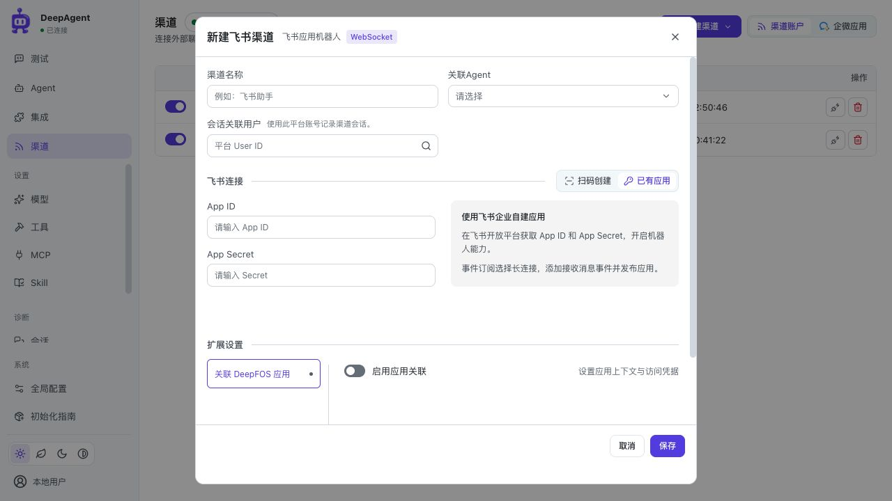
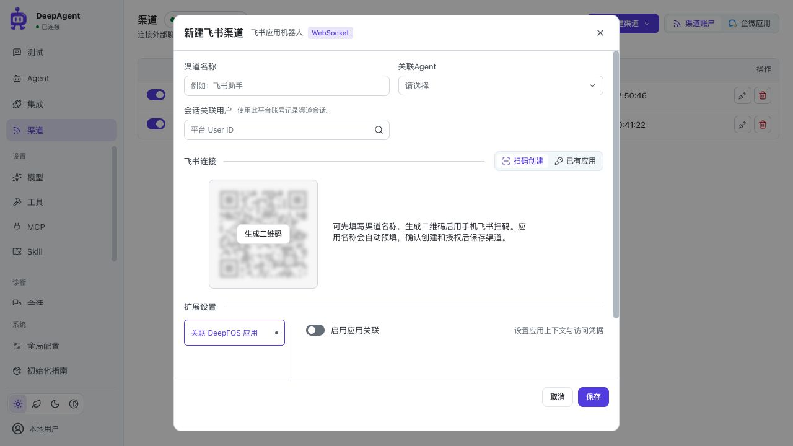

# 飞书渠道实现与验收

日期：2026-09-27。首次接入发布为 v0.11.7（`9c2d8ec`）；本次 v0.11.8 审计以该提交为基线，数据库保持 008。下方初次接入验证为历史记录，本次变更与验证见末节。

## 实现范围

- 保留单渠道网关，注册独立 FeishuAdapter；仅使用 WebSocket。官方依赖固定为 `lark-channel-sdk==1.4.0`、`lark-oapi==1.7.3`。
- Console 新建渠道下拉选择企微或飞书。飞书支持已有应用 App ID／Secret 和官方扫码注册；配置表单沿用现有布局，飞书官方图标覆盖渠道、会话、诊断与用量。
- 扫码任务限定管理员及发起人，十分钟过期，支持取消。凭据仅留服务端，保存失败可重试，成功后消费，API 停止时清理；不新增注册任务表。
- 群聊按群共享会话且要求 @ 机器人，私聊按发送人分开。保留每条消息的发送人、租户和线程来源；名字获取失败回退 ID。来源事实不扩大业务执行权限。
- 原三张渠道表继续使用，仅消息表增加四个可空来源字段；008 兼容原 007 数据，不静默降级丢弃新数据。
- 官方 SDK 存在模块级 WebSocket 事件循环。为避免关闭一个账号影响其他账号，每账号 SDK 使用受控子进程，匿名管道连接唯一业务网关；不增加公网端口、不另建业务网关、不修改 SDK 私有实现。

使用与部署见[飞书接入指南](../../guides/feishu-channel.md)，上游比较见[飞书调研](../../design/32-new-channels/feishu-channel-research.md)。

## 已完成的验证

| 验证 | 结果与边界 |
| --- | --- |
| Python 单元全量（适配器开发中的文件另测） | 1,710 项；首次仅两项仍断言旧 Head 007，更新为 008 后关联 17 项全部通过；8 项跳过 |
| 公共渠道定向回归 | 29 个模块、289 项通过，18 项按环境跳过；覆盖企微及公共生命周期、权限、消息、会话、迁移 |
| Python 集成全量 | 57 个模块、403 项；45 项按环境跳过，首次仅 3 项 Codex 订阅测试与稳定进程争用本机锁。改为测试独立临时锁目录（仍真实 flock），该模块 3 项全部复测通过，生产逻辑未改 |
| Console 全量 | 710 项通过，无失败或跳过 |
| 注册与 API 定向 | 41 项通过；注册 API 行覆盖 100%，注册服务行覆盖 100%、分支 93.75% |
| 导入与备份 | 配置导入 20 项通过；备份、迁移及来源关联 26 项通过，其中 2 项真实 PostgreSQL／MySQL 环境跳过 |
| 飞书真实 SDK 入站至 History | 官方 SDK 收本地 protobuf WebSocket → 共享 ChannelService → 实际 HTTP/SSE → FunctionModel → SQLite → SDK CardKit HTTP；4 条消息形成 3 个会话、重复消息不执行；最终卡片 ACK 前 History 已持久化正文 |
| 适配器完整回归 | 49 项通过；含 5 项真实 SDK HTTP/WS 多进程测试，全适配器模块行覆盖 93.90%、分支 84.71%，包含 core 与 worker，无排除行 |
| 多账号生命周期 | 真实 SDK 与本地 HTTP/WS：双账号收发、关闭 A 不影响 B、SDK 子进程退出恢复、父进程退出回收、REST 连接测试不创建 WS |
| 浏览器 | 隔离 SQLite＋真实本地 API，手填新增／保存／编辑／Secret 掩码／身份说明／受控扫码二维码与关闭取消；检查窄视口弹窗滚动和固定底部；隔离服务及浏览器页已关闭 |
| 最终链路复测与审计 | 最终适配器代码上的 SDK→History 与默认注册等 6 项通过；API／Store／008 复核未发现新增阻断问题，管理员与任务 owner、凭据保护、导入二次校验及降级保护均保留 |
| 依赖和格式 | `pip check`、`git diff --check` 通过 |

计数存在交叉，不能相加作为唯一用例数。浏览器扫码使用受控注册响应，不代表真实授权成功。

## 明确未覆盖与已知边界

- 没有用户飞书租户凭据，未在真实飞书完成授权审批、发布、私聊／群聊收发、资料权限、媒体、CardKit 限流及网络断线验收。
- 本轮没有运行真实 PostgreSQL／MySQL 服务端迁移；SQLite 007→008 保留数据与降级保护已验证。
- SDK 在异步入队阶段确认接收，确认与业务入库之间存在进程崩溃丢消息短窗口；不声称端到端严格一次投递。数据库消息 ID 仍承担持久去重，已完成写操作不会因重复入站自动重放。
- 注册任务在当前 API 进程内，重启需要重新扫码。沿用单 API worker 部署限制。
- 缺少卡片权限时回退最终 Markdown；不支持的消息不应当作空附件请求启动 Agent。
- 飞书名字只是展示；无法获得时保留 open_id，不把飞书账号自动映射成平台授权用户。

## 测试证据

临时日志统一位于忽略目录 `output/TMP_to_delete-feishu-*`，可在验收后删除。关键文件：`full-unit.log`、`baseline-retest.log`、`channel-regression.log`、`full-integration.log`、`frontend-final.log`、`registration-tests.log`、`registration-coverage.json`、`ingress-tests.log`。代码仓库保留可重复执行的单元、集成和前端测试，日志不提交。

## 本地环境验证

稳定 8000 已重启并加载新接口；健康检查与渠道 API 均为 HTTP 200。本地 SQLite 已备份后升级 008，全部原表行数不变，`pragma quick_check` 返回 ok，附件目录保留。备份为忽略目录 `data/TMP_to_delete-before-feishu-008-20260927.db`（权限 600），验收确认后可删除。此阶段未启动真实账号网关；后续已按用户要求启用本地网关（见下节），始终未修改共享 Test 数据库。

## 最终界面与本地启动

- 顶部直接展示渠道名称、关联 Agent、会话关联用户。新建 Agent 默认未选择；选择 Agent 后覆盖渠道名称，编辑已有渠道不自动重命名。
- 飞书连接与企微连接标题均带留白分割线；飞书扫码／已有应用按钮等宽并在标题右侧。连接区 180px、二维码 176px，切换保留授权任务且不移动扩展区。
- 扫码空态为模糊二维码与居中生成按钮；说明紧贴右侧，过期或失败在右侧重试。手填凭据左列纵排、右列说明。
- 二维码使用官方 SDK 授权 URL 和飞书 PersonalAgent 默认模板，仅包含应用名称预填，不携带自定义权限／订阅；生成时渠道名称预填飞书应用名，留空使用 DeepAgent。生成之后改名不会修改已生成的授权链接。
- 日常本地使用 combined_runtime 同时启动 API 8000 和 Gateway 8010，保留原有两个企微渠道；不再只启动 API。

## v0.11.7 发布前审计

审计覆盖注册状态与取消、保存/编辑、来源身份、官方 SDK 多进程长连接、消息去重与回复、数据库 008、配置导入备份，以及渠道列表/会话/用量品牌展示。

- 手填保存只取消未消费的扫码任务；扫码保存才按已消费处理，避免残留注册任务。
- 保存成功后的刷新走公共刷新提示，不再将刷新故障误报为保存失败。
- 飞书编辑保留服务端设置；移除不可见生成按钮的冗余状态分支。
- 清理过期的卡片/纵向切换布局说明，更新静态资源缓存版本。

- 注册容量回收已结束任务；官方二维码有效期收短时同步缩短后台超时，连续重试不会占满槽位。
- 流式卡片首次发送超时后不重复发送同一卡片引用；未确认投递保留失败状态。删除 SDK core 中不再使用的重复 fingerprint。
- 本轮专项：飞书适配器与渠道兼容 123 项、注册/API/迁移与保存重试 49 项、Console 全量 716 项通过。浏览器复核新建占位、扫码/手填切换和凭据布局；没有保存测试渠道或执行真实飞书授权。
- 全仓 Python 本轮执行 2165 项：2111 通过、53 按环境跳过，1 项既有压缩测试的 25ms 超时断言失败；该压缩模块单独复测 44 项全部通过。未修改压缩生产逻辑，也不将首次全量结果记为全绿。
- 审计修复完成后追加注册与适配器定向 91 项全部通过；`pip check` 与暂存区 `git diff --check` 通过。
- 本地重启核验 `/health`、`/info`、`/console/` 为 200，运行版本 0.11.7；`/api/v1/channel-runtime` 显示 deployed/reachable，原两个企微账户 connected；SQLite revision 为 008。

## v0.11.8 调整与审计

### 最终行为

- 注册采用飞书 PersonalAgent 默认模板，仅传 `app_preset.name`；移除中间方案中自定义的权限、事件、描述及额外注册选项。模板由飞书服务端维护，不能宣称所有权限已获批；已有应用不会自动变更。
- 扫码空态和授权完成保留模糊二维码，成功后明确提示「渠道尚未保存」，由用户补齐资料再保存。右侧说明卡片与 176px 二维码等高、顶部对齐，后台链接独立放在右下角。弹框尺寸不变，扩展区留白随可用高度收缩。
- 飞书首次处理中用公开 `add_reaction` 添加 Get 表情，终态及停止时尽力删除；权限或网络失败不阻断正文，错误只记录安全分类和错误码。
- 卡片流式正文与独立 loading_icon 分开，工具等待及正文输出期间保留三点动画，终态及异常尽力收尾；不修改企微适配器或共享消息投影。
- 渠道详情优先压缩标题列，应用信息顶部对齐；用量查询间距收紧，多渠道图标在同一占位错位堆叠，支持键盘切换及 reduced-motion。

### 上游依据与边界

[AstrBot 注册](https://github.com/AstrBotDevs/AstrBot/blob/95e98b8aed75d56713666eff39e31bafffd95426/astrbot/core/platform/sources/lark/app_registration.py#L105)与[OpenClaw 注册](https://github.com/openclaw/openclaw/blob/ffb50bc0479d8a52b6f5b7575632c8726b6cff41/extensions/feishu/src/app-registration.ts#L176)不携带自定义 addons；默认模板不等于全部权限。底部加载图标参考[飞书官方插件 builder.ts](https://github.com/larksuite/openclaw-lark/blob/dde0be3680d6fd5443cab426c8f4b3216266346a/src/card/builder.ts#L690)，不把 streaming_mode 当作自带动画。客户端动效及租户审批仍需实际飞书验收。

企微扫码本次仅调研，未实现；官方 CLI 支持扫码返回 Bot ID/Secret，名称等预填能力未获确认，不影响当前企微消息逻辑。

本次真实生成过未授权二维码，确认链接只有设备码、SDK 来源和名称参数（DeepAgent 名称示例为 105 字符）；没有代用户扫码授权或创建应用。测试截图和日志放在忽略目录 `output/TMP_to_delete-*`，不提交真实账号界面截图。

### 本次发布验证

- Python unit + integration：2130 passed、53 skipped、690 subtests passed；15 项依赖弃用等警告，无失败。
- Console 全量：719 项通过；包含授权状态、扫码保存及多渠道图标去重/轮换、不触发数据请求的回归。
- 飞书后端独立审查及定向回归：66 项通过；企微适配器及共享消息服务无差异。
- 浏览器：1233×994 下扫码卡片与二维码均为 176px 且顶部一致；表单 clientHeight/scrollHeight 同为 644，无多余滚动条；已有应用切换及用量图标换层正常。
- `pip check`、`git diff --check` 通过；本地 API 与网关重启，`/health` 正常、`/info` 为 0.11.8。数据库仍为 008，没有迁移改动。
- 清理中间权限方案说明、失效截图引用和缓存版本，临时实测截图保留于忽略目录，不作为发布文件。未代用户创建真实应用或发送测试消息。
