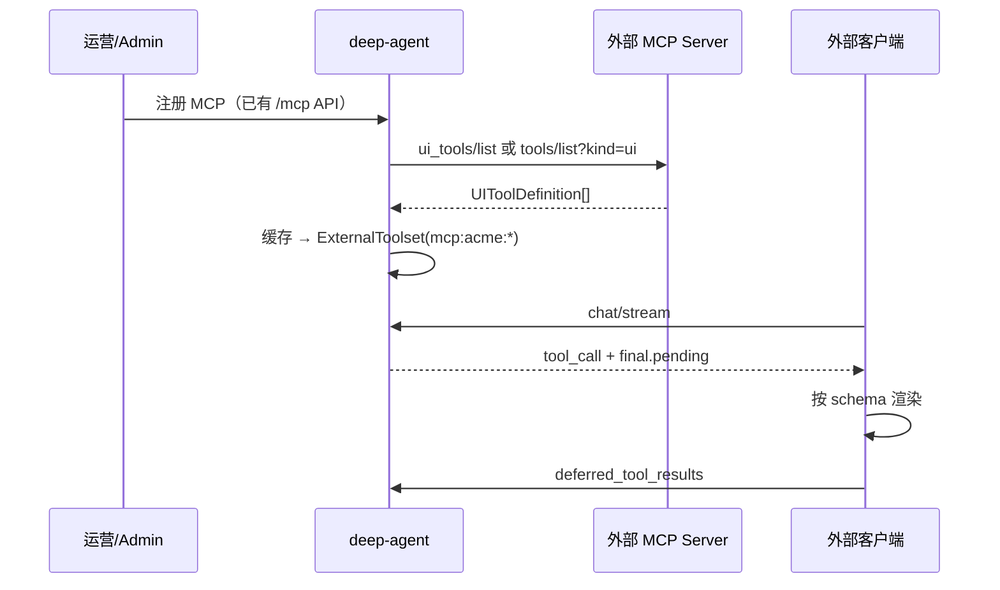

# UI 工具扩展能力 — 方案对比（面向产品 / 架构评审）

> 目标：让**外部开发者**在不改 deep-agent 源码的前提下，扩展人机交互（UI）工具类型。  
> 前提：集成方**自建客户端**负责渲染；平台负责 schema 注册、deferred 执行语义、与 Agent 的对接。

---

## 1. 要解决什么问题

| 现状 | 期望 |
|------|------|
| UI 工具写死在 `capabilities/ui/builtin.py` | 外部可注册新工具名与参数 schema |
| 仅 `confirm_action` / `ask_user_choice` | 日期、表单、文件、自定义布局等 |
| MCP 与 UI 是两条执行链路 | 明确：MCP 可**声明** UI 工具，但**不在 MCP 进程内等用户点击** |

**不变量**（建议保留）：

- 模型侧仍是 Pydantic AI **`ExternalToolset`** + **`final.pending`** + **`deferred_tool_results`** 续跑
- UI 工具**不在服务端同步执行**（包括不在 MCP `call_tool` 里阻塞等用户）

---

## 2. 方案总览

| 方案 | 外部如何扩展 | 平台改动量 | 与 MCP 关系 | 推荐度 |
|------|--------------|------------|-------------|--------|
| **A. MCP UI 工具发现** | MCP Server 暴露 UI 定义接口 | 中 | 强绑定 | ⭐⭐⭐ 主推 |
| **B. 配置 API / DB** | REST 注册 JSON Schema | 中 | 独立 | ⭐⭐⭐ 与 A 互补 |
| **C. 请求体携带 `ui_tools`** | 每次 chat 传工具列表 | 小 | 无关 | ⭐⭐ 灵活、信任成本高 |
| **D. MCP 注解分流** | 普通 MCP tools 加 `client` 元数据 | 中 | 强绑定 | ⭐⭐ A 的简化版 |
| **E. 小部件注册表（Widget Registry）** | 平台存 schema + widget 类型枚举 | 大 | 可选挂 MCP | ⭐ 长期 |

下面分述。

---

## 3. 方案 A：MCP 扩展 — UI 工具发现（你提到的方向）

### 3.1 思路

MCP Server 除业务 `tools` 外，再提供**固定发现接口**，向 deep-agent 返回「仅在客户端执行的 UI 工具」定义。deep-agent 将其编译为 `ExternalToolset`，与现有内置 `ui` 合并；执行路径与今天一致。



### 3.2 发现接口形态（二选一或并存）

**A1 — 专用 MCP Tool（实现简单）**

MCP 实现工具 `ui_tools_list`（或约定名 `_deepagent_ui_tools`），**无业务参数**，返回：

```json
{
  "tools": [
    {
      "name": "pick_delivery_date",
      "description": "Let user pick a delivery date in the UI.",
      "parameters_json_schema": { "type": "object", "properties": { "prompt": { "type": "string" } }, "required": ["prompt"] },
      "widget": "date_picker",
      "result_schema": { "type": "object", "properties": { "date": { "type": "string", "format": "date" } } }
    }
  ]
}
```

deep-agent 在 `load_and_register_mcp` 时调用一次（或定时刷新），**不要**把 `ui_tools_list` 暴露给模型。

**A2 — MCP Resources / 自定义 HTTP（更干净）**

- Resource URI：`ui://tools/manifest`
- 或 MCP Server 配置里写 `ui_tools_manifest_url`

适合已是 HTTP MCP 的集成方。

### 3.3 工具名与命名空间

避免与内置 `ui`、其它 MCP 冲突：

```
{mcp_server_name}__{tool_name}
# 例：acme__pick_delivery_date
```

SSE `tool_call.tool` 带完整前缀；客户端按 `(mcp_server, tool, widget)` 路由渲染。

### 3.4 配置项（扩展现有 `mcp_servers`）

| 字段 | 说明 |
|------|------|
| `ui_tools_enabled` | 是否拉取 UI 定义，默认 `true` |
| `ui_tools_discovery` | `tool` \| `resource` \| `none` |
| `ui_tools_refresh_sec` | 缓存 TTL |

Agent 的 `capabilities` 包含 `mcp:acme` 时，自动带上该 MCP 贡献的 UI 工具。

### 3.5 客户端职责

平台文档约定：

- `widget` 为**提示字段**（`confirm` / `choice` / `date_picker` / `custom`）
- 外部客户端**自行实现**渲染；官方客户端可只支持通用 fallback（JSON 表单）
- `result` 形状以 MCP 提供的 `result_schema` 为准

### 3.6 优点 / 缺点

| 优点 | 缺点 |
|------|------|
| 与现有 MCP 注册流程一致（Admin 已有） | 需约定发现协议并版本化 |
| 工具定义跟业务 MCP 同仓库、同生命周期 | stdio MCP 要多一次发现调用 |
| 模型工具列表与业务工具同一能力包 | 要处理发现失败、缓存失效 |

---

## 4. 方案 B：UI 工具配置 API（独立于 MCP）

### 4.1 思路

新增一等资源 `ui_tools`（DB 表 + REST），不经过 MCP：

```
POST   /api/v1/ui-tools
GET    /api/v1/ui-tools
PATCH  /api/v1/ui-tools/{name}
DELETE /api/v1/ui-tools/{name}
```

```json
{
  "name": "pick_delivery_date",
  "description": "...",
  "parameters_json_schema": { ... },
  "widget": "date_picker",
  "result_schema": { ... },
  "enabled": true,
  "tenant_id": "optional"
}
```

`build_agent` 时从 DB 加载，合并进 `ExternalToolset(id="ui-dynamic")`。

### 4.2 与 Agent 绑定

- **按 Agent**：在 `agents.capabilities` 中使用 `ui:<canonical_tool_name>` 精确引用
- **默认能力**：`capabilities` 为空时不自动启用扩展 UI 工具
- **按租户**：多租户场景隔离

### 4.3 优点 / 缺点

| 优点 | 缺点 |
|------|------|
| 不依赖 MCP 协议扩展 | schema 与业务代码分离，易不同步 |
| 运营可直接在 Admin 配 | 需要新 Admin 页面与迁移 |
| 适合「无 MCP、只要一个确认框」的场景 | 外部开发者仍要向平台提交配置 |

**建议**：与方案 A **并存** — MCP 发现的工具可自动写入 DB 快照，或仅运行时合并。

---

## 5. 方案 C：请求体动态 `ui_tools`（类 AG-UI）

### 5.1 思路

扩展 `StreamChatRequest`：

```json
{
  "agent_id": "...",
  "message": "...",
  "ui_tools": [
    { "name": "pick_date", "description": "...", "parameters_json_schema": { ... } }
  ]
}
```

当次 run 合并进 `ExternalToolset`（Pydantic AI 已支持 per-run `toolsets`）。

### 5.2 优点 / 缺点

| 优点 | 缺点 |
|------|------|
| 实现快，无需 DB | **信任问题**：客户端可任意扩模型工具面 |
| 适合纯前端集成、无 Admin | 难以审计、易与 MCP 工具重名 |
| 与 AG-UI `tools[]` 思路一致 | 不适合「平台统一治理」 |

**建议**：仅对**已认证集成方**开放，或要求工具名必须以 `client_{app_id}_` 为前缀；长期仍用 A/B 作 source of truth。

---

## 6. 方案 D：MCP 注解分流（A 的轻量版）

不增加发现接口，而是在现有 MCP `tools/list` 的 **annotations / _meta** 里标记：

```json
{
  "name": "pick_date",
  "description": "...",
  "inputSchema": { ... },
  "_meta": {
    "deep_agent": {
      "execution": "client",
      "widget": "date_picker"
    }
  }
}
```

deep-agent 构建 toolset 时：

- `execution: server`（默认）→ 现有 `MCPToolset`
- `execution: client` → 转入 `ExternalToolset`，`call_tool` 不转发 MCP

### 对比方案 A

| | 方案 A 专用发现 | 方案 D 注解 |
|--|----------------|-------------|
| MCP 实现 | 多一个 list 工具/资源 | 只改现有 tool 元数据 |
| 模型可见性 | UI 工具可与业务工具分离 | 同一 list，需过滤 |
| 清晰度 | 高 | 中 |

适合：工具数量少、愿意改 MCP SDK 注解的团队。

---

## 7. 方案 E：Widget 注册表（长期）

平台维护：

- `widget` 枚举 + 文档化 `result` 形状（`confirm` / `choice` / `date_picker` / …）
- 可选：外部提交 **Widget Manifest URL**（npm 包名仅作文档，平台不执行 JS）

客户端按 `widget` 渲染；`parameters_json_schema` 校验 args。  
新 widget 类型需平台发版或插件审核 — 适合强管控环境。

---

## 8. 推荐组合与分期

### Phase 1（MVP）

1. **方案 D**：支持 MCP `_meta.deep_agent.execution = "client"` 分流（改动集中 `toolset_builder` + 注册逻辑）
2. **文档**：更新 `ui-tools-external.md` — widget 约定 + 客户端如何实现 fallback
3. **`GET /api/v1/tools`**：区分 `kind: mcp` 与 `kind: ui-client`，列出 execution=client 的工具

### Phase 2

4. **方案 A1**：约定 `ui_tools_list` 发现工具 + MCP 配置项 `ui_tools_enabled`
5. **方案 B**：`ui_tools` 表 + Admin CRUD（可选手动覆盖 MCP 发现结果）

### Phase 3

6. **方案 C**：受控 `ui_tools` 请求体（可选，服务纯 API 集成方）
7. **方案 E**：官方 widget 扩展 + 审核流

---

## 9. 执行语义（各方案统一）

无论工具来源，运行时行为应一致：

```
模型调用 execution=client 的工具
  → 不调用 MCP / 不执行 Python
  → run 结束于 DeferredToolRequests
  → SSE final.status = pending
  → 客户端 deferred_tool_results 续跑
```

**禁止**：在 MCP `call_tool` 内阻塞等待用户点击（除非明确文档为旁路方案，不走 pending 协议）。

---

## 10. 安全与治理

| 风险 | 缓解 |
|------|------|
| 恶意 schema 过大 | 限制 tools 数量、schema 深度、注册需 Admin 权限 |
| 工具名冲突 | 强制 MCP 前缀 `server__tool` |
| 客户端伪造 ui_tools | Phase 3 前不开放或需 API Key + 前缀 |
| 发现接口失败 | 降级：仅用上次缓存 + 告警；不影响该 MCP 的 server 工具 |
| 审计 | DB 记录 ui_tool 来源（mcp / manual / request） |

---

## 11. 与现有代码的衔接点

| 模块 | 改动方向 |
|------|----------|
| [`capabilities/mcp/db_loader.py`](../deep_agent/capabilities/mcp/db_loader.py) | 注册时拉取 UI 定义或读注解 |
| [`capabilities/mcp/toolset_builder.py`](../deep_agent/capabilities/mcp/toolset_builder.py) | 拆分 server / client toolsets |
| [`agent/factory.py`](../deep_agent/agent/factory.py) | 合并内置 ui + 动态 ExternalToolset |
| [`api/v1/mcp.py`](../deep_agent/api/v1/mcp.py) | 扩展 MCP 配置字段 |
| 新建 `api/v1/ui_tools.py` | 方案 B CRUD |
| [`schemas/chat.py`](../deep_agent/schemas/chat.py) | 方案 C 可选字段 |
| [`docs/ui-tools-external.md`](ui-tools-external.md) | widget 契约、命名、续跑 |

---

## 12. 决策建议（简短）

- **主推**：**方案 A（MCP UI 发现）+ 方案 B（配置 API）** — 与你描述的「MCP 暴露定义 + 开放配置」一致；MCP 负责与业务同仓迭代，API 负责运营覆盖与无 MCP 场景。
- **快速验证**：先做 **方案 D（注解分流）**，一周级可落地，再演进到 A。
- **不建议**仅靠方案 C 作为唯一入口（治理弱）；可作为高级 API 选项。

如需选定一条路线写详细 RFC（含 OpenAPI 与 MCP 协议草案），见 **[`rfc/0001-ui-tools-mcp-discovery-and-api.md`](rfc/0001-ui-tools-mcp-discovery-and-api.md)**（方案 A+B）。
