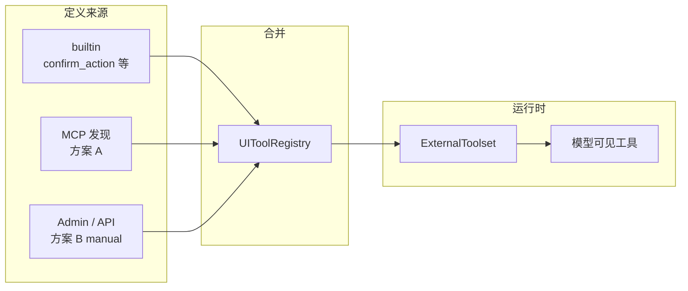
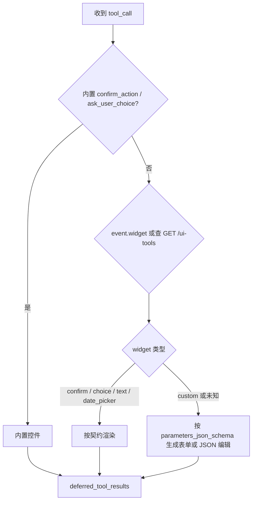

# UI 工具使用与扩展指南（面向集成方）

> 本文面向**使用 deep-agent 服务、但不修改其源码**的开发者（业务方、前端集成方、MCP 作者、Agent 配置人员）。
>
> 若你需要在 deep-agent **仓库内**新增内置工具类型或改运行时，请参阅 [`ui-tools.md`](ui-tools.md)。

---

## 1. 你能做什么

| 能力 | 说明 |
|------|------|
| 使用内置确认框、选项列表 | `confirm_action`、`ask_user_choice`（`kind=ui`） |
| **通过 MCP 声明 UI 工具** | MCP 实现 `ui_tools_list` 或 Resource `ui://tools/manifest`，平台按需发现并注入模型 |
| **通过 Admin / API 手工注册** | `POST /api/v1/ui-tools`，适合无 MCP 或运营侧配置 |
| 配置 Agent 指令、绑定可见范围 | `instructions` + `capabilities` 中的 `ui:<name>` |
| 自建客户端对接 HITL 协议 | `final.pending` + `deferred_tool_results`（见 §6） |
| 查询已注册 UI 工具定义 | `GET /api/v1/ui-tools`、`GET /api/v1/tools` |

**仍不支持**：

- 在单次 `chat` 请求体里临时挂载工具列表（无方案 C）
- 让普通 MCP `call_tool` 在服务端阻塞等待用户点击（MCP 业务工具仍是同步执行）
- 在官方 Web 聊天页自动渲染所有扩展 widget（仅内置两种；扩展工具需自建客户端，见 §5.4）

执行语义不变：扩展 UI 工具与内置工具一样，走 **`ExternalToolset` → `final.pending` → 客户端 `deferred_tool_results` 续跑**。详见 [`sse-protocol.md`](sse-protocol.md)。

---

## 2. 三种定义来源



| 来源 | `source` | 典型场景 |
|------|----------|----------|
| 平台内置 | `builtin` | 通用确认、单选/多选 |
| MCP 发现 | `mcp` | UI schema 与业务 MCP 同仓库迭代 |
| 手工注册 | `manual` | 运营配置、覆盖 MCP 定义、无 MCP 的纯客户端 widget |

**同名冲突时优先级**（高 → 低）：`manual` > `mcp` > `builtin`。列表接口会返回 `shadowed_by` 供排查。

---

## 3. MCP 业务工具 vs MCP UI 工具

这是最容易混淆的一点。

| 对比项 | MCP **业务**工具（`call_tool`） | MCP **UI**工具（发现协议） |
|--------|--------------------------------|---------------------------|
| 注册方式 | MCP `tools/list` 常规定义 | `ui_tools_list` 或 `ui://tools/manifest` |
| 暴露给模型 | 是，工具名如 `search_orders` | 是，规范名如 `acme__pick_date` |
| 执行位置 | deep-agent 调 MCP，**同步**返回 | **不执行**；客户端渲染后 `deferred_tool_results` |
| SSE | 流内 `tool_result`，无 pending | `final.pending` + 续跑 |

因此：**查数、算数、调 API 用普通 MCP 工具**；**等人点按钮、填表单用 UI 工具发现**，不要把「等用户操作」写进 MCP `call_tool` 里阻塞。

### 3.1 发现时机

| 时机 | 行为 |
|------|------|
| **Agent 组装**（用户发起对话时） | 仅当 Agent `capabilities` 含**非 builtin** 的 `mcp:<name>` 时，连接该 MCP 发现并写入 DB |
| **Admin 手动刷新** | `POST /api/v1/mcp/{name}/ui-tools/refresh` |
| 服务启动 | **不**批量发现（避免拖慢启动） |
| **builtin MCP**（`mcps/<name>/`） | **不参与** UI 发现 |

首次对话前若需确保 DB 中已有定义，可在 Admin → MCP 配置行点击「刷新 UI」，或先触发一次带该 MCP 能力的对话。

---

## 4. 内置 UI 工具

通过 `GET /api/v1/tools` 查看。`kind=ui` 为平台内置人机工具（以接口返回为准）。

### `confirm_action` — 确认 / 取消

| 参数 | 类型 | 必填 | 说明 |
|------|------|------|------|
| `message` | string | 是 | 确认文案 |
| `confirm_label` | string | 否 | 确认按钮，默认「确认」 |
| `cancel_label` | string | 否 | 取消按钮，默认「取消」 |

回传：`{ "confirmed": true }` 或 `{ "confirmed": false }`

### `ask_user_choice` — 单选 / 多选

| 参数 | 类型 | 必填 | 说明 |
|------|------|------|------|
| `prompt` | string | 是 | 问题或说明 |
| `options` | string[] | 是 | 可选项，至少 1 项 |
| `allow_multiple` | boolean | 否 | 多选时 `true` |

回传：单选 `{ "selected": "选项" }`；多选 `{ "selected": ["A","B"] }`

官方 Web 聊天页已内置上述两种控件的渲染。

---

## 5. 如何扩展 UI 工具

扩展分两条路径，可单独使用，也可组合（例如 MCP 发现 + manual 覆盖）。

### 5.1 路径 A：MCP UI 发现

#### 步骤概览

1. 在 MCP Server 中实现业务工具（照常）。
2. 额外实现发现接口（二选一）：
   - **Tool 模式（默认）**：工具名固定 `ui_tools_list`，无参，返回 Manifest JSON 字符串
   - **Resource 模式**：URI `ui://tools/manifest`，`application/json`
3. 在 Admin 注册 MCP（**非** `mcps/` 下的 builtin 包），Agent `capabilities` 加入 `mcp:<server_name>`。
4. 刷新 UI 定义（对话时自动发现，或 Admin「刷新 UI」）。
5. 在 Agent `instructions` 中说明何时调用 `\<mcp\>__\<local_name\>` 及 `result` 含义。
6. 自建客户端按 `widget` 渲染并提交 `deferred_tool_results`。

#### Manifest 示例

```json
{
  "protocol_version": "1.0",
  "mcp_server": "acme",
  "tools": [
    {
      "name": "pick_delivery_date",
      "description": "Ask the user to pick a delivery date in the client UI.",
      "parameters_json_schema": {
        "type": "object",
        "properties": {
          "prompt": { "type": "string", "description": "Label above the picker." },
          "min_date": { "type": "string", "format": "date" },
          "max_date": { "type": "string", "format": "date" }
        },
        "required": ["prompt"]
      },
      "widget": "date_picker",
      "result_schema": {
        "type": "object",
        "properties": { "date": { "type": "string", "format": "date" } },
        "required": ["date"]
      },
      "metadata": { "form_version": "1" }
    }
  ]
}
```

| 字段 | 必填 | 说明 |
|------|------|------|
| `protocol_version` | 是 | 当前仅支持 `"1.0"` |
| `tools[].name` | 是 | MCP 内局部名：`^[a-z][a-z0-9_]{0,63}$`，不得与 `ui_tools_list` 等保留名冲突 |
| `tools[].description` | 是 | 给模型的工具说明 |
| `tools[].parameters_json_schema` | 是 | JSON Schema object |
| `tools[].widget` | 否 | 客户端渲染提示（§5.3） |
| `tools[].result_schema` | 否 | 文档化用户提交后的 `result` 形状 |
| `tools[].metadata` | 否 | **不发给模型**；经 SSE 透传给客户端（§5.4） |

#### 规范名（模型看到的工具名）

```
canonical_name = {mcp_server_name}__{tools[].name}
```

示例：`acme__pick_delivery_date`。

#### MCP 配置（可选）

在 MCP `config` JSON 中可设置：

```json
{
  "ui_tools": {
    "enabled": true,
    "mode": "tool",
    "refresh_seconds": 300
  }
}
```

| `mode` | 行为 |
|--------|------|
| `tool` | 调用 `ui_tools_list`（默认） |
| `resource` | 读取 `ui://tools/manifest` |
| `none` | 不发现 UI 工具 |

#### 参考实现

仓库内示例：[`mcps/ui_tools_demo/server.py`](../mcps/ui_tools_demo/server.py)（`ui_tools_demo__pick_color`，widget `choice`）。

---

### 5.2 路径 B：Admin / API 手工注册

适合不经过 MCP、或由运营统一配置的场景。

#### Admin

1. 打开 **Admin → UI 工具 → 手工注册**
2. 选择**配置模板**（确认 / 选项 / 文本 / 日期 / 空白自定义）或从零编辑参数、结果 Schema
3. 填写**规范名**（建议 `myapp__tool_name`）、描述、**Widget**、可选 Metadata
4. 勾选「覆盖同名 MCP 定义」可在与 MCP 工具同名时以 manual 为准
5. 到 **Agent 配置 → 能力 → UI（扩展）**，为目标 Agent 选择该工具

#### API

```http
POST /api/v1/ui-tools
Content-Type: application/json

{
  "name": "myapp__collect_note",
  "description": "Ask the user to enter a note in the client UI.",
  "parameters_json_schema": {
    "type": "object",
    "properties": {
      "prompt": { "type": "string" }
    },
    "required": ["prompt"]
  },
  "widget": "text",
  "result_schema": {
    "type": "object",
    "properties": { "text": { "type": "string" } },
    "required": ["text"]
  },
  "metadata": { "form_version": "1" },
  "enabled": true,
  "override": false
}
```

| 接口 | 用途 |
|------|------|
| `GET /api/v1/ui-tools` | 列表；支持 `source`、`mcp_server`、`enabled` 过滤 |
| `GET /api/v1/ui-tools/{name}` | 单条详情（含 schema、widget、metadata） |
| `PATCH /api/v1/ui-tools/{name}` | 更新；`source=mcp` 时默认仅可改 `enabled`、`override`（改 schema 需 `?force=true`） |
| `DELETE /api/v1/ui-tools/{name}` | 删除 manual；mcp 来源删除后下次发现可再写入 |

`name` 须匹配 `^[a-z][a-z0-9_]{1,120}$`，且不得占用 `confirm_action`、`ask_user_choice`（除非平台另有策略）。

---

### 5.3 Widget 契约

`widget` 是**建议性**字符串，指导客户端如何渲染；未知 widget 时应回退为 `custom`（按 `parameters_json_schema` 生成简单表单或 JSON 展示）。

| `widget` | 建议参数 | 建议 `result` | 备注 |
|----------|----------|---------------|------|
| `confirm` | `message`, `confirm_label?`, `cancel_label?` | `{ "confirmed": bool }` | 同内置 `confirm_action` |
| `choice` | `prompt`, `options[]`, `allow_multiple?` | `{ "selected": string \| string[] }` | 同内置 `ask_user_choice` |
| `text` | `prompt`, `placeholder?`, `multiline?` | `{ "text": string }` | |
| `date_picker` | `prompt`, `min_date?`, `max_date?` | `{ "date": "YYYY-MM-DD" }` | |
| `custom` 或任意自定义字符串 | 任意 schema | 符合 `result_schema` | Admin 选「自定义…」可输入任意 widget 名 |

`result_schema` **不会**在服务端校验用户提交内容，仅供文档与客户端自测；请在 Agent `instructions` 中写明模型如何解析 `result`。

---

### 5.4 metadata 字段

| 项 | 说明 |
|----|------|
| 是否发给模型 | **否** — 不出现在 `ToolDefinition` 里 |
| 如何获取 | `GET /api/v1/ui-tools/{name}`；SSE `tool_call` / `final.deferred.calls[]` 会附带 `metadata`（若已配置） |
| 典型用途 | 表单版本、图标、布局参数、业务组件 ID、渲染变体 |
| 与 `result` 关系 | 用户操作结果仍通过 `deferred_tool_results.result` 提交，形状由 `result_schema` / 约定决定 |

---

### 5.5 Agent 配置清单

扩展工具要对某 Agent **可见且可调用**，需同时满足：

1. **工具已启用**：`enabled: true`
2. **Agent 显式引用**：`capabilities` 含 `ui:<canonical_tool_name>`
3. **MCP 来源工具**：Agent 同时含 `mcp:<mcp_server_name>`，且父 MCP 已启用（manual 来源无此要求）
4. **instructions**：写明何时调用、参数含义、如何解读 `result`

`capabilities` 为 `null` 时只启用默认能力，不自动启用任何扩展 UI 工具。

**instructions 示例**（日期选择）：

```text
当需要用户选择送货日期时，调用 acme__pick_delivery_date，在 prompt 中说明用途。
用户选择后 result.date 为 ISO 日期字符串，再继续后续逻辑。
调用 UI 工具后停止推理，等待 tool result。
```

---

### 5.6 查询模型可见工具

```http
GET /api/v1/tools
```

- `kind=ui`：内置 `confirm_action`、`ask_user_choice`
- `kind=ui-client`：MCP / manual 注册的扩展工具，每个工具各自返回一个 `ui:<name>` 能力

扩展工具在对话时按 Agent 的 `ui:<name>` 能力过滤；管理面查看完整定义请用 `GET /api/v1/ui-tools`。

---

## 6. 官方 Web 聊天页

访问服务根路径（如 `https://your-host/`）：

1. 选择已配置 instructions 的 Agent
2. 模型触发 **内置** UI 工具后，页面展示按钮或选项，操作后自动续跑
3. 刷新后从未完成的 `tool_call` 可恢复控件

**扩展 UI 工具**（`acme__*`、`myapp__*` 等）在官方页**不会**自动渲染专用 widget；请使用 §7 自建客户端，或仅在内置 `confirm` / `choice` widget 语义兼容时自行映射。

---

## 7. 自定义客户端集成（HITL）

自建 Web / 桌面 / 移动端需实现与官方前端相同的两段式流程，并扩展对 **动态工具名 + widget** 的支持。

### 7.1 相关接口

| 接口 | 用途 |
|------|------|
| `POST /api/v1/chat/stream` | 流式对话（推荐） |
| `POST /api/v1/chat` | 非流式 |
| `GET /api/v1/sessions/{id}/history` | 历史回放（含未完成 tool_call） |
| `GET /api/v1/tools` | 能力概览 |
| `GET /api/v1/ui-tools` | 完整定义（schema、widget、metadata） |

### 7.2 首次对话

```http
POST /api/v1/chat/stream
Content-Type: application/json
Accept: text/event-stream

{
  "agent_id": "你的-agent-uuid",
  "session_id": "可选",
  "message": "用户输入"
}
```

关注 SSE 事件：

- `tool_call`：记录 `tool`、`args`、`tool_call_id`；动态工具可能带 `widget`、`metadata`、`source`、`mcp_server_name`
- `final.status === "pending"`：`deferred.calls` 列出待处理调用（同样可带 `widget` / `metadata`）

当存在未完成的 UI `tool_call` 时，渲染控件并**暂停**发送新用户消息。

### 7.3 续跑

```http
POST /api/v1/chat/stream

{
  "agent_id": "同上",
  "session_id": "同上",
  "deferred_tool_results": [
    {
      "tool_call_id": "与 tool_call 一致",
      "result": { "date": "2026-06-23" }
    }
  ]
}
```

- 续跑可不传 `message`
- `result` 形状须与 `result_schema` / instructions 一致

### 7.4 渲染策略建议



1. 启动或首次 pending 时，可拉取 `GET /api/v1/ui-tools` 缓存 `name → { widget, parameters_json_schema, result_schema, metadata }`
2. 优先使用 SSE 事件上的 `widget` / `metadata`，与 DB 定义合并
3. 内置工具与 `widget=confirm|choice` 可共用一套控件实现

官方内置实现参考：[`frontend/console/chat.js`](../frontend/console/chat.js)（`BUILTIN_UI_TOOLS`、`renderHitlWidget`、`resumeDeferred`）——扩展时需登记内置工具或使用 registry 驱动。

### 7.5 历史回放与 pending 恢复

`GET /api/v1/sessions/{session_id}/history?agent_id=...` 中，assistant `parts` 里存在 `tool_call` 且无同 `tool_call_id` 的 `tool_result` 时，仍视为 pending，应恢复控件。

判断时除内置名外，应将 `GET /api/v1/ui-tools` 返回的工具名（或会话所用 Agent 的可见工具集）一并纳入 UI 工具集合。

---

## 8. 不新增工具名时的常见模式

仅使用内置 `confirm_action` / `ask_user_choice` 时：

| 需求 | 做法 |
|------|------|
| 执行前审批 | `confirm_action`，message 写清动作 |
| 是 / 否 | `confirm_action` |
| 多选一 | `ask_user_choice` |
| 多选多 | `ask_user_choice`，`allow_multiple: true` |
| 自由文本 | 注册 `widget: text` 的扩展工具，或退化为「其他」+ 下轮打字 |
| 表单多字段 | 注册 `widget: custom` + object 参数 schema，或拆成多步 UI 调用 |

---

## 9. 故障排查

| 现象 | 可能原因 | 处理 |
|------|----------|------|
| 模型从不调用扩展工具 | instructions 未写工具名与场景 | 使用规范名 `mcp__local`，补充 §5.5 类规则 |
| `GET /tools` 无 `ui:<name>` | 无已启用 manual/mcp 工具或父 MCP 不可用 | 注册工具或刷新 MCP UI |
| 模型看不到扩展 UI 工具 | Agent 未配 `ui:<name>`；MCP 来源还可能缺父 `mcp:<name>` | 编辑 Agent capabilities |
| 对话后 DB 仍无 MCP 工具 | 未触发发现；builtin MCP | 使用非 builtin MCP；或手动 `POST .../ui-tools/refresh` |
| 只有 JSON、没有控件 | 非官方前端且未实现 HITL | 按 §7 实现渲染与续跑 |
| 续跑 422 | 未带 message 且无 deferred | 续跑只传 `deferred_tool_results` |
| `tool_call_id` 不匹配 | id 抄错 | 使用 pending 事件中的 id |
| manual 未覆盖 MCP | `override` 未勾选 | PATCH 设置 `override: true` |
| 列表显示 shadowed | 同名优先级 | 检查 `shadowed_by` 字段 |

---

## 10. 相关文档

| 文档 | 读者 |
|------|------|
| [`sse-protocol.md`](sse-protocol.md) | SSE 与 `final.pending` 协议 |
| [`rfc/0001-ui-tools-mcp-discovery-and-api.md`](rfc/0001-ui-tools-mcp-discovery-and-api.md) | 方案 A+B 完整规范（已实现） |
| [`ui-tools-extension-proposals.md`](ui-tools-extension-proposals.md) | 方案对比与背景 |
| [`ui-tools.md`](ui-tools.md) | 仓库内贡献者：改 builtin / 运行时 |
| [`README.md`](../README.md) | 部署与快速开始 |
